# System Setup
## Summary

The Etherion Foliage Plugin works through a chain of custom assets and blueprint systems, which can be seen in the flowchart below:

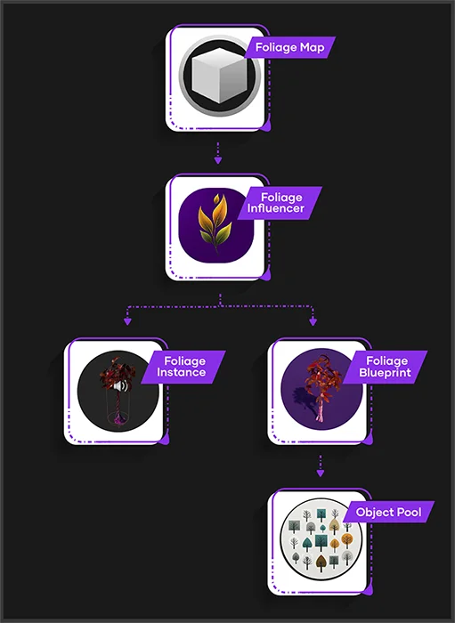

The **Foliage Map** acts as a reference library which stores the foliage static meshes and their associated blueprints, so that the system knows what blueprints to swap the meshes with.  
  
A **Foliage Influencer** is an actor which detects nearby foliages instances in the level.  
  
A **Foliage Instance** is simply a foliage mesh which has been painted by the foliage tool.  
  
When the **Foliage Influencer** detects a **Foliage Instance**, it converts it to the associated blueprint listed in the **Foliage Map** asset.  
  
Once a **Foliage Instance** has been converted to a **Foliage Blueprint**, the custom logic inside the **Foliage Blueprint** will determine when and how it turns back into a **Foliage Instance**.  
  
In Unreal Engine, spawning and destroying many blueprints very quickly is bad for performance. The **Object Pool** is a hidden collection of objects that are created at the start of the game.  
  
We keep Foliage Blueprints in the pool until they are needed, and return them to the pool when they are not needed.

---

## Foliage Map

A **Foliage Map** is a collection of all the foliage types you want to interact with physics.  
It links each **Foliage Blueprint** to the **Static Mesh** you will paint with the foliage tool.

Each project requires at least one Foliage Map asset, but you can add more if needed.  
Having multiple Foliage Maps can be useful when importing various foliage-physics environments from our Etherion Designs store.

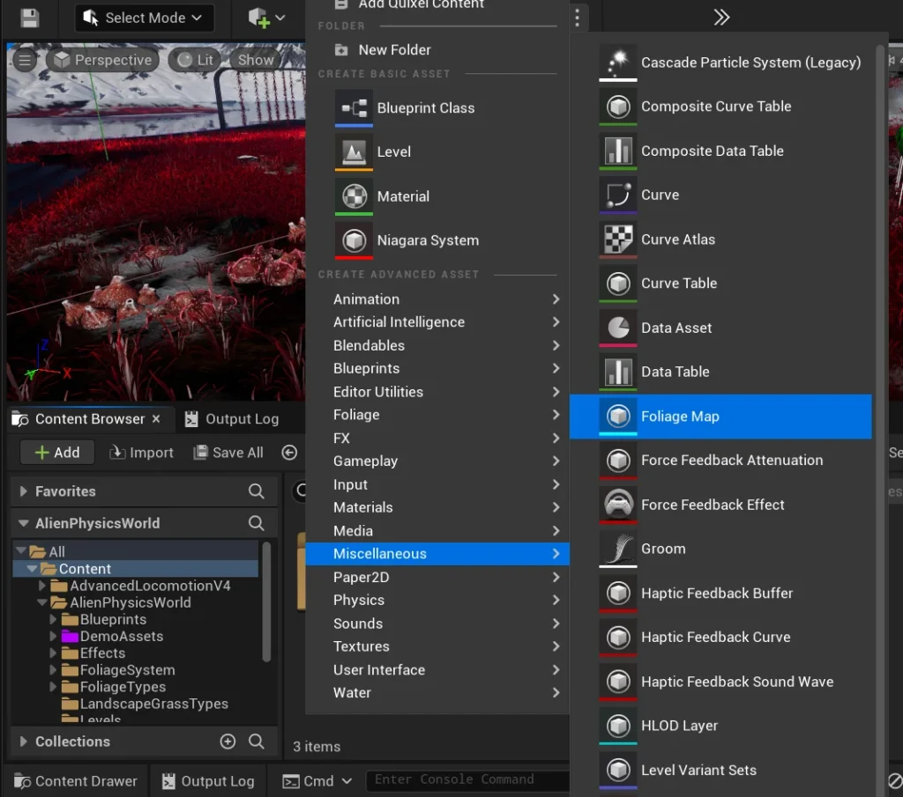

You can create a Foliage Map by right clicking an empty space in the content browser, and going to **Miscellaneous > Foliage Map**.
![[docs/assets/Documentation_Setup_FoliageMapExample.webp]]

You can also find an example Foliage Map in this location:  
**Plugins / Etherion Foliage Plugin / ExampleContent / FoliageTypes / FoliageMap_ExampleAssets**

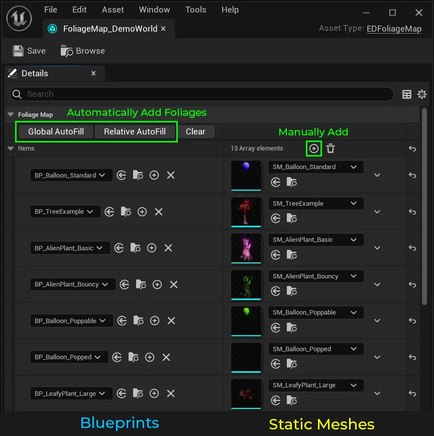

When you open a Foliage Map, you’ll see two columns.  
Each row corresponds to a foliage type, linking its Foliage Blueprint with a matching Static Mesh.

### Automatic Fill

To quickly fill your Foliage Map with all the foliage Static Meshes and their associated Foliage Blueprints, you can use these automated buttons:

1. **Global Auto-Fill**: Searches for foliage meshes and blueprints throughout the entire project.
2. **Relative Auto-Fill**: Searches for foliage meshes and blueprints only in the same folder as the Foliage Map.

The Auto-Fill buttons automatically find all blueprints that are children of BP_FoliageParent and read their StaticMesh component into the correct slot. Be sure to save your project before using these buttons, as they can sometimes malfunction.

### Manual Fill

To manually add foliage to your Foliage Map, click the **+** icon to create a new entry in the list.  
Then, assign the Static Mesh on the right and its corresponding blueprint on the left.

---

## Foliage Influencer

A **Foliage Influencer** is a simple spherical actor that converts instances to blueprints.  
When the a foliage influencer touches a Foliage Instance in your level, it instantly swaps the instance with the corresponding **Foliage Blueprint** listed in the **Foliage Map**. This conversion happens so fast that it creates the illusion that the foliage is always interactive.

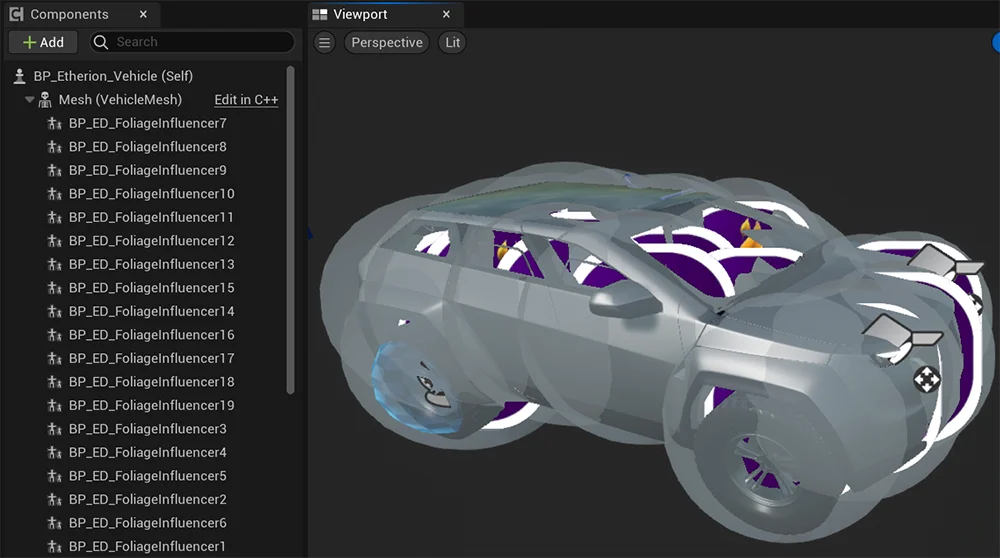

  
The Foliage Influencer is highly optimized, allowing you to use virtually unlimited Foliage Influencers without noticeable performance impact.

---

### **Adding to your Blueprint**

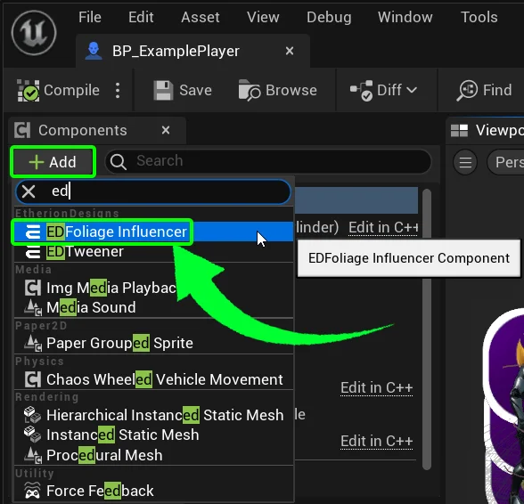

**[PRO VERSION]**  
To add a foliage influencer to your Character pawn or other Blueprint, click **Add** in the component menu.  
Then, search for **“ED”** and click on **_EDFoliage Influencer_**.

**[LITE VERSION]**  
The Lite version is yet to be updated. We are still in the process of completing multiplayer for our pro version before updating the Lite. So instead of adding it as a component, you must use the old method of adding a blueprint by dragging it in. Just search your **_AlienPhysicsWorld_** folder for **_BP_FoliageInfluencer_** to find it.

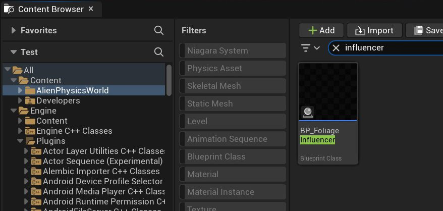

### **Ensure Correct Attachment**

Next, drag the **EDFoliageInfluencer** inside your Blueprint’s hierarchy so it becomes a child of the object you want it to follow.  
This makes sure it moves together with that object in-game.

Some examples might include:

- **Player Pawn:** Attach _EDFoliageInfluencer_ to your character mesh, or root _Capsule Component_.
- **Vehicle:** Attach _EDFoliageInfluencer_ to your _Vehicle Mesh_.
- **Simulated Static Mesh blueprint:** Attach _EDFoliageInfluencer_ to your _Simulated StaticMesh_.
- **Simulated Skeletal Mesh blueprint:** You can position your _EDFoliageInfluencer_ and attach it to your bone socket using a Construction Script.

### **Influencer Radius**

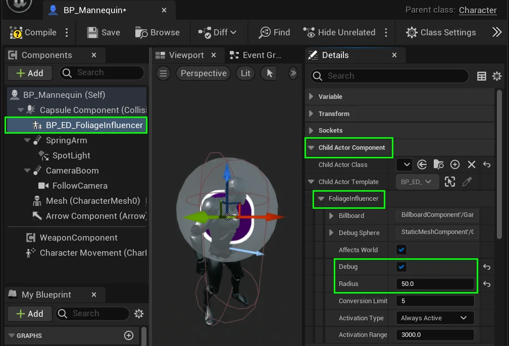

With ****EDFoliageInfluencer**** selected,  
go to the Details Panel and expand these tabs:  
**Child Actor Component > Child Actor Template > Foliage Influencer**

Check the “**Debug**” checkbox to enable radius visibility.  
With the sphere visible, you should adjust the radius until it covers the desired area.

### Optimization

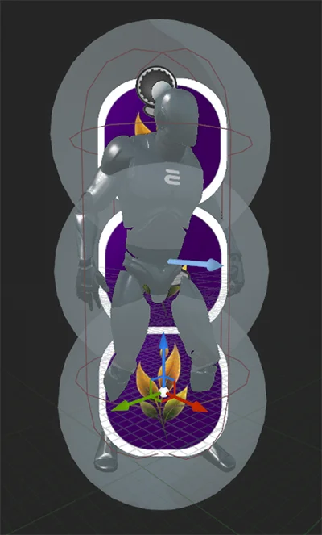

  
To improve performance, it’s better to use multiple, smaller ‘Foliage Influencer’ actors than one large one.  
  
This is because simulated foliage can be heavy on the CPU.  
By using smaller influencers, only the foliage near your character or simulated objects will be activated, saving processing power.

Feel free to duplicate the ****EDFoliageInfluencer**** component as many times as needed to cover your entire mesh area.

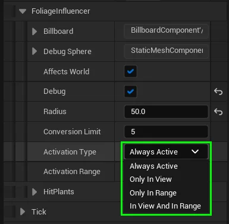

To further improve performance, you may want to change the **Activation Type**.

The Activation type determines when the Foliage Influencer is active.  
You may want it to only be active when within view, within range, or when it is both within view and within a designated range.

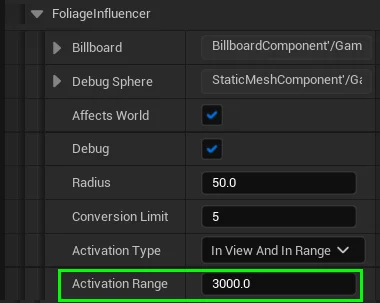

If you set **Activation Type** to involve range, you can set the range using **Activation Range** variable.  
This uses standard unreal units, and is measured as a **distance from the camera**.

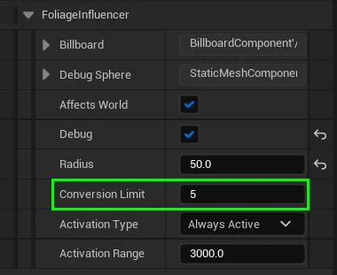

Lastly, the **Conversion Limit** is an integer specifying the maximum number of foliage instances that this influencer can convert per-frame.

If you encounter larger framerate drops _(especially when using a Foliage Influencer on projectile explosions)_, you may want to adjust this value so that it limits the amount of conversions.  
  
If you are rendering a cinematic, its usually good to set this to a rediculously high amount, like 999.

---

## Mesh Collision Settings

Now lets configure the player’s or game-object’s mesh to ensure that it collides correctly with the simulated physics foliage.

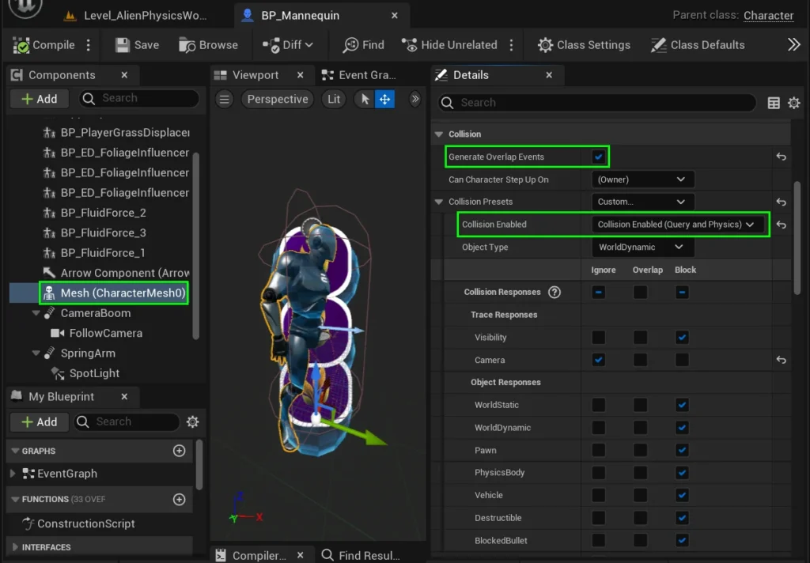

With your blueprint open, select your character’s or object’s mesh and go to the details panel. Then scroll down to the **Collision** tab.

Ensure that **Generate Overlap Events** is checked.

Under the **Collision Enabled** dropdown box, your mesh must set to either of these options:

- **Physics Only (No Query Collision)**
- **Collision Enabled (Query and Physics)**

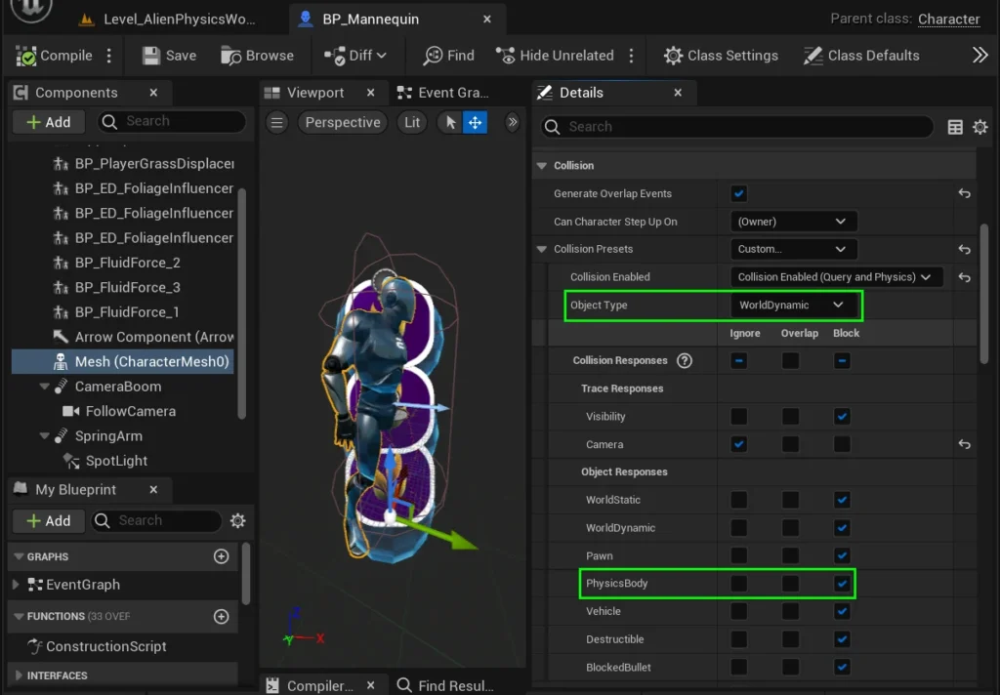

Under the **Object Type** dropdown box, the Character’s mesh should be assigned one of the following options:

- **World Dynamic**
- **World Static**
- **Vehicle**
- **Destructible**

By default, we recommend **World Dynamic**.

Finally, under the **Object Responses** section,  
you must ensure that the Mesh has the **Physics Body** response set to **Block**.

## Chaos Vehicle Collision Settings

If the Blueprint you are working on is a Chaos Vehicle, you may notice some issues with the wheels bouncing all over your foliage.  
This is because the Wheel utilises a line trace, and by default, it is set to hit PhysicsBody’s.

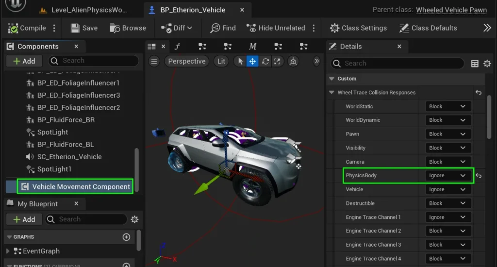

To fix this, select the **Vehicle Movement Component**.

In the Details Panel, scroll to **Custom > Wheel Trace Collision Responses**.

Change the response to **PhysicsBody** to **Ignore**.

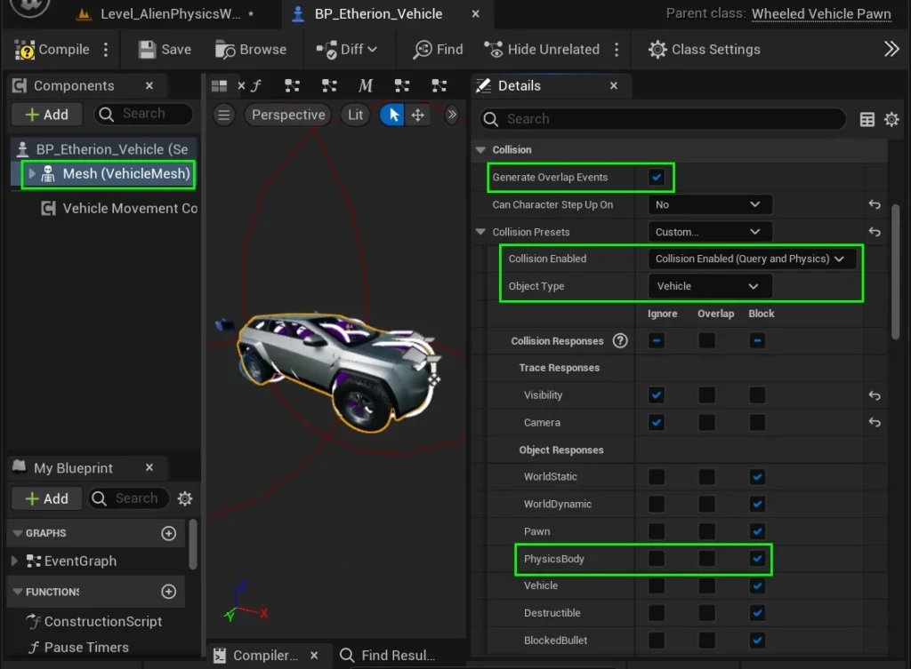