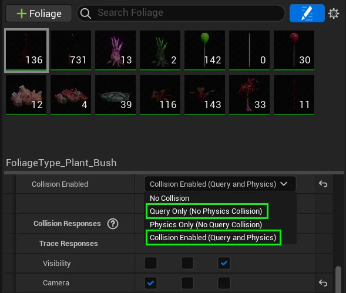
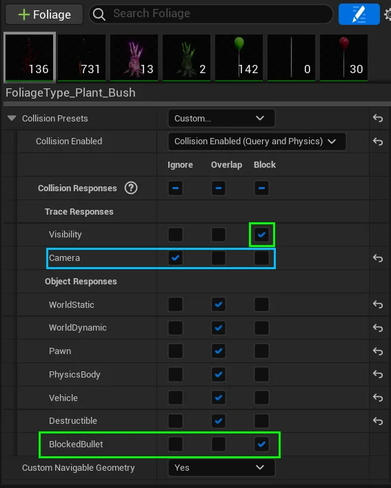
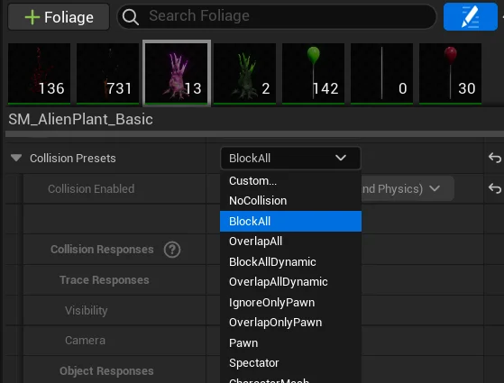
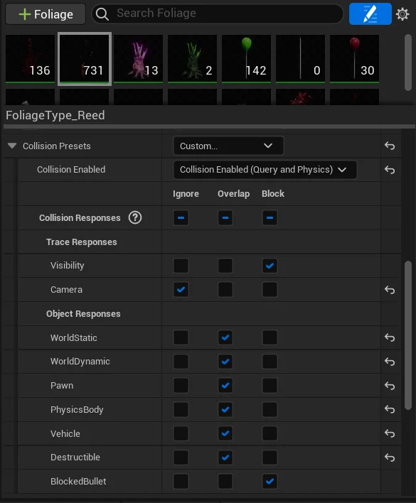
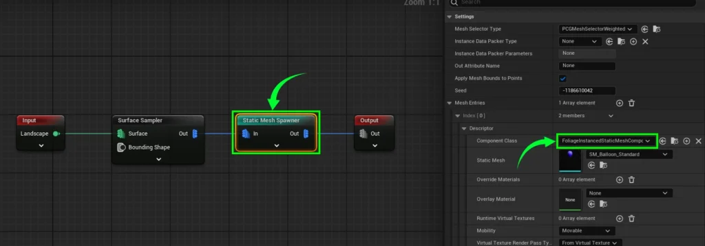

# Foliage Painting & PCG Settings
Let’s dive into adding some lush greenery to your project!  
First, open the foliage tool, and add some of the pre-existing foliage meshes from the Alien Physics World.  
If you don’t know how to do this, please view this following video by Royal Skies:

<iframe width="560" height="315" src="https://www.youtube.com/embed/lFXOnCea728" title="YouTube video player" frameborder="0" allow="accelerometer; autoplay; clipboard-write; encrypted-media; gyroscope; picture-in-picture; web-share" allowfullscreen></iframe>

---

## Required Collision Settings

In order to work with our physics system, foliage requires the following collision settings:  

**Collision Enabled** must be set to either “**Query Only**”,  
or  “**Query and physics**”.  
  
**Physics Only** will not work with our system.

Your foliage MUST have the “**Visibility**” Collision Response checked in order to function.

**OPTIONAL**  
The “**BlockedBullet**” Collision Response determines what projectiles do when they collide with your foliage.  
– **Block** = Hit  
– **Overlap** = Hit but travel through  
– **Ignore** = Do not collide

**OPTIONAL**  
Set your “**Camera**” collision to “**Ignore”** if you do not want your foliage affecting your third-person camera. This is useful for grass-type foliages.

---

## Examples

### **Solid Plants**

If the plant is large, like **SM_AlienPlant**, you may want it to block your player pawn as a fallback in case the physics system does not activate (or is disabled). You can easily do this by setting the collision preset to “**Block All**”.

### **Grass-Type Plants**

For weaker grass-type foliages, such as SM_Reed, you may want to set the object response collision to “**Overlap**” or “**ignore**”, so that the player can walk through them in case the physics system is disabled in-game.

Additionally, you may also want the camera movement to not be affected by these foliages. In this case, set the “**Camera**” setting to “**ignore**”.

---

## PCG Setup [PRO ONLY]

To get PCG working with our plugin, its very simple.  
The static mesh spawner needs to use the `FoliageInstancedStaticMeshComponent` class.  
If that is done, everything should be working correctly with the rest of our system.

