# Preparing your Assets

To create your own custom foliage interactions, you’ll need the following assets:

- a Static mesh
- a Skeletal mesh
- a Physics Asset

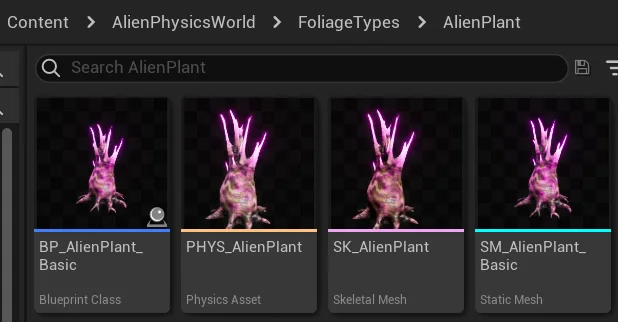

---

## Static Mesh

Your foliage Static Mesh must have some form of **Simple Collision** in order to be detected by our system.  
Please do not use **Complex Collision**, as this will not work.

_**Note:** Accurate collision data is crucial for our system’s foliage conversion process. Collision data is used to identify and convert foliage instances into blueprints. So if you ever encounter issues with foliage not converting to blueprints properly, be sure to double check your collision._

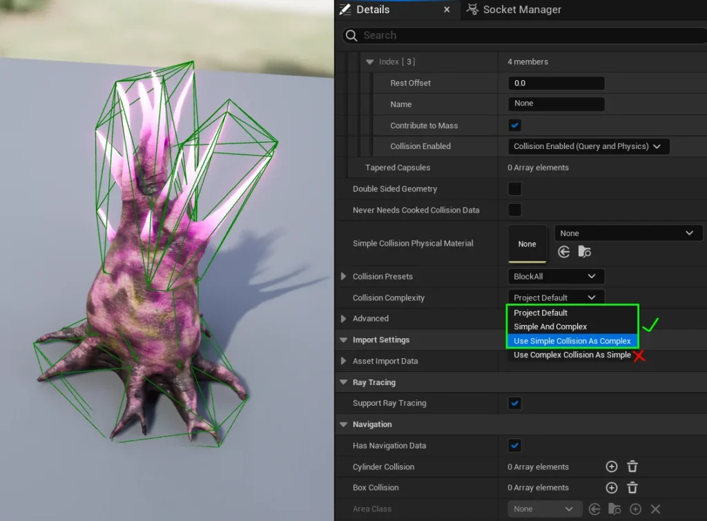

---

## **Skeletal Mesh**

You can either create your own skeletal mesh using third-party external software, or by using Unreal Engines latest tools.  
Rather than reinvent the wheel and explain the process, we thought we’d provide some pre-made tutorials to help you create your skeletal mesh.

[Blender Rigging Tutorial](https://youtu.be/X590IZeyT1s?si=Q9p51vMR0Yc3tzH5)

[Cinema4D Rigging Tutorial](https://youtu.be/RUeY1HMXvFM?si=mcJKNTV6m1w65LFh)

[3DS Max Rigging Tutorial](https://youtu.be/dc4AJLplpZg?si=3d0ga_37Tf1FX_gs) 

[Maya Rigging Tutorial](https://youtu.be/1wvdQy2Fdhw?si=I4faBMuEfMb0ByLd)

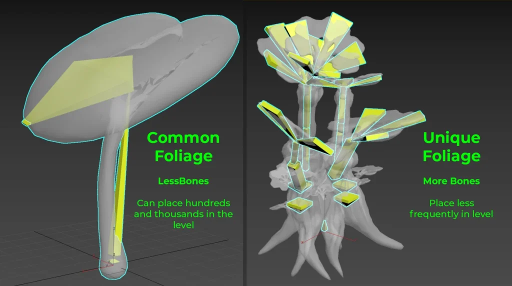

When creating your skeletal mesh, please be aware that the number of bones you have will impact performance.  
  
If your plant is very common, like a long grass or reed, we recommend having only 2-3 bones.  
  
If it is unique and uncommon on your landscape, you can go upwards of 20 bones if necessary. But it’s best to keep bones to a minimum to boost performance.

When importing a skeletal mesh, the default settings for “**Create Physics Asset**” will be checked. This isn’t optimal, as the importing will cause this auto-creation to ignore creating physics bodies for small bones.  
  
Generally, a lot of foliages can contain small bones, so this is a waste of time. Its best practice to uncheck “**Create Physics Asset**” upon importing your skeletal mesh, and instead create one manually after import.

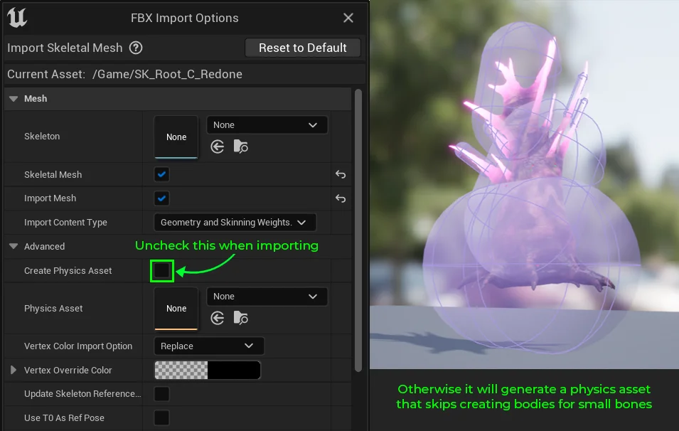

---

## Physics Asset

### **Creating a Physics Asset**

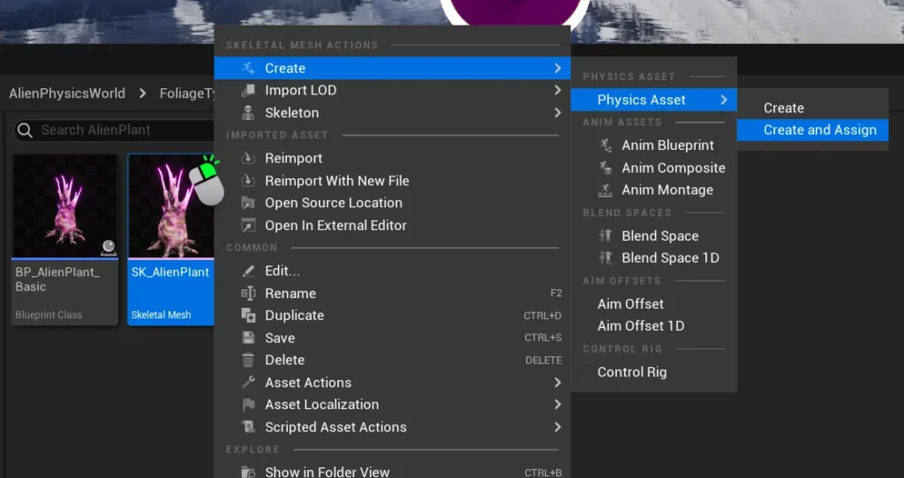

Right click your Skeletal mesh.  
Click **Create > Physics Asset > Create and Assign**.  

For most foliages, it’s usually best to select “**Capsule**” as the primitive type, but you can change the default Primitive type to whatever your physics asset needs.  
  
Uncheck “**Walk Past Small Bones**” and check “**Create Body for All Bones**” to ensure that each of your bones has a physics body.  
  
Click “**Create Asset**“  

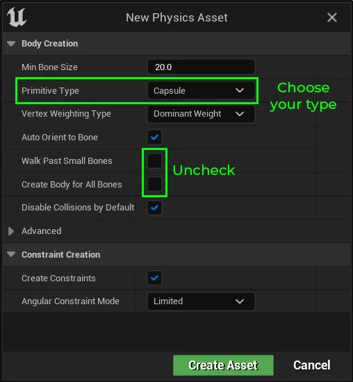

### **Tweaking the Physics Asset**

Please open your **Physics Asset** so that you can tweak its properties and make it interact naturally.

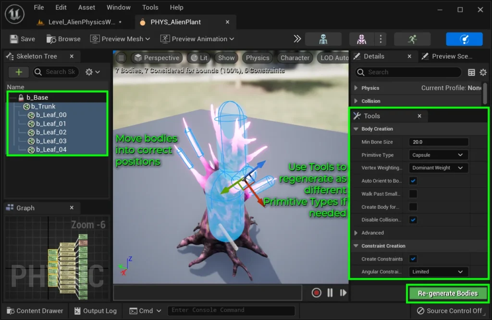

Use the Tools and the Body Creation toolbox to re-generate the bodies that need to be different shapes.  
  
Adjust the position, rotation, and scale of each body until it fits the mesh.

### **Recommendations**

While you are free to do what you want with your physics asset, there are some recommendations we’d like to provide to make it easier for you to produce similar results to our own physics assets.

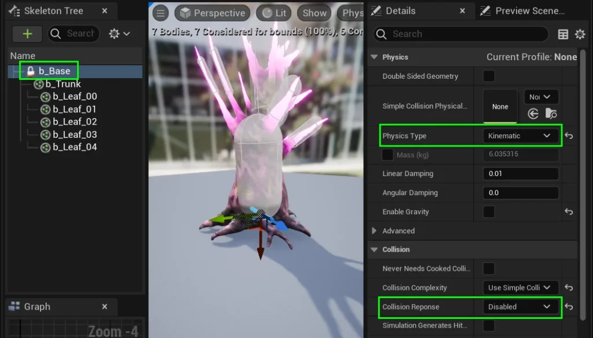

Select the root bone’s **Physics Body**, and set its **Physics Type** to **Kinematic**.  
  
This will keep the plant rooted to the ground, and prevent it from flying away when kicked by the player.  
  
Set the **Collision Response** to **Disabled** if you don’t want anything being blocked by this body.

Select all the Physics Bodies, and uncheck “**Enable Gravity**”.  
  
Doing this will ensure that the plant doesn’t immediately fall over under the weight of it’s own gravity when it is converted from a **Foliage Instance** to a **Foliage** **Blueprint**.

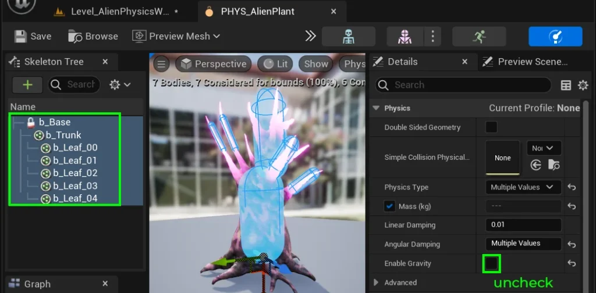

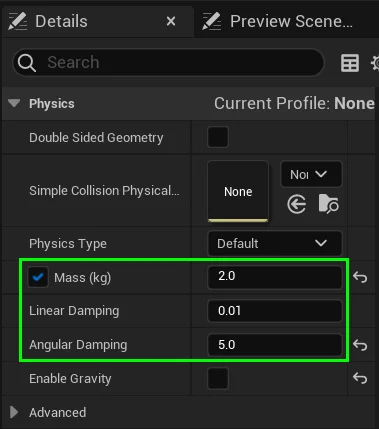

Optionally adjust the **Mass**, **Linear Damping**, and A**ngular Damping** of each body, to make it seem like the bodies have the correct weight and resistance to movement.

Show the constraints of your physics actor by clicking the settings icon above your bodies, and selecting “**Show Constraints**“.

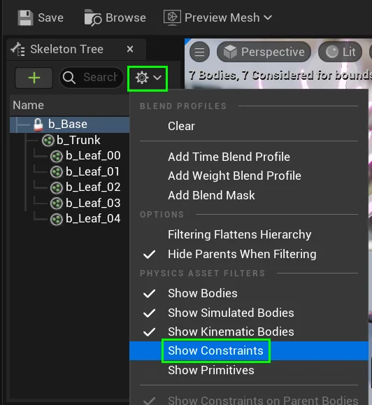

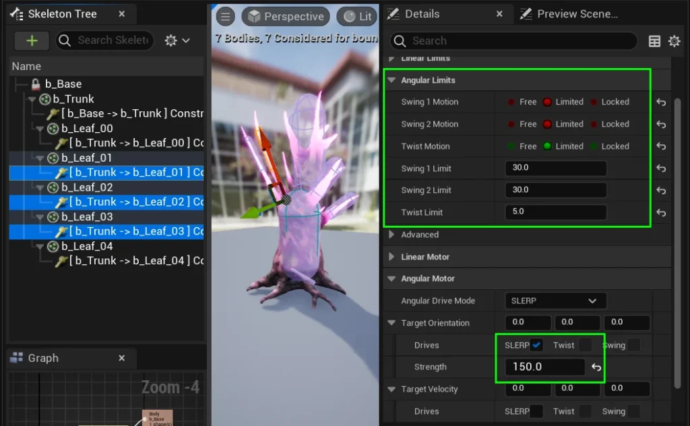

With each constraint selected, adjust the **Angular Limits**.  
  
To give them a spring effect, go to **Angular Motor** tab and check the **SLERP** checkbox. Adjust the intensity of the spring effect by changing the **Strength** value.

We recommend viewing our own pre-designed physics assets as examples of what settings are suitable for different foliage types.  
You can find these in their respective folders under **Content / AlienPhysicsWorld / FoliageTypes**

---

# Naming Conventions {#naming-conventions}

Naming conventions are not strict, however, there is one rule you must follow if you plan to create Custom Foliage:

**Ensure each foliage name is unique, so that one foliage name cannot be found inside another name.**

Here are some examples of how to **NOT** name your foliages:

- BP_Gaspods_X
- BP_Gaspods_X_Destroyed
- SM_Gaspods_X
- SM_Gaspods_X_Destroyed

The reason the above names are bad is because **BP_Gaspods_X_Destroyed** contains **BP_Gaspods_X**.  
To correct this, here some examples of how you **SHOULD** name your foliages:

- BP_Gaspods_X_Whole
- BP_Gaspods_X_Destroyed
- SM_Gaspods_X_Whole
- SM_Gaspods_X_Destroyed

**BP_Gaspods_X_Whole** cannot be found inside **BP_Gaspods_X_Destroyed** which ensures they will not conflict.  
So far the only blueprints that utilize naming conventions are our **[Foliage Placement Tools][grouped-foliage-placement]**, but you should be following these conventions even if you are not planning on using these tools in case there are some updates in the future.

---

#  Checklist

- Static Mesh has **Simple Collision**
- Physics Asset root body is set to **Kinematic**
- **Optional:** Physics Asset root body has **Collision Disabled**
- Physics Asset bodies have **Gravity Disabled**
- Physics Asset constraints properties are set
- **Optional:** Physics Asset constraints have **SLERP Angular Drive** for ‘spring’ effect
- Asset names cannot be found inside one another
