# Foliage Blueprint – Basics
All foliages require a Foliage Blueprint in order to interact with the player.  
This asset will contain the physics-simulated Skeletal Mesh, and other programmed features that allow the foliage to interact with its environment.  
This page contains a guide on how to create a basic Foliage Blueprint, and apply your custom foliage to it.  
  
If you have purchased one of our Alien or Fantasy Environments, you’ll automatically get access to the Pro Version of our physics system.  
This includes an upgraded version of the Parent blueprint, which comes with many additional features that we will also cover in this tutorial.

# Blueprint Creation

## **Creating your Child Blueprint**

All Foliage Blueprints must be a child of “**BP_FoliageParent**”.  
To create a child of this blueprint, navigate to **Content / AlienPhysicsWorld / FoliageSystem**

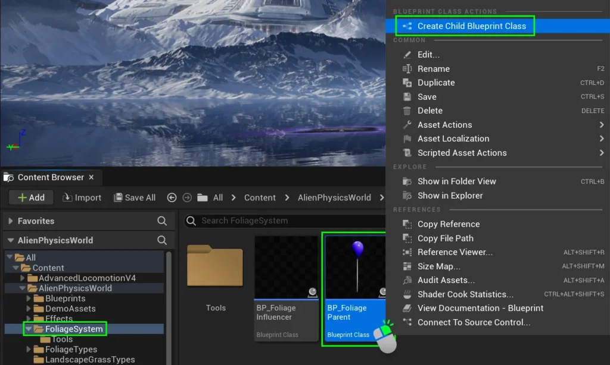

Right click **BP_FoliageParent**, and click “**Create Child Blueprint Class**”.  
  
Rename this Blueprint with “**BP_**” as its prefix, then complete its name to reflect the **Static Mesh** and **Skeletal Mesh** of the plant species it represents _(**BP_FoliageName**)_.  
  
We then recommend moving this new Child Blueprint into the same folder as your custom foliage assets to make the next steps easier.

## **Adding Custom Assets to the Child Blueprint**

Open the Child Blueprint you just created.  
Inside, you’ll se a number of components.

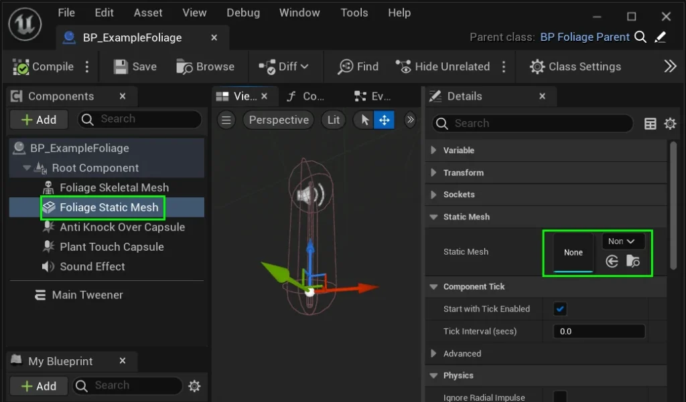

Select the “**Foliage Static Mesh**” component.  
In the **Details Panel**, set your custom static mesh in the “**Static Mesh**” reference slot.

Select the “**Foliage Skeletal Mesh**” component.  
In the **Details Panel**, set your **Custom Skeletal Mesh** in the “**Skeletal Mesh**” reference slot.  
  
Once your **Skeletal Mesh** is applied, the **Physics Asset** will automatically be linked to the foliage.  
  
You do not need to pay attention to the Animation field.

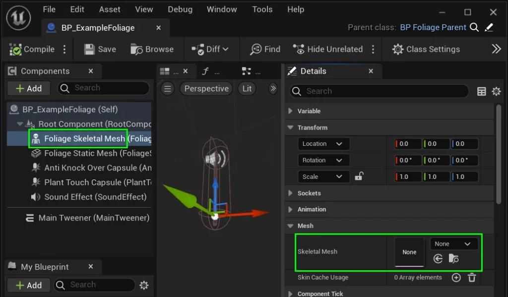

# **Capsules** & Physics Scaling

Our system includes features for physics-based scaling of your foliage, as well as foliage detection.  
In our Child Blueprint, you’ll find two capsules: the **PlantTouch Capsule** and the **AntiKnockover Capsule**.

### **Plant Touch Capsule**

This capsule is used for simple collisions, such as triggering a sound or basic functions within the blueprint.  
By default, it plays a sound effect when touched. You should adjust the position and size of the PlantTouch Capsule to fit your plant.

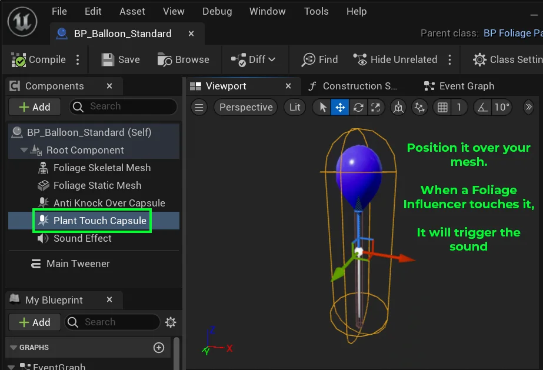

### **Anti Knock Over Capsule**

Unfortunately Unreal Engine’s physics system is not top of the range when compared to other game engines like Source 2.  
As such, it can be very unreliable when trying to create resistance when player pawns interact with foliage.  
Using a foliages Physics Asset to create resistance will often cause the player mesh to freak out and fly to the other side of your level.

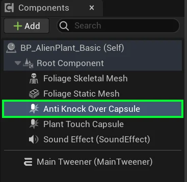

To simulate realistic resistance without encountering the typical issues you’d find with physics assets,  
use the **Anti Knock Over Capsule**.  
  
When activated, it prevents the player from passing through large plants, like a tree.

To set it up, begin by scaling the capsule to be thinner than your foliage,  
and position it inside the trunk of your plant.  
  
Remember, this is the object that will block the player!

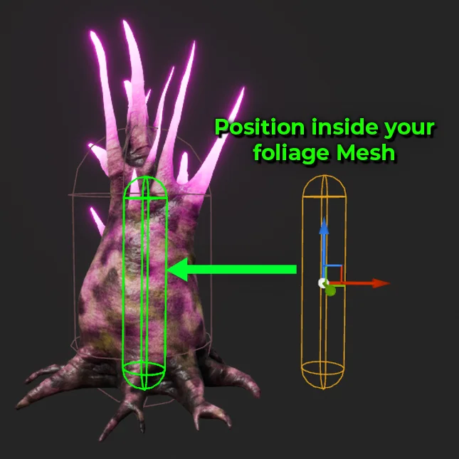

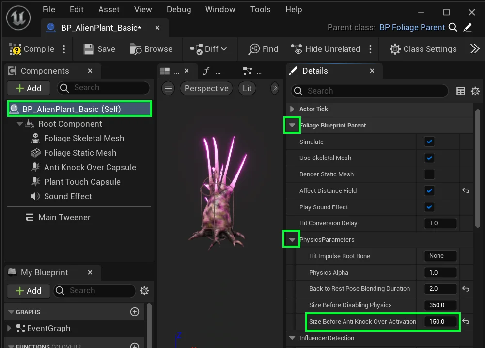

Then, select the **Class Component** **(Self)** and look to the **Details Panel**.  
  
Under **Foliage Blueprint Parent**, find the **“Size Before Anti Knock Over Activation”** variable and adjust its value.  
  
If the foliage’s size in world units is smaller than this value, the capsule won’t activate.  
if it’s larger, the capsule will collide and **block all.**  
  
If you don’t need this feature, set the value to a very large number _(e.g., 9999999 units)_.

### Disabling Physics based on Size

For very large plants, you may want to disable physics interactions entirely.  
  
The blueprint can automatically disable physics if the plant’s radius exceeds a certain threshold, controlled by the **“Size Before Disabling Physics”** variable.  
  
If you don’t want this feature, simply set the value to a very large number  
_(e.g., 9999999 units)_.

---

## Sound

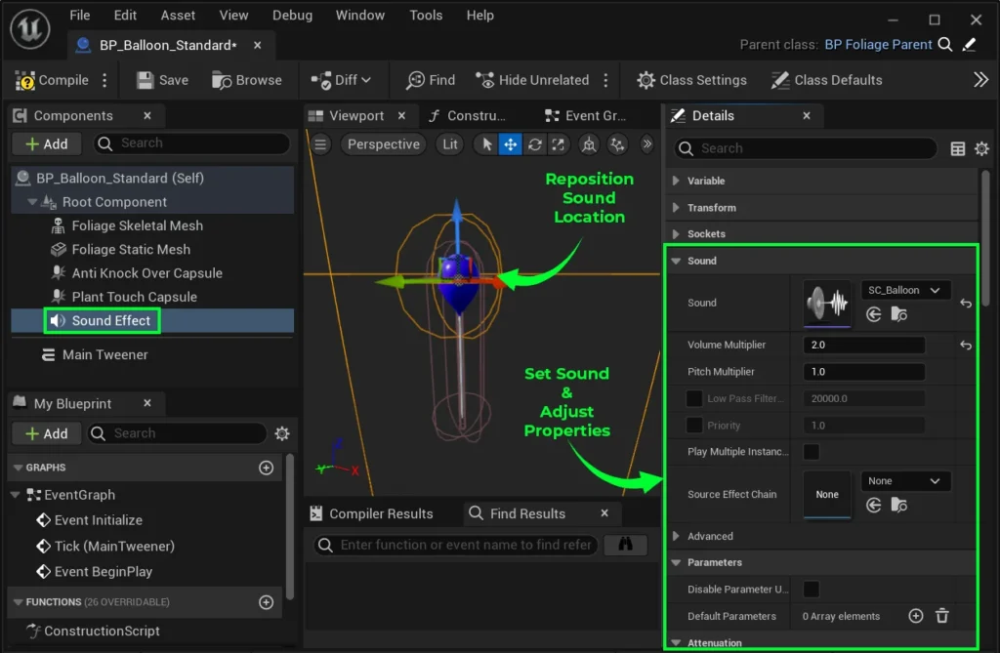

#### **Sound Effect**

To customize your foliage sound effect, select the **Sound Effect** component and change the sound in the **Details Panel**.  
  
You can also adjust the **volume**, **attenuation** and other properties from the details panel.

If you don’t want any sound, select the **Class Component** _(the very top of the hierarchy labelled “Self”)_.  
  
Go to the **Details Panel**, and uncheck **“Play Sound Effect”**.

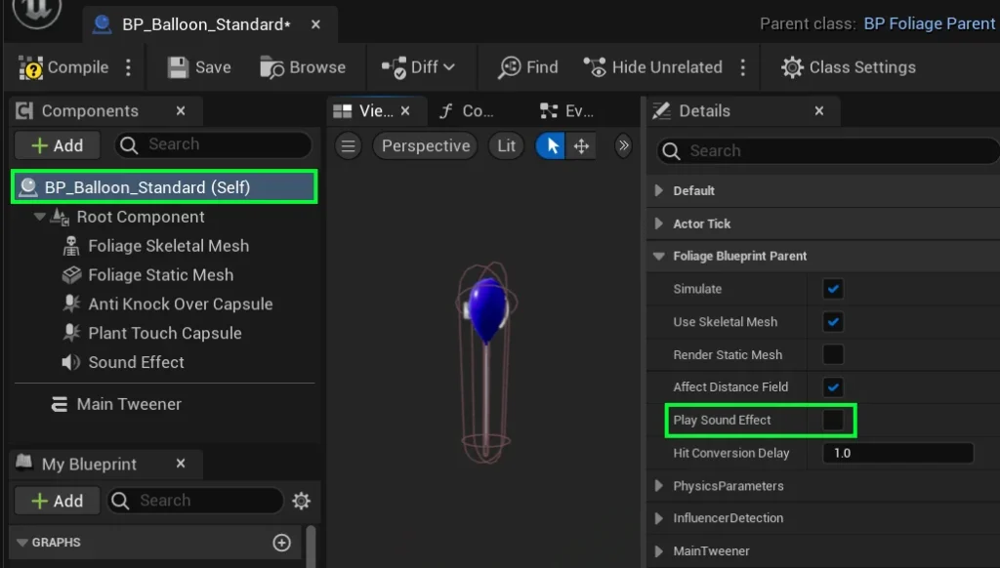

#### Scaling sound based on Size [PRO]

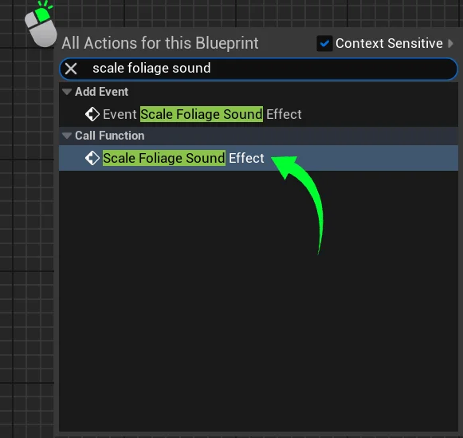

You can automatically adjust a sound’s volume and pitch based on the size of the foliage, or disable sound entirely if the foliage is too large for physics interactions.  
  
In your Foliage Blueprint, right-click and search for the node called **“Scale Foliage Sound Effect”** (not to be confused with **“Event Scale Foliage Sound Effect”**).

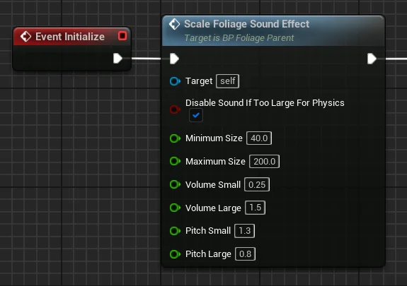

Plug this newly created node into **Event Initialize** and set its variables to fit your needs.  
  
**Minimum Size** and **Maximum Size** _(measured in world units)_ define the scale limits for adjusting **pitch** and **volume**. These caps ensure that pitch and volume changes stop when the foliage reaches the specified size range.

The “**DIsable Sound If Too Large For Physics**” checkbox determines whether a sound should play if a plant exceeds the scale set by the **Size before Disabling Physics** variable.

---

## Before You Continue!

Select your **Class Component (Self)** and go to the **Details Panel**.  
  
All of the settings for the rest of this page will be found under  
**Foliage Blueprint Parent** in the **Details Panel**.

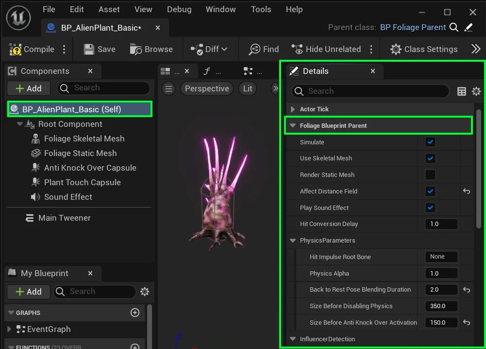

---

## Object Pooling {#object-pooling}

**Object Pooling** is a system that reuses objects rather than constantly spawning and destroying them, improving performance by reducing memory allocations.  
Without it, frequent spawning and destroying can hurt game performance, especially with many dynamic objects such as **Foliage Blueprints!**

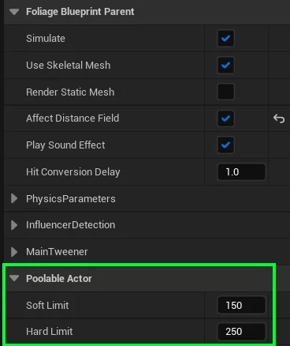

The **Pro Version** of our Foliage Blueprint uses object pooling to enhance performance.  
The **BP_FoliageParent** class, which all Foliage Blueprints are based on, includes two object pooling variables you may need to adjust:

#### Soft Limit

The soft limit is the target number of objects in the pool. If more objects are needed, the pool can create them, but it will try to return to this limit over time.  
When the soft limit is exceeded, unused actors are destroyed gradually, one by one, across frames to avoid performance issues.  
This helps reduce memory usage without affecting gameplay.

To disable the **Soft Limit** set it to `0` in the poolable actor’s details panel.

#### Hard Limit

The hard limit is the maximum number of actors the system can pool.  
Once this limit is reached, no new actors will be spawned by the system, and it will a return null/invalid actor on acquire, signaling that it cannot provide a new actor.  
This strict enforcement ensures that the pool does not grow beyond the allocated memory capacity, protecting the system from runaway resource consumption.

To disable the **Hard Limit** set it to `0` in the poolable actor’s details panel. (**Warning:** this can cause huge performance drops)

---

## Timing Parameters

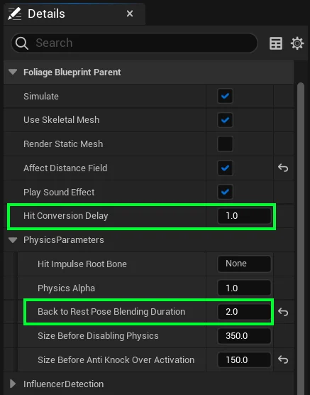

These two parameters control how your foliage deactivates its physics when interacting with Foliage Influencers and Bullet Projectiles.  
  
For reference, the “**rest pose**” we will be talking about here, refers to the static state of the foliage before it is physically moved.

#### **Hit Conversion Delay**

When foliage is hit by a projectile, it physically reacts and gets pushed. For rapid-fire weapons, a slight delay before resetting the foliage to its **rest pose** is better for performance.  
This value determines the delay (_in seconds_) before the foliage begins returning to its rest pose, allowing for animations or effects to play naturally.  
_**Tip: Adjust this value to control the responsiveness when foliage is hit by rapid-fire weapons.**_

#### **Back to Rest Pose Blending Duration**

This value controls how many seconds it takes for the foliage to smoothly blend back into its **rest pose** after being pushed. The longer the duration, the smoother the transition.

---

## PRO Influencer Detection Settings {#pro-influencer-detection-settings}

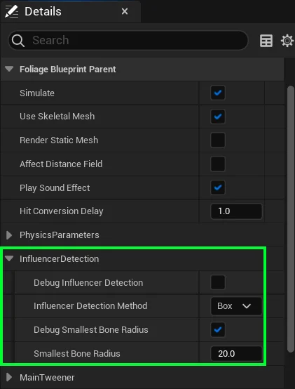

Our **Foliage Influencer** will detect foliage instances painted using the foliage tool by sensing their bounding box.  
  
However, once a foliage instance is converted to a foliage blueprint, the detection method can be adjusted.  
  
You can set the **Influencer Detection Method** to either **Box** or **Individual Bones**.  
If you choose **Individual Bones**, the **Smallest Bone Radius** value sets a size limit, preventing detection of bones smaller than this radius.  
  
To preview these detection methods, enable the **Debug Influencer Detection** and **Debug Smallest Bone Radius** checkboxes.

---

## **Other Settings**

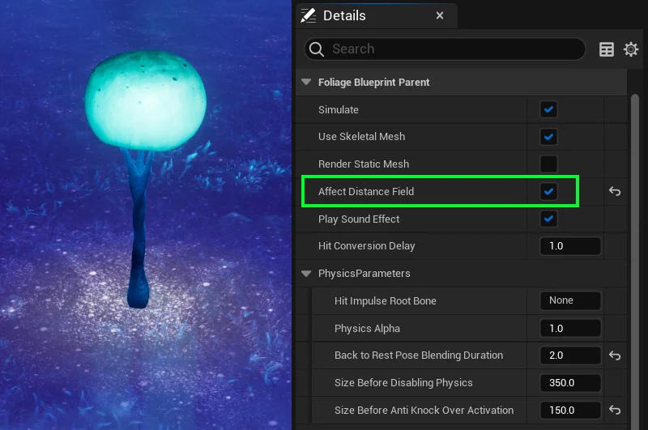

#### **Affect Distance Field**

When enabled, the foliage static mesh will contribute to distance field lighting, regardless of whether it is visible. This is useful if your plant is in glowing water that utilises distance fields to create the glow effect.  
  
_Note: Set this property to false in order to optimize performance when distance field effects are not needed._

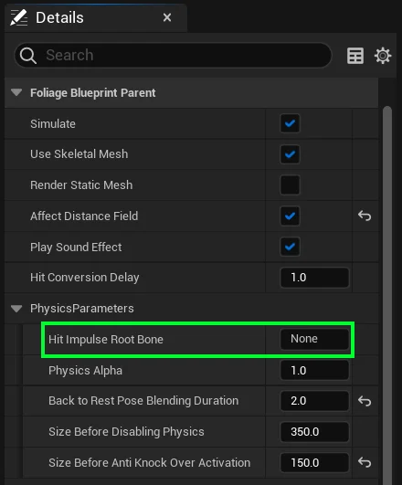

#### **Hit Impulse Root Bone**

This variable would hold the name of the specific bone in a skeletal mesh that, when hit, propagates an impulse to itself and all its child bones in the hierarchy.  
  
For example, if you choose the middle bone, only the middle bone and all the bones that come sequentially after it will receive the impulse.  
All bones before it in the hierarchy will not receive the impulse.

#### **Physics Alpha**

This float value controls the blending factor for physics simulation.  
A value of 0 means no physics simulation, while a value of 1 means full physics simulation is applied.
