# Foliage Link System - PRO
Unreal’s foliage tool paints hierarchical instanced static meshes.  
They are very optimized, but they lack the ability to play sounds, particle effects and other ambient features. They are static-meshes only.  
  
We built the **Foliage Link System** to overcome this limitation. It allows you to place additional Blueprints at the same positions as foliage instances, linking them directly to their corresponding foliage Blueprints for two-way communication. This setup makes it possible to add ambient sounds, effects, and interactions to foliage, **even before they’ve been converted into foliage Blueprints**.  
  

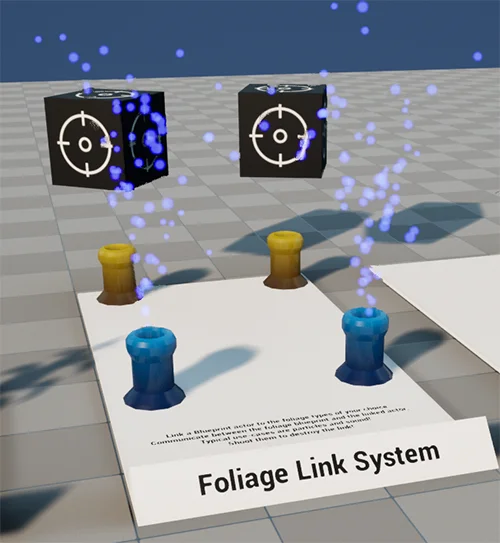

---

# Basic Tutorial

To help you understand how the system functions, we’ll guide you through the process of creating a basic linked foliage.

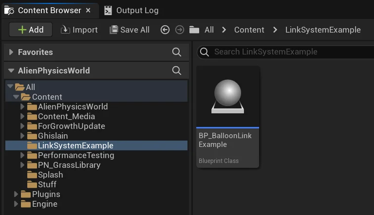

First of all, create a blank blueprint, which you will use as the foliage link blueprint.  
  
You **MUST** ensure that the word **“link”** is included in the name, as this is required for our C++ code to recognize this blueprint as a foliage link blueprint.  
  
We called this blueprint **BP_BalloonLinkExample** because we intend to link it to our pre-existing balloon foliage type.

Open up the blueprint.  
Click on **Class Settings**.  
Under **Interfaces**, add a new interface.  
Search for **EDFoliageLink** and click it.  
  
Adding this interface gives the blueprint access to all the required functions that are used by foliage link blueprints.

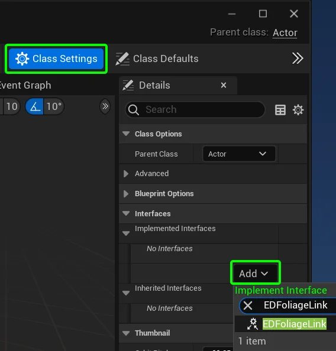

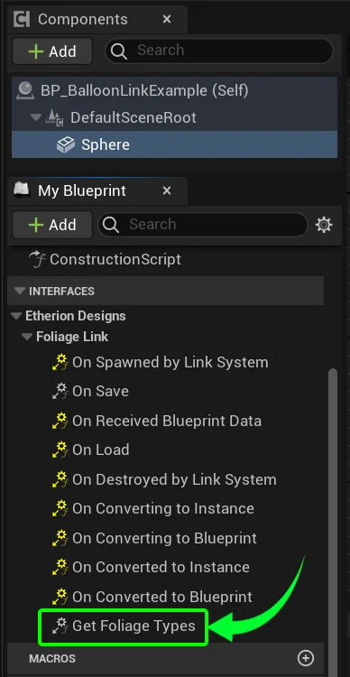

In order to link this blueprint to your chosen foliage types, expand the Interfaces panel.  
Double click on **Get Foliage Types**.

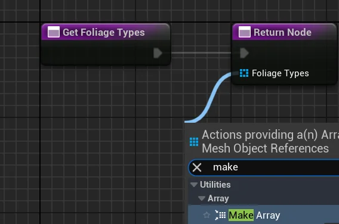

It will open up the function. From the **Foliage Types** input node, drag it out and click **Make Array**.

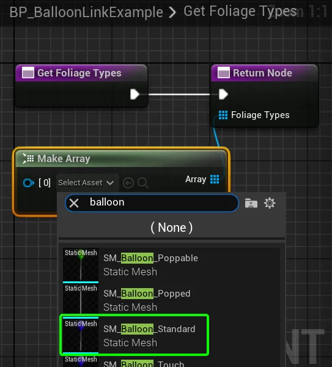

This array is the list of Foliage Meshes that the link will automatically pair to at the start of the game.  
For the purposes of this demonstration, we will link it to the **Balloon Standard** foliage type.

In theory, this blueprint should now automatically spawn in the same positions as all Balloon Standard meshes that have been painted by the foliage tool.  
  
However, since nothing is in the blueprint, it will be invisible.  
So create a sphere inside this blueprint for testing purposes, so that you can see whether it links.

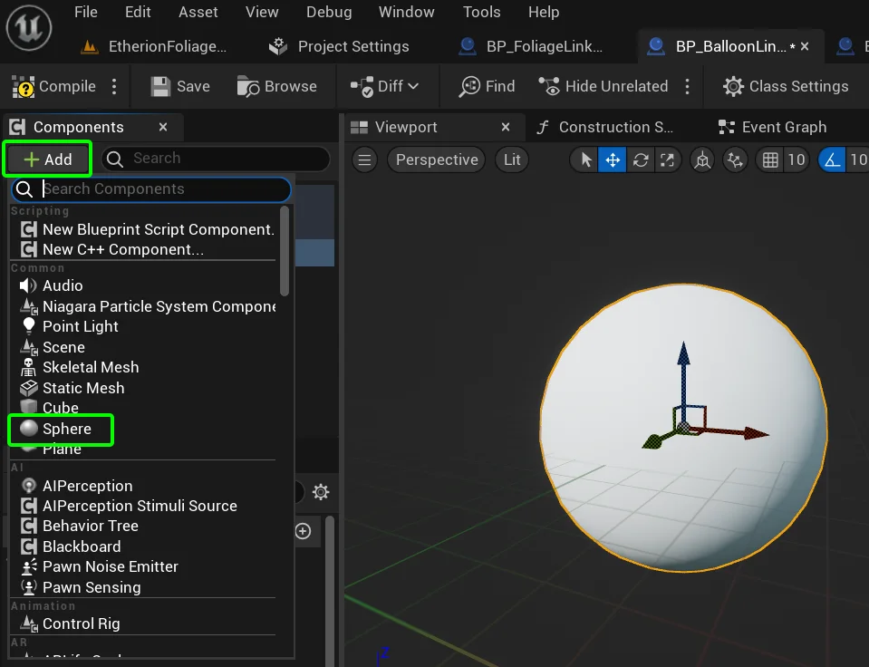

If you compile and save the blueprint, and then paint **SM_Balloon_Standard** across your level, you should now see the blueprint with its sphere spawn on each instance of the foliage type.

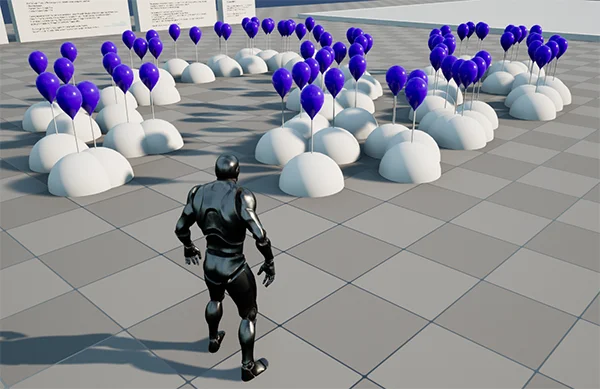

---

# Precision Placement

When designing Foliage Link Blueprints, you will likely need a visual representation of where each component will spawn, relative to the foliage mesh it’s spawning with.  
But you also dont want that mesh spawning in the world! To account for this, we designed a node called **“Switch on World Type”.**  
This node allows different functions to occur based on whether you are in editor, playing the game, and many other play-types.

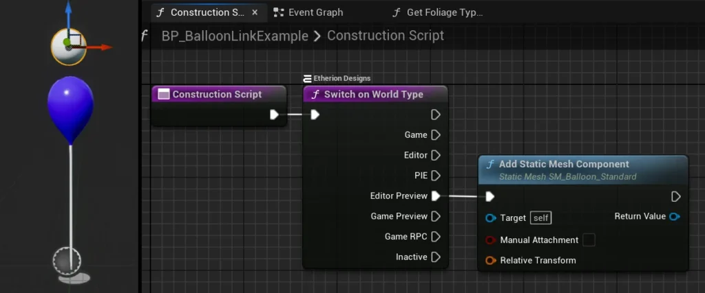

Open up the Contruction Script, and create the **Switch on World Type** node.  
  
Create an “**Add Static Mesh Component**” and select your foliage mesh (**SM_Balloon_Standard**).  
  
Connect this function to the “**Editor Preview**” so that it only spawns in the editor and not the game.

Now you can move and scale the sphere to be above the balloon.  
These functions help provide a visual guide so you can design particle effects and sounds with precision placement!

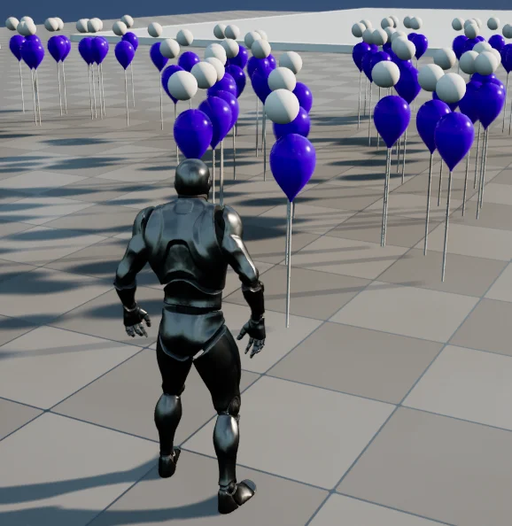

---

# Sending Data from the Foliage Link Blueprint

The foliage link system allows for two-way communication of data between the foliage link blueprint and the foliage blueprint.  
Before we try this out, we first need to create the data structure which will contain the information we want to send.  
  
Right click the content browser and click **Blueprints > Structure**.  
Name it “**ST_BalloonData**“

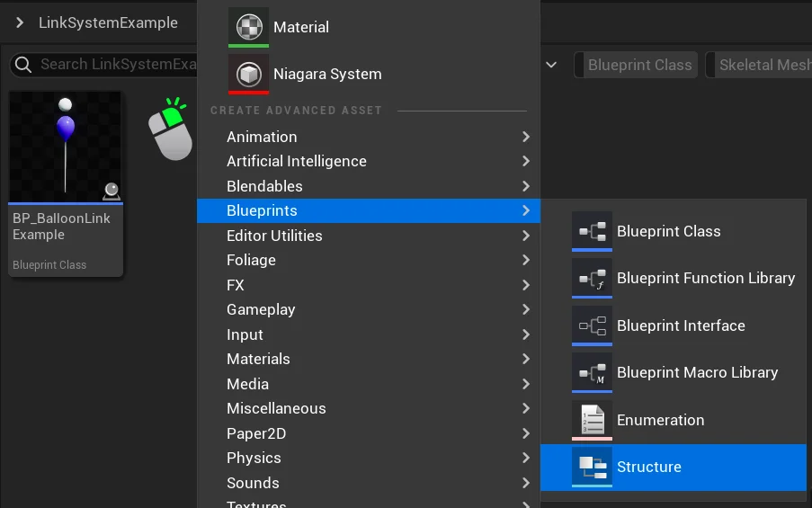

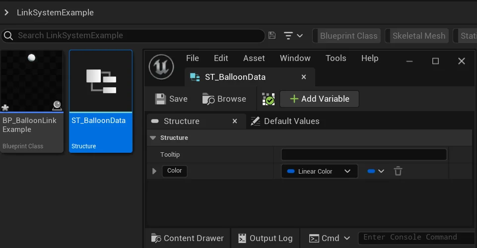

  
  
Here you should create all the types of data that you want communicated between the foliage link blueprint and the foliage blueprint.

For this example, we’ll just create a **Linear Color** data type, named “**Color”**.

With this step complete, open up **BP_BalloonLinkExample**.

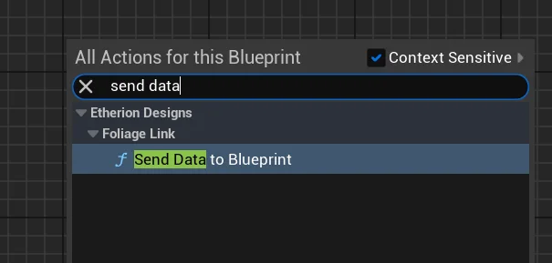

  
Now we will use the function that sends data to the Foliage Blueprint.  
In the Event Graph, right click an empty space and add the **Send Data to Blueprint** node.  

  
  
From this node, drag out **Any Struct** and **make** your Data Structure (just search for the name of the structure we created earlier)

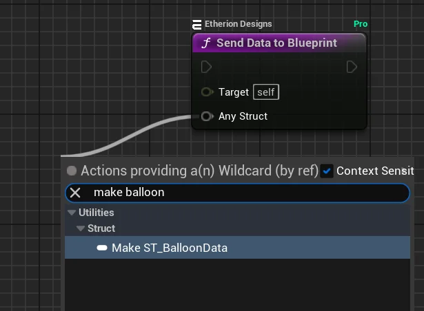

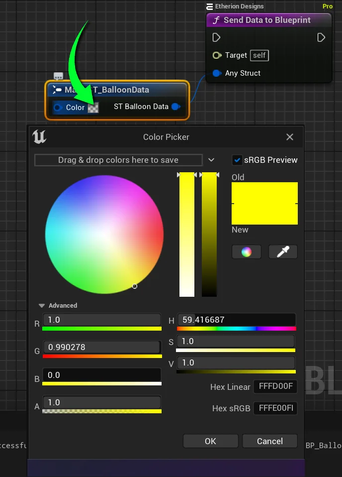

  
  
Here you can edit the values of what data you want to send to your Foliage Blueprint.  
In this example, we will set it to yellow.

_(Remember to make the Alpha value 1 so it isnt transparent)_

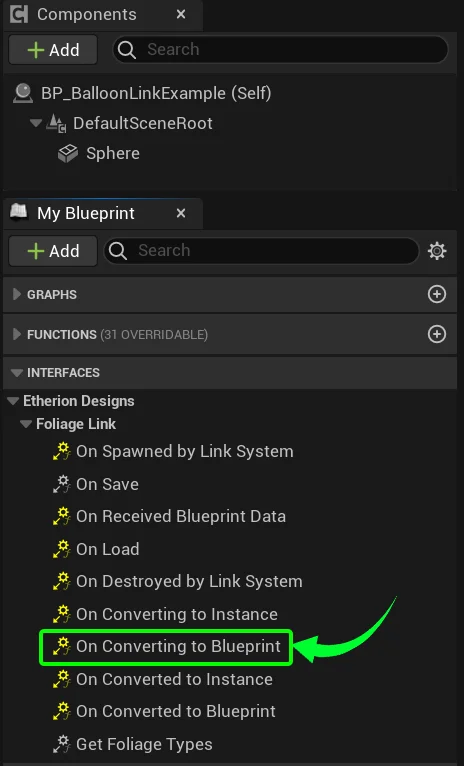

The node that sends the data is complete. Now we need to ensure that this data is only transferred when we want it to.

Under **Interfaces** there are many events that you can use to call the sending of data.  
You aren’t limited to only transferring data from one of these events. You can design it any way you like.  
  
But for this example, we will send the data when the foliage instance converts to a blueprint.

To do this, double click on **On Converting to Blueprint** to create the event.

Connect our **Send Data** function to the event, so that it fires the moment our Foliage Instance is interacted with and becomes a blueprint.

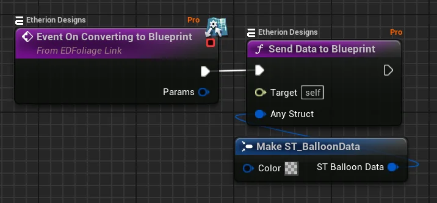

---

# Receiving the Foliage Link Data

  
  
We need the Foliage Blueprint to now receive the data that was sent.  
  
Open up the Balloon that the _Foliage Link Blueprint_ is linked to.  
Navigating to **Plugins / Etherion Foliage Plugin – Pro Content / ExampleContent / FoliageTypes / Balloon**.  
  
Open **BP_Balloon_Standard**.

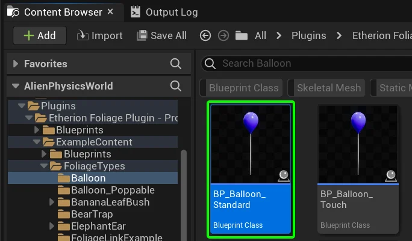

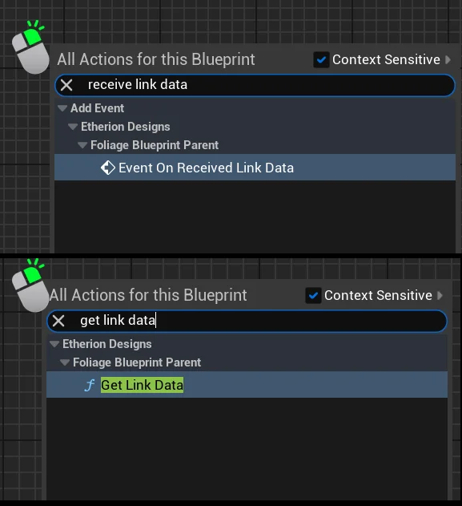

In the Event Graph, add the following two nodes:

- **On Received Link Data**
- **Get Link Data**

Connect them like so,  
and break the **ST_BalloonData** structure.

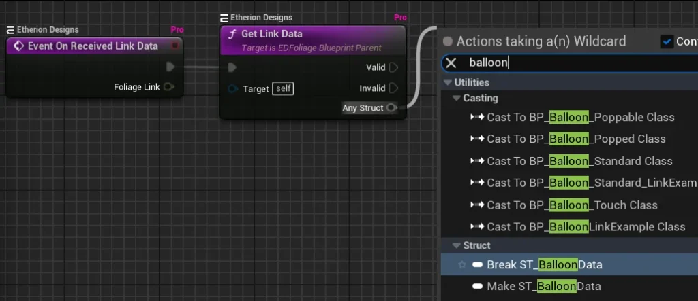

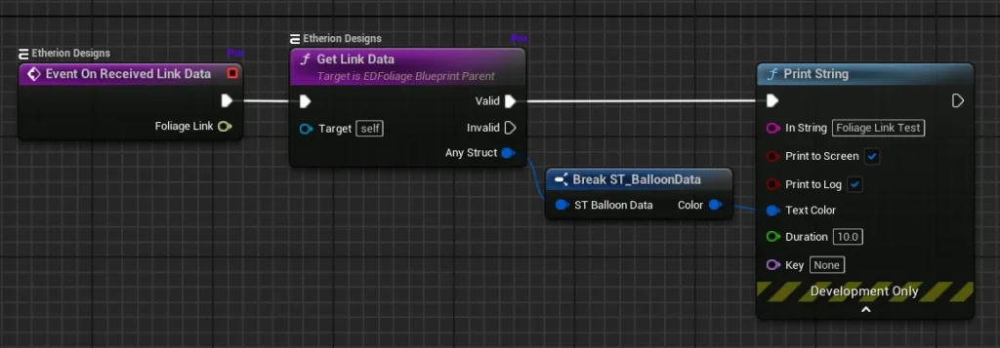

Now create a print string and connect the ST_BalloonData **Color** to the **Text Color**.

Now when you play the game, you can confirm that the data is being sent from the **Foliage Link Blueprint** to the **Foliage Blueprint** when you interact with the foliage!  
The text color should be yellow **because it was set to be yellow in the** **Foliage Link Blueprint!**

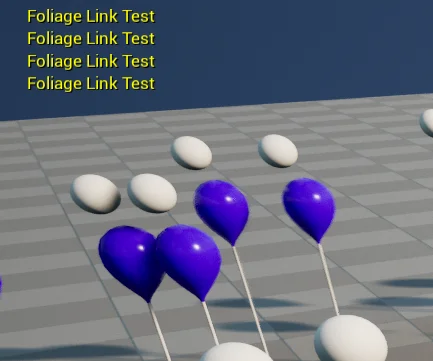

---

# Example Blueprints

For some additional example blueprints, navigate to **Plugins / Etherion Foliage Plugin – Pro Content / ExampleContent / FoliageTypes / FoliageLinkExample**.

These examples include sending and receiving, along with interactions and destruction.

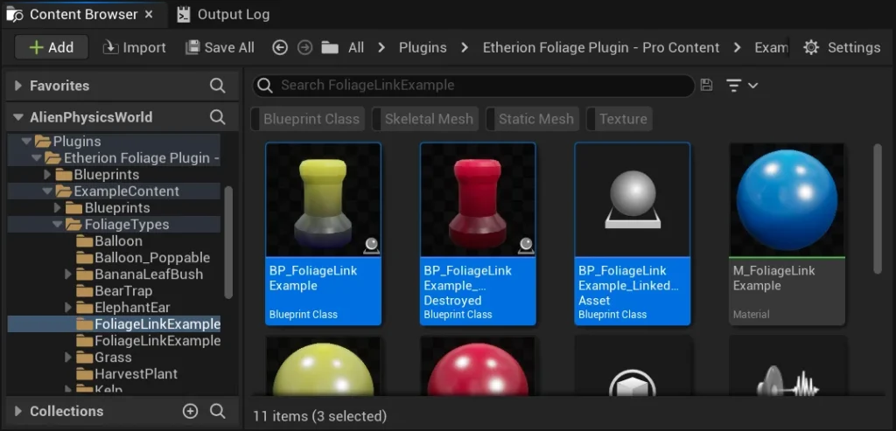

---

# Checklist

- The Foliage Link Blueprint is the blueprint which contains ambient effects that are always linked to the Foliage Blueprint.
- The Foliage Link Blueprint must have “**link**” in its name.
- The Foliage Link Blueprint must have the **EDFoliageLink** blueprint interface applied in its class settings.
- The Foliage Link Blueprint is applied to the selected foliage types, set in the **Get Foliage Types** event (taken from the blueprint interface).