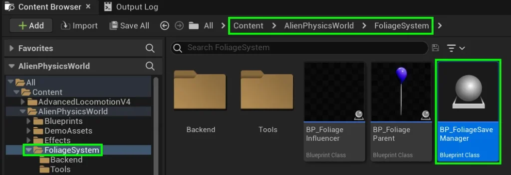

# Saving and Loading Foliages - PRO
Saving and Loading foliages is almost a requirement for all games, so long as your gameplay involves saving.

To implement saving and loading, you will need to ensure that your level has **BP_FoliageSaveManager** in it.

Drag a copy of **BP_FoliageSaveManager** into your level from **Content / AlienPhysicsWorld / FoliageSystem**

Next, in the details panel you will notice a some variables. Here’s what they do:

#### Save to File

If checked, this creates a custom foliage **savegame file** which stores the state of the foliage, even after the game is quit.  
If unchecked, it will only remember while playing the game, and will not remember the foliage states if the game is quit and reopened.

#### Save and Load Blueprints

If checked, a separate procedure finds all actors based on our **BP_FoliageParent** blueprint, and also saves their position and transform data.  
Please be aware that upon loading, these blueprints will be restored as foliage instances.

#### Automatically Load upon Begin-Play

Determines whether a loading attempt will occur when the game starts.

# How It works (Backend)

### Storing the Data

Our Saving Blueprint gets all the **Foliage Instanced Static Mesh Components** in the level, which is a special type of **Hierarchical Instanced Static Mesh Component** for the foliage. Each of these components has a **static mesh** and an **array of transforms** to know where to draw that static mesh in the level.  
From each of them, it retrieves the **static mesh** and the **transforms** and saves it in a special **struct** which is then converted to **JSON** file.  
This **JSON** file is returned by the **SaveFoliageState** node.  
  
But this process only accounts for the static meshes, what about the foliage that are currently converted to blueprints?  
They’re not existing in the **Foliage Instanced Static Mesh Components** right now so they’re not accounted for!  
  
If the **BP_FoliageSaveManager** has the `Save Blueprints` variable checked, a separate procedure finds all actors inheriting from `EDFoliageBlueprintParent` C++ class, and then gets their static mesh and transforms and associates them with the data we gathered from the **Foliage Instanced Static Mesh Components** IF the `Save Blueprints` flag is checked in the `SaveFoliageState` node (which is controlled here in the blueprint via `Save And Load Blueprints` flag).

The blueprint deals with the **JSON** data after that so you can change how its saved, or even encrypt it before save.  
For example the flag `Use File` indicates whether we’re putting the save data in the `In-Memory Save Block` or writing it to a file using our `FileStatics` blueprint function library nodes.

### Loading

The same goes for loading the foliage. We read the data from wherever we saved it in the blueprint, and then feed it to **LoadFoliageStates**.  
If **Load Blueprints** flag is checked in the node, then we also load the blueprint saves as well (and by blueprints we mean the ones that were blueprint before save)

Before loading, it clears all the foliage instances in the level, but it doesn’t remove the foliage blueprints as they are being interacted with.  
So if a **foliage save data** (whether it was an instance or a blueprint) has a transform that we already have a foliage blueprint for in the level while loading, we don’t load that foliage save data and keep the blueprint.  
  
For the blueprint to be recognized by that save data it should have approximately the same transform and the same static mesh.