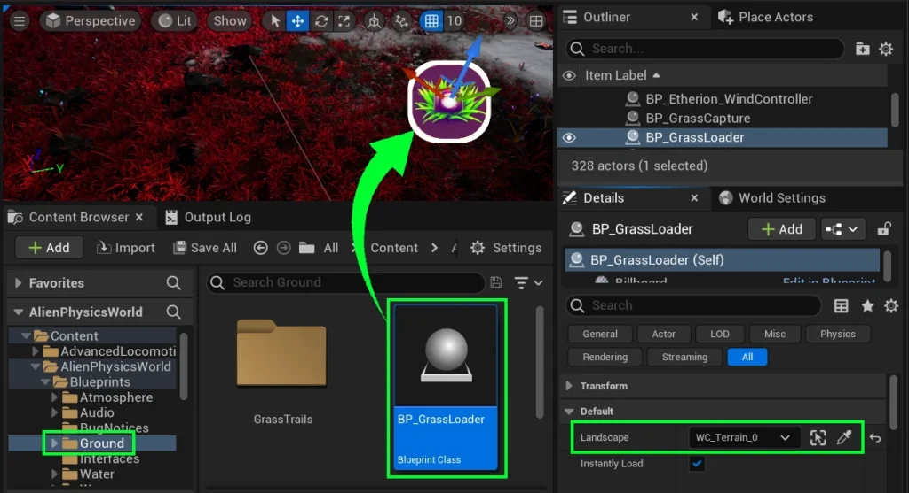
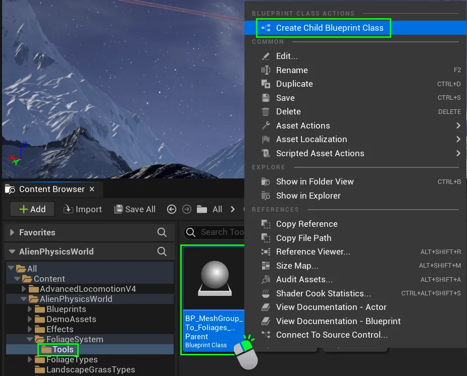
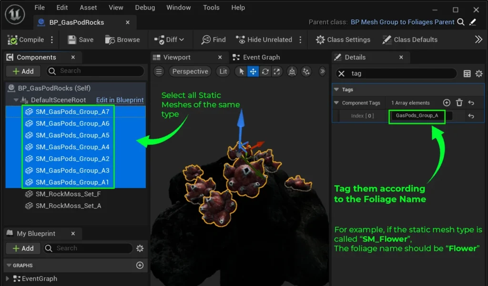
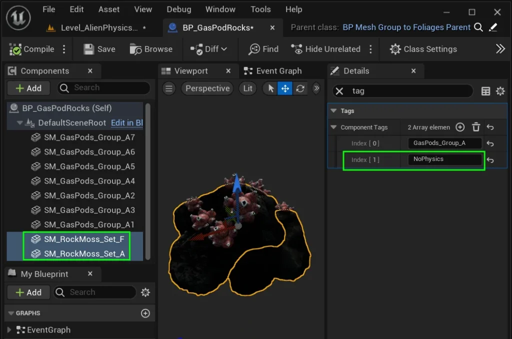
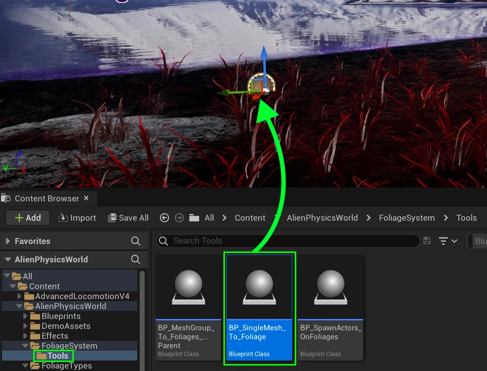
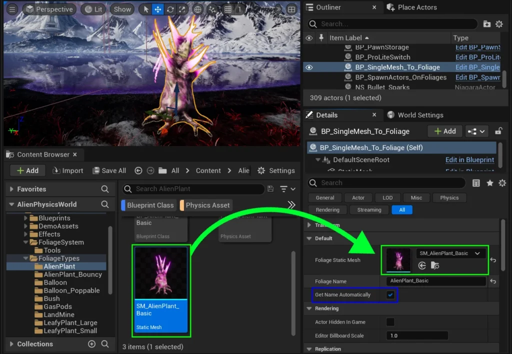

# BONUS Foliage Tools - PRO
## Instant Grass Loader {#instant-grass-loader}

For some reason, Unreal Engine loads grass extremely slowly, and the developers still havent fixed this issue.  
So we fixed it for you! Navigate to **Content / AlienPhysicsWorld / Blueprints / Ground /**

Drag in **BP_GrassLoader** into your level.  
  
In the details panel, click the **Landscape** dropdown and select the landscape you want grass to instantly load into.  
  
Congratulations! You no longer have to wait 40 seconds for your landscape to fill with grass! Woohoo!

---

## Foliage Group Placement Blueprint {#grouped-foliage-placement}

Modern level design requires an efficient approach, which is often why static meshes are grouped together as blueprints.  
We developed a way for you to do this with foliage, by converting static meshes to foliage instances at the start of your game.

If you navigate to **Content / AlienPhysicsWorld / Foliage System / Tools**  
you will find a blueprint called **BP_MeshGroup_To_Foliages_Parent**

Create a child of this blueprint  
**Right Click > Create Child Blueprint Class.**  
  
Name this Child Blueprint according to the mesh group you are about to create, and move it to your desired location.

Add all the static meshes you want in your group and arrange their positions until you are satisfied with the design.  
  
Then select each static mesh that is associated with a **Foliage** that is in your **[[1 Foliage Physics/2 System Setup|Foliage Map]]**, and tag them according to their foliage name.

All actors that are tagged with a foliage name associated in the **Foliage Map** will be converted to a foliage instance of that type upon the start of the game.

Any static meshes that you do not want to convert to a Foliage should have the tag “**NoPhysics**“.  
  
Even if they have other tags, this “**NoPhysics**” tag will prevent the system from converting them to foliage instances, as can be seen in the example here.  

---

## Static Mesh Foliage Placement Blueprint {#static-mesh-foliage-placement-blueprint} 

Using Unreal's native foliage placement tool can be a nightmare when you want to carefully position and scale certain foliage.  
We developed a simple tool that allows you to instead place a static mesh, which will be converted into a foliage instance at the start of the game.

To utilize this tool, navigate to  
**Content / AlienPhysicsWorld / FoliageSystem / Tools**  
  
Drag **BP_SingleMesh_To_Foliage** into your level

In the details panel, assign a foliage static mesh that has been associated with your **Foliage Map** into the “Foliage Static Mesh” slot.  
  
By default, it will automatically remove “**SM_**” from the name in an attempt to correctly get the foliage name from the mesh.  
  
However, if your naming conventions are different, you can manually name it according to the foliage name listed in the Foliage Map, by unchecking “**Get Name Automatically**” _(seen in blue)_.  
  
Then you can manually name it by changing the “**Foliage Name**” variable seen in the details panel.

If done correctly, this static mesh will convert into its associated foliage instance at the start of the game.  
Feel free to duplicate, position, rotate and scale this actor all over your level.

---

## Issues?

If your foliage tool blueprints are not functioning correctly, please ensure your all your foliage files have the correct **[naming conventions][naming-conventions]**.
