# Tweener Component - PRO
# Overview

The **ED Tweener Component** is a versatile Blueprint tool that allows you to create smooth transitions and animations between values.  
It is highly efficient, and provides a wide range of easing types.

## Features

### **Tweener Type – Control the Flow of Animation** 

Define the direction and flow of your animations with four distinct Tweener Types, each suited to different scenarios.  
Choose the type that best fits your animation needs:

- **Reversed:** Runs the animation backward, starting from the end value and transitioning to the start value. Ideal for reversing effects, like closing a door that was opened or retracting an object to its original position.
- **Ping Pong:** The animation plays forward from the start value to the end value, then reverses back to the start. This back-and-forth motion is great for creating looping effects, like a pendulum swinging or a bouncing ball.
- **Ping Pong Reversed:** Begins the animation in reverse, moving from the end value to the start value, and then returns to the end. This is particularly useful when you want to introduce a reverse-first motion.
- **Normal:** Plays the animation from the starting value to the ending value in a forward direction. This is perfect for any one-way transition, such as moving an object.

### **Easing Type – Achieve Smooth and Natural Animations**

The way your animation progresses over time is crucial for achieving a polished, professional look.  
The ED Tweener Component offers an extensive range of Easing Types to control the speed and acceleration of your transitions:

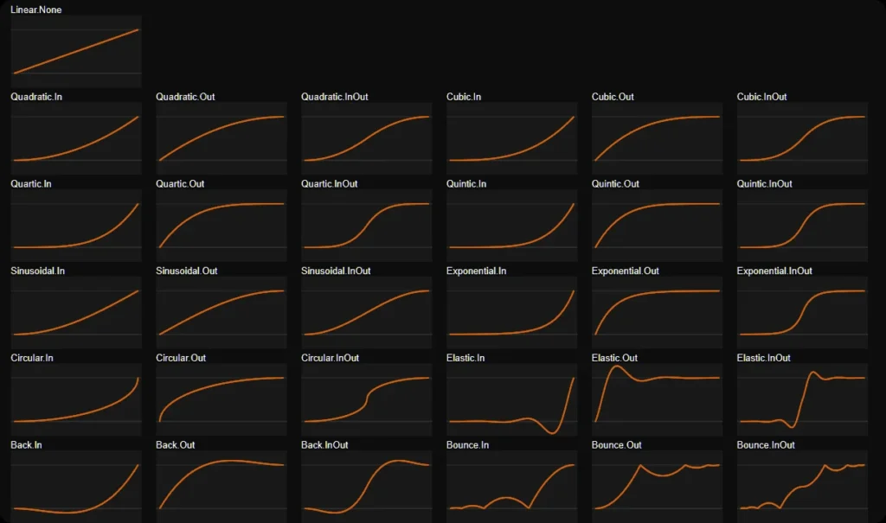

- **Linear** Provides a steady, constant rate of change throughout the animation. Use this for mechanical, no-frills transitions where even timing is key.
- **Quadratic, Cubic, Quartic, and Quintic** These functions offer progressively more dramatic easing effects, from gentle (Quadratic) to stronger accelerations and decelerations (Quintic). You can use these to mimic natural physics, where motion starts slow, speeds up, and then slows again.
- **Sinusoidal, Exponential, and Circular** These easing types mimic real-world physics with smooth arcs and curves. Perfect for creating organic, fluid motion such as waves, rotations, or scaling.
- **Elastic and Bounce** These playful easing types add a bouncy or elastic feel to animations. Use them for dramatic effects, like a springy UI element or a character jumping and bouncing on the ground.
- **Back** Adds a slight backward motion before the animation moves forward. This can be useful for creating anticipation in animations, such as a button pressing inward before popping back out.

Each easing type defines how the transition speeds up, slows down, or maintains a constant speed over time. You can experiment with various combinations to create animations that feel dynamic, fluid, and perfectly suited to your project’s needs. For a visual reference, you can explore these easing functions at [https://easings.net](https://easings.net/).

### **Looping – Endless Possibilities for Repetitive Animations**

Enable Looping to repeat the tweener animation continuously. This is particularly useful for creating infinite cycles, such as:

- A rotating object that spins continuously.
- A pulsing light that fades in and out on repeat.
- An object oscillating back and forth, such as a swinging lamp.

Looping works seamlessly with the various tweener types, giving you full flexibility over how your animations repeat. Combine looping with the Ping Pong tweener type for back-and-forth motion or with Normal for endless forward progression.

---

# Getting Started

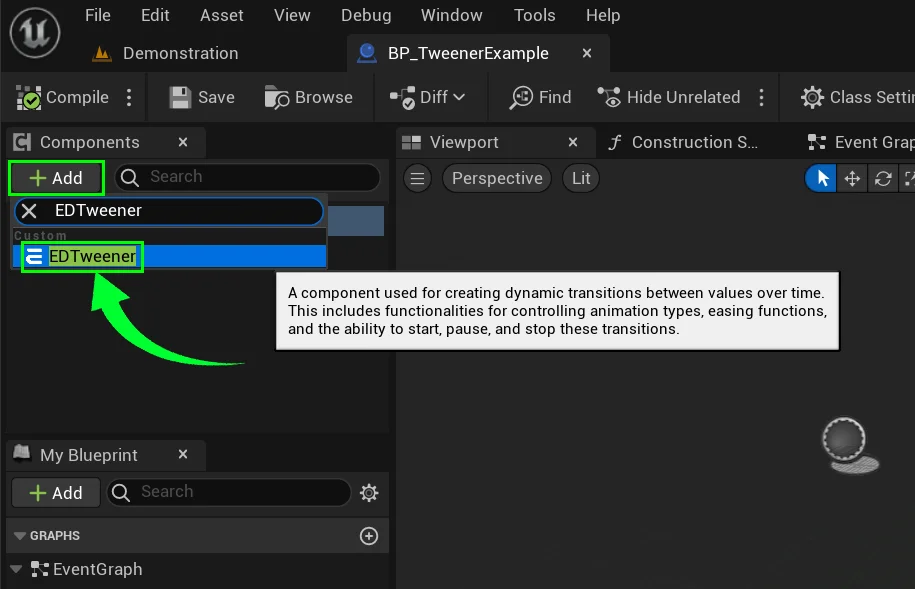

To add a Tweener component to your blueprint, first open up the blueprint actor that you want to animate. This could be any object like a character, a prop, or even a light.  
  
Navigate to the **Components** panel and click on the **Add** button.  
Search for **“EDTweener”** in the list and select it.

Once added, the ED Tweener Component needs to be configured to define the specifics of your animation. You’ll be working with key properties that control how the Tweener behaves, so let’s break each one down.

## Configuring Tweener Properties

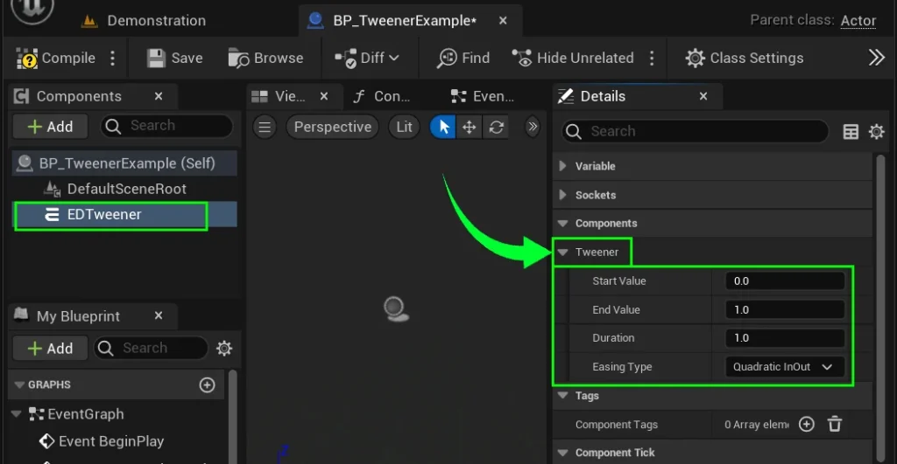

- **Start Value & End Value**

- These are the two boundary points of your animation. The Start Value is where the animation begins, and the End Value is where it finishes. These values can represent anything that can be animated numerically, such as position, rotation, scale, color, opacity, or even a custom property you’ve defined. For example if you’re changing the opacity of a material, the values might range from 0 (completely transparent) to 1 (fully visible).

- **Duration**

- Define how long the animation will last, in seconds. A short duration (e.g., 0.5 seconds) will create a fast, snappy animation, while a longer duration (e.g., 5 seconds) will result in a smooth, gradual transition.

- **Easing Type**

- Define how long the animation will last, in seconds. A short duration (e.g., 0.5 seconds) will create a fast, snappy animation, while a longer duration (e.g., 5 seconds) will result in a smooth, gradual transition.

## Implementing Tweener Events

The ED Tweener Component provides several useful events that you can hook into to execute specific actions during the animation. These events are critical for triggering other behaviors or for more complex animation chains.

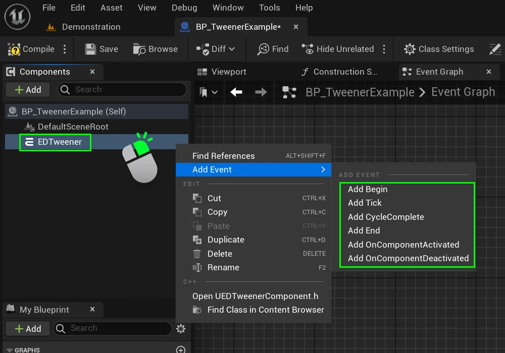

To bind tweener events, right-click on the **EDTweener** component in the Components panel.  
Hover over **Add Event**, and select the event you want.

### Begin Event

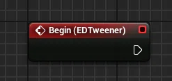

This event is triggered when the tweener starts its animation. It serves as an entry point for initializing any effects or actions that should occur at the beginning of the animation sequence.

You can use this event to set up any initial state required for the animation, such as modifying materials, activating sound effects, or initializing variables

### Tick Event

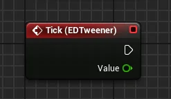

This event is the heart of the tweener component which is fired every frame during the animation, allowing you to continuously update your animated objects based on the current value of the animation.

This is where you can implement custom behaviors that depend on the current progress of the animation. For example, you might adjust the opacity of an object or change the speed of a particle effect.

### Cycle Complete Event

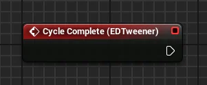

This event is triggered at the completion of each cycle of the animation. If your animation is set to loop or repeat, this event allows you to respond to each completed iteration.

### End Event

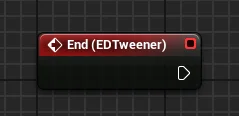

This event is triggered when the tweener has completed its animation, marking the end of the animation sequence. It serves as a clean-up point for any actions or effects you initiated at the beginning.

Use this event to deactivate or reset any properties or effects that were initiated in the Begin event. This ensures that your game state remains consistent and that resources are released when they are no longer needed.

This is also an ideal time to trigger any follow-up actions, such as transitioning to a new animation or initiating another sequence in your game.

## Starting the Tweener

Before starting, ensure you’ve defined the **Start Value, End Value, Duration, and Easing Type** by selecting the component and checking it’s details panel.  
These parameters dictate how your animation will behave, ensuring you achieve the desired visual effect.

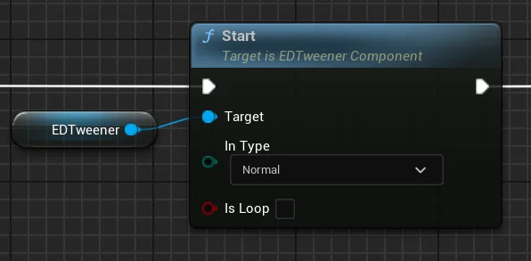

Once the ED Tweener Component is set up and events are implemented, you can start the tweener using the **Start** function.  
This function initializes the animation and begins transitioning from **Start Value** to **End Value** according to the specified settings.

To create this **Start Function**, drag your component into the graph to make a reference to it.  
  
Then, drag out from your tweener reference, and search for the **Start** function.

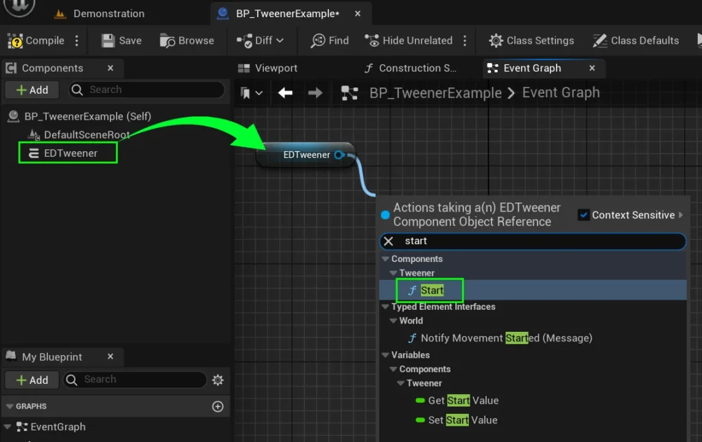

## Pausing and Resuming the Tweener

You can pause and resume the animation at any point using the Pause and UnPause functions. This allows you to halt animations mid-flow and continue at will.  
When the tweener is paused, its CurrentValue and ElapsedTime remain unchanged and the Tick event will no longer be called. and when it is unpaused it will continue from where it left off.

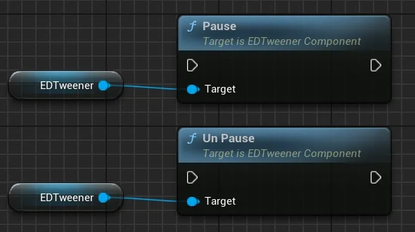

Drag your component into the graph to make a reference to it, then drag out from your tweener reference and search for the **“Pause**” or **“UnPause**” functions.

## Stopping the Tweener

The ED Tweener Component provides two functions to stop an ongoing animation These functions allow you to control when and how the tweener should end, either preserving the current state or resetting it back to its initial value.

### Stop Node

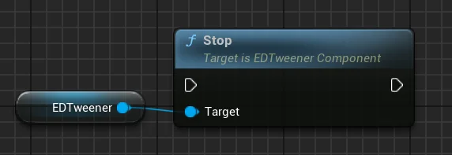

Use this node to halt the animation immediately. This will keep the **CurrentValue** at its present state when stopped and trigger the End event.  
When the **Stop** function is called, the tweener stops updating its value and does **not** revert to the starting state. Use this function if you want to end the animation but retain the current state for further modifications or interactions.

### **Stop and Reset node**

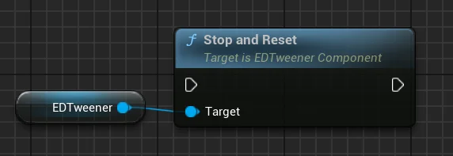

Use this node to halt the animation and reset the **CurrentValue** to the initial **StartValue**. This function also triggers the **Tick** event one final time with the **StartValue**, reverting to the starting state, and fires the **End** event afterwards.

## Usage Example

For a practical example of how to implement and use the ED Tweener Component, check out the `**BP_TweenerExample**` Blueprint provided in the plugin’s content folder.

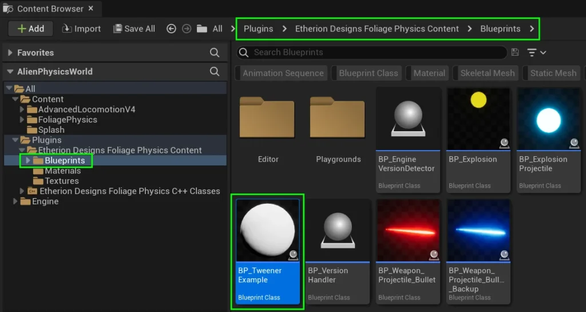