# Footstep Sound Effects {#footsteps}
The **Alien Physics World** that installed with our plugin, and many other supported Environments come with an **in-built footstep sound effect system** that you can easily set up with your own player.

# How the System Works

The system exists inside an **AnimNotify** blueprint located at  
**Content / AlienPhysicsWorld / Sounds / Footsteps / BP_Foostep_AnimNotify**  
  
This **AnimNotify blueprint** blueprint is triggered each time a footstep hits the ground, and these triggers are set up inside walking and running animations.  
Each time a notify is called, it activates an event in the **AnimNotify** blueprint, performing a line trace from the character’s head to the ground.  
  
This line trace automatically knows the height of the character and adjusts the Trace Length accordingly.  
The line trace occurs in order to detect the **Physical Material** of the surface below.  
Based on the detected material, it plays a corresponding sound effect, creating accurate footstep sounds for different surfaces.

---

# Animating Footsteps

To get your player to utilize our foostep sound effects, you will need to open your player’s animations and call **BP_Foostep_AnimNotify** each time a foot touches the ground.  
  
Begin by opening up one of your player’s animations _(for example, a running animation)_.  
In the tracklist, find a position where your players foot starts to touch the ground, and right click the Notify Track.  
click **Add Notify** > **BP_Footstep_AnimNotify**

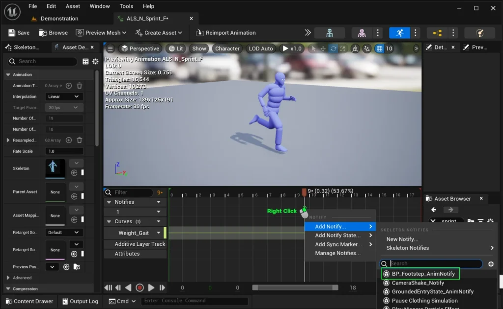

Do this as many times as the feet touch the ground. See below for an example

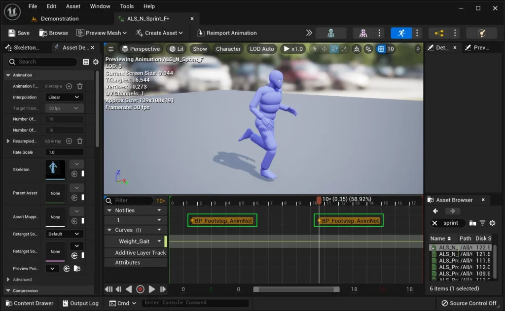

Open all the other animations that your character has and repeat the steps above until all of them reference **BP_Footstep_AnimNotify**.

---

# Setting up your Character’s Socket

In order to detect the ground’s physical material, we need to run a line trace from the character’s head to the ground.  
By default, your character may not have the appropriate socket name for the line trace to work with.  
Open your Character’s **Skeletal Mesh**, and open the **Skeleton Tree** tab.

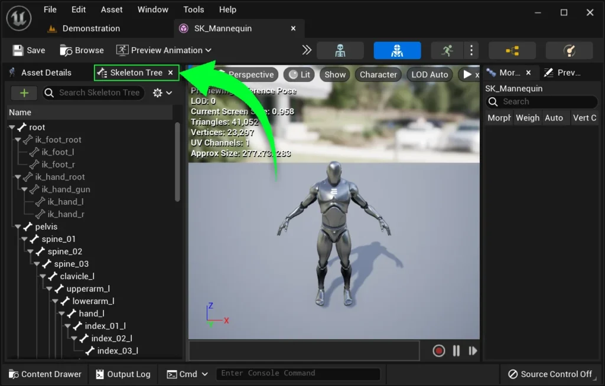

Scroll down until you find the head bone, and add a socket called “**headSocket”.**

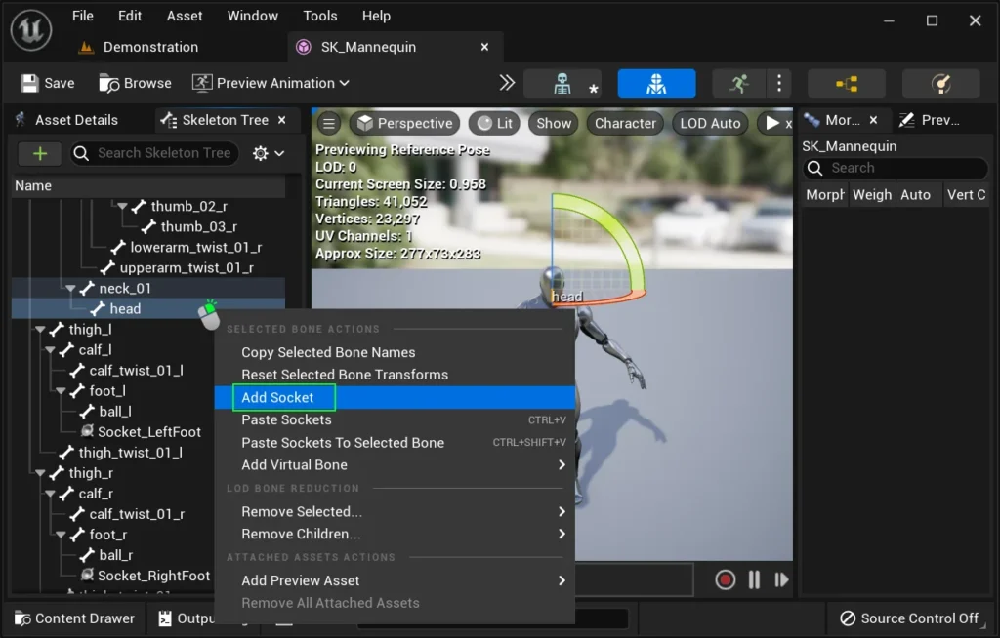

Your custom character should now play footestep sound effects with levels from Etherion Designs.  
If you have your own custom levels, the sound effects will only play if you have the correct Physical Materials applied to the surface below the character.

---

# Assigning Materials to Foostep Sounds

If you want footstep sound effects to apply to your own custom meshes and materials, you’ll need to assign **Physical Materials** to one or more of the following:

- Materials
- Material Instances
- Landscape

In order to use our pre-made footstep sounds, you must reference our **Physical Materials** from:  
**Content / FoliagePhysics / Materials / Physical Materials**

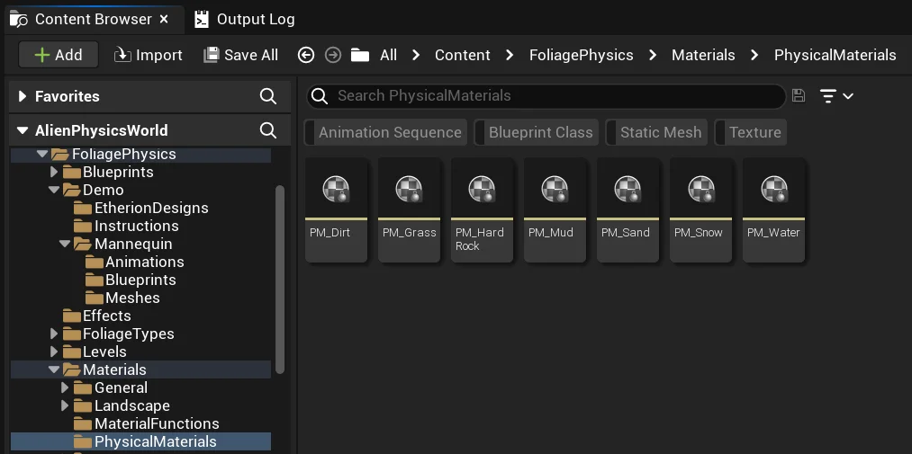

### Applying to Materials

To apply a **Physical Material** to your material, first open your material.  
While your material is still open, select one of our **Physical Materials** from the content browser _(outlined in the screenshot above)_.  
Then in your material’s details panel, click the “assign” button to apply the Physical Material to your Material.

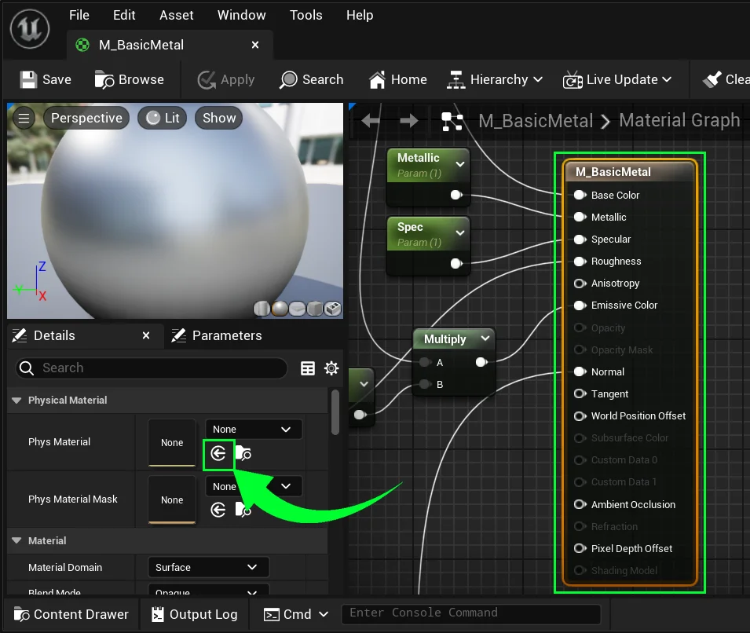

### Applying to Material Instances

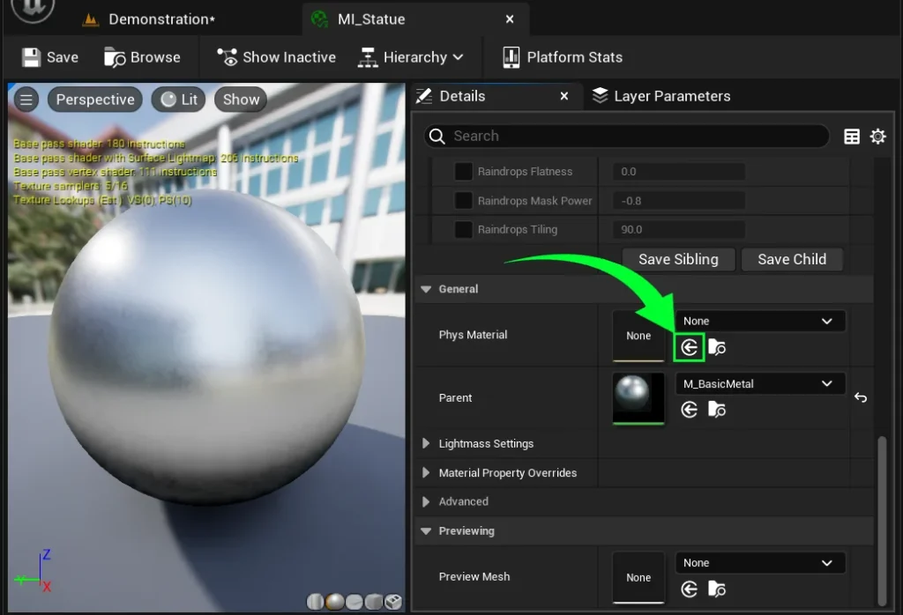

To apply them to your material instance, first open your material instance.  
  
While your material instance is still open, select one of our Physical Materials from the content browser _(outlined in the screenshot above)_.  
  
Then in your material instance’s details panel, click the “assign” button to apply the Physical Material to your Material.

### Applying to Landscape Materials

Lanscape Physical Materials can be applied using two methods.  
The easiest is to apply them using the LayerInfo files.  
See the video below, by _**Matt Aspland**_, on how to do this:

The second method is to do it via the **Material Editor**.  
This method can be useful if you want to use the same **LayerInfo** for multiple landscapes, but want different sound effects depending on your Landscape Material.

Open your Landscape Material and create a node called **Landscape Physical Material Output**  
Select this node, and in the details panel, add as many items to the array as you need.  
Then assign these to our physical materials.

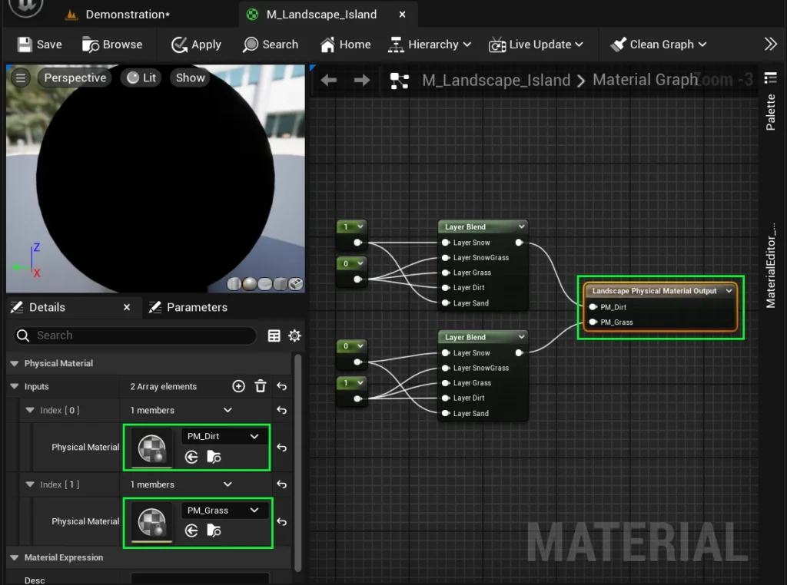

You can use layer blend nodes to assign physical materials to different layers.  
Set a value of 0 to not assign a physical material, and a value of 1 to assign a physical material.

---

# Creating New Footstep Sounds

Now, add some uniqueness to your game by using your own custom footstep sound effects!

Open **BP_Footstep_AnimNotify**, located at:  
**Content / AlienPhysicsWorld / Sounds / Footsteps / BP_Foostep_AnimNotify**  
  
Here you will find nodes that play sound cues based on whether the line trace detects a certain physical material.  
To replace an existing footstep sound cue, you can find your associated physical material and replace the **Spawn Sound Attached** reference with your own custom sound.

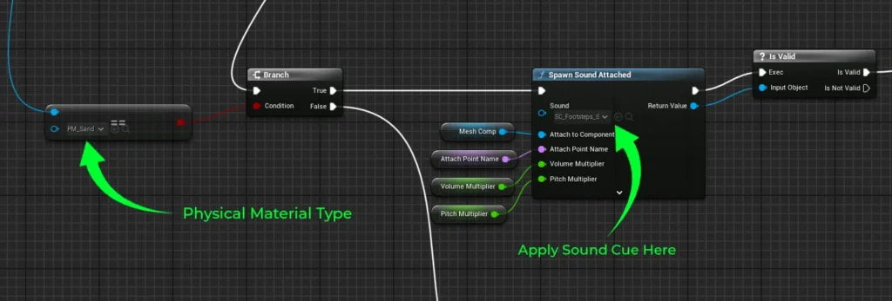

If you want to create brand new physical material types, simply copy one of the examples and replace it with your own physical material and sound cue.  
Ensure that you link up the nodes in the same structure as all the other nodes.

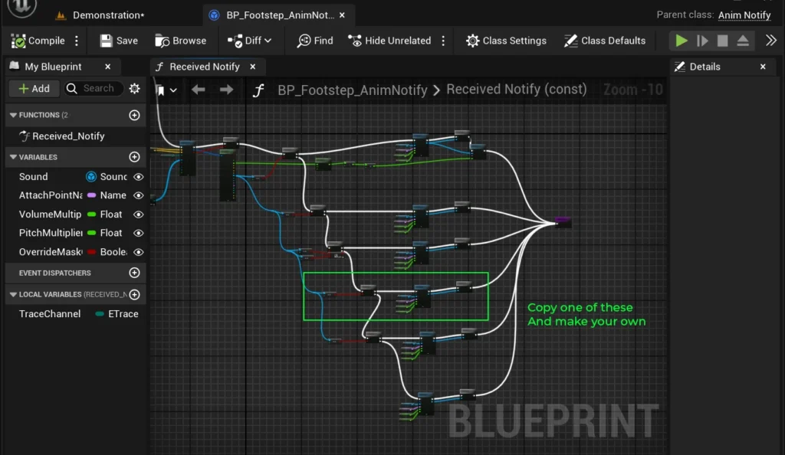

If you wish to learn more about Physical Materials, you can visit the official **[Unreal Engine Documentation](https://dev.epicgames.com/documentation/unreal-engine/physical-materials-user-guide-for-unreal-engine)** on Physical Materials

---

# Water Sound Effects

If you are creating your own custom level, water will not play our designated sound effects by default.  
This is because Water doesn’t have its own collision set up by default.  
To save you some time, we created two blueprints that can help you do this very quickly.

## **BP_WaterSoundCollider**

**BP_WaterSoundCollider** is a blueprint designed to create artificial water collision for your character.  
It contains a static mesh plane that uses the **Visibility** trace channel and has the “Water” **Physical Material** applied.  
This allows the **BP_Footstep_AnimNotify** blueprint to detect the water surface.

To utilize it, first navigate to  
**Content / AlienPhysicsWorld / Blueprints / Water**  
and drag **BP_WaterSoundCollider** into your level.

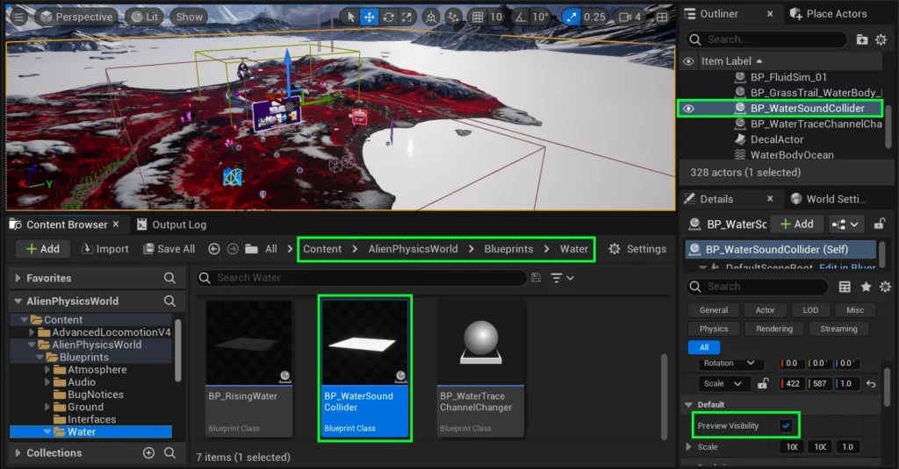

Place the blueprint in the same location as your water surface, and scale its size to match the dimensions of the water.  
When you are finished, open the **Details panel** and uncheck “**Preview Visibility**” to hide the collider in the editor to continue level designing without interference.  
_(regardless of this checkbox, it will automatically remain hidden in-game)_.

## **BP_WaterTraceChannelChanger**

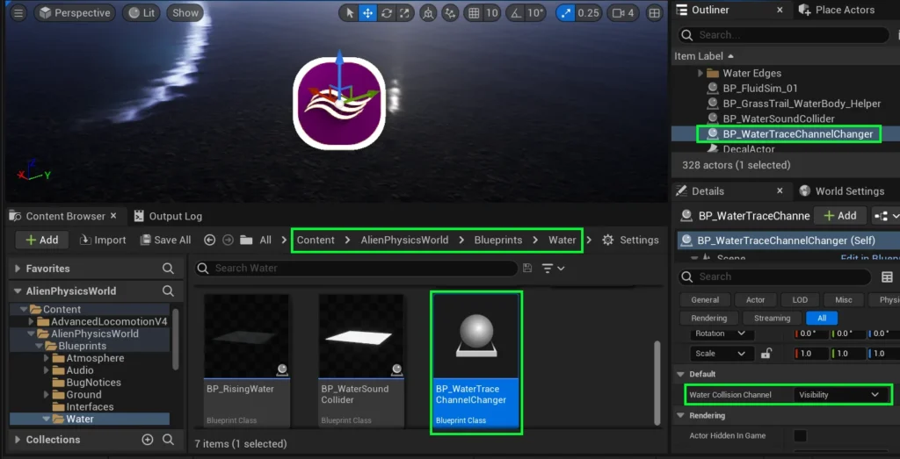

If your project uses the **Advanced Locomotion System** or any other character system that has an IK controller for the feet, you might run into an issue: the character’s feet could mistakenly detect water as a solid surface and end up “walking on water.”

This happens because the pawn may use the **Visibility** collision channel to decide what surfaces are walkable.

We created a solution that allows you to change the collision channel to all **BP_WaterSoundCollider** actors in your level.  
To use it, navigate to **Content / AlienPhysicsWorld / Blueprints / Water**.  
Drag in **BP_WaterTraceChannelChanger** into your level.

  
In the **details panel**, you can choose which collision channel you would like all of the **BP_WaterSoundCollider** actors to use.  
For example, if your character’s feet IK controller uses the **Visibility** trace channel, you may want to make **BP_WaterSoundCollider** use the “**Camera**” channel instead.