# Weather System - PRO
# Overview

The Etherion Designs wind system works by panning a **world-space** wind texture across the entire level.  
The speed, direction, scale & intensity of this wind texture is determined by a blueprint placed in the level, called **BP_WindController**.  
These variables are fed into each foliage’s material, which uses the wind map to apply **World Position Offset**, which moves the foliage mesh vertices.

The benefit of this solution is that it is very performant and realistic compared to other Wind solutions on the Marketplace.  
However, the downside of this method is that each foliage of varying size, must have a seperate wind mask applied to its material instance.  
This is because Unreal does not allow the size of a foliage mesh to be communicated to materials – so please keep this in mind when designing your foliages.

---

# Basic Setup

Navigate to **Content / AlienPhysicsWorld / Blueprints / Atmosphere / Wind**

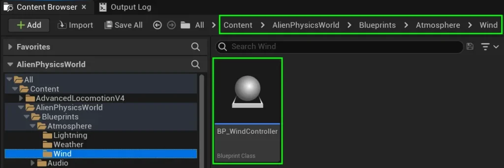

Please add one **BP_WindController** to each level where you want wind to affect your foliage.

After adding the **BP_WindController**, please rotate to face the direction you want wind to blow in.  
If you need your wind blowing in random directions, don’t worry – we can sort this out later!

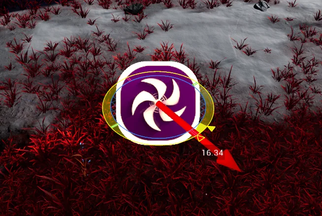

By default, the wind should now be working with any of our foliages from Etherion Designs. If you wish to customize your wind, please continue reading

---

# Adjust Wind Speed & Intensity

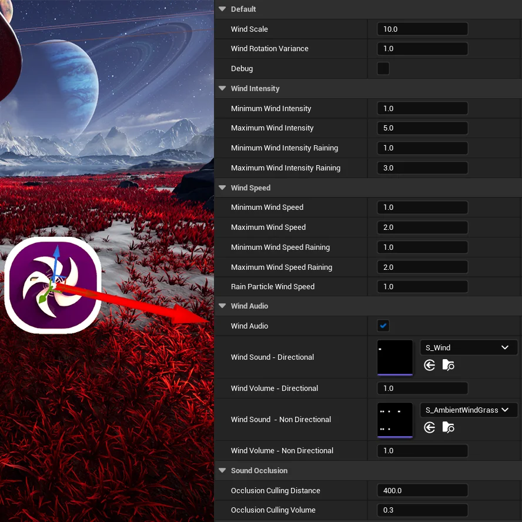

Select the **BP_WindController** in your level, and take a look at the details panel.

  
Here you will find a range of variables. Hover your mouse over any of them to preview what they do.

#### Default

- **Wind Scale**
- **Wind Rotation Variance**
- **Debug**

- This adjusts the scale of the Wind Map. Generally its best to leave it at 10
- The amount of variance that occurs to the wind’s blowing direction
- Prints ERROR strings when true, and shows wind direction arrow

#### Wind Intensity

- **Minimum Wind Intensity**
- **Maximum Wind Intensity**
- **Minimum Wind Intensity Raining** [PRO]
- **Maximum Wind Intensity Raining** [PRO]

- The minimum wind intensity while not raining
- The maximum wind intensity while not raining
- The minimum wind intensity during rain – varies based on the intensity of the rainfall
- The maximum wind intensity during rain – varies based on the intensity of the rainfall

#### Wind Speed

- **Minimum Wind Intensity**
- **Maximum Wind Intensity**
- **Minimum Wind Speed Raining** [PRO]
- **Maximum Wind Speed Raining** [PRO]

- The minimum wind speed while not raining
- The maximum wind speed while not raining
- The minimum wind speed during rain – varies based on the intensity of the rainfall
- The maximum wind speed during rain – varies based on the intensity of the rainfall

Set your chosen speed & intensity values, and be sure to play in level to see how they look before saving!

---

# Adjust Wind Audio

**BP_WindController** features a built-in binaural wind audio system that is fully customizable.  
The system adjusts the volume based on wind intensity and plays the wind sound directionally, following the wind’s rotation.  
It operates using a specific sound cue, which has two sound-file inputs which are set in the blueprint.

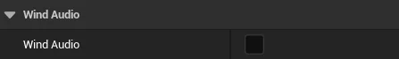

If you don’t want to use it, you can turn the system off by unchecking “**Wind Audio**“.

This Wind-Sound-System comes with two primary variables:

- **Wind Sound – Directional**

- This sound file will play from the direction of the wind. It automatically adjusts based on wind rotation in the game, and will play binurally. You can notice this if you wear headphones. This sound file will also automatically link to our custom sound cue, adjusting its volume based on the wind’s intensity.

- **Wind Sound – Non-Directional**

- This sound file is non-directional and will not adjust based on wind-rotation. It is ideal for open-world grass rustling. The volume will automatically adjust based on the wind intensity. If you don’t want Non-Directional Wind, you can simply leave this variable blank.

Furthermore, you can adjust their volume using the Wind Volume variables found next to these Sound Variables

---

# Silencing Audio Inside Rooms

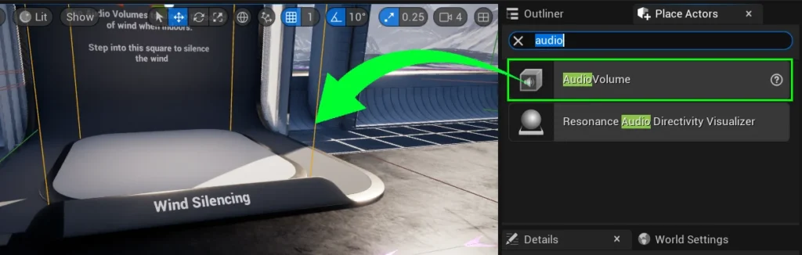

No doubt your gameplay won’t be entirely outside, and so you’ll need to make sure Wind Audio doesn’t play indoors.  
To do this, please add an Audio Volume to your level, encompassing the area you wish to silence.

With your **Audio Volume** selected, go to the **Details Panel**.

Under **Ambient Zone Settings**, adjust the **Exterior Volume** to the level that you wish to hear the wind. If you want all outside sounds to be silent while the player is in the volume, you can set this value to 0.

Additionally, if you want all inside sounds to be silent while the player is outside this volume, you can alter the variable called **Interior Volume**.

Please note that for sounds to work with Audio Volumes, they must have a specific setup in the details pannel. With your sound selected, the setting called “**Allow Spatialisation**” must be set to true, even if “**Enable Spatialisation**” is false, otherwise these sounds will ignore Audio Volumes.

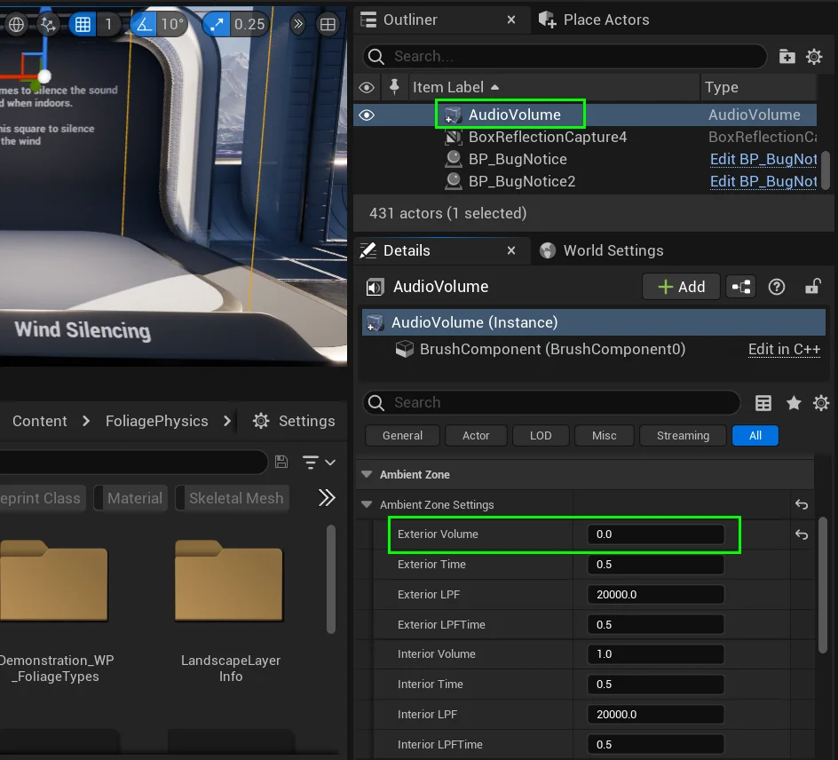

## Audio Listener Location

If you’re using a **Third-Person Character** in your game, you might notice that even when your player’s body is inside a volume, the exterior sounds are still loud.  
This happens because the the game’s “**virtual ears**” are stuck to the **3rd person camera**, and not the player’s head.  
  
_In Unreal Engine, the location that hears sound is called the_ **Audio Listener**.  
  
An easy fix to this is to use the node “**Set Audio Listener Override**” in order to attach to **Audio Listener** a component of your choice.  
The **Set Audio Listener Override** node will automatically move the **Audio Listener** to the root location of the component it is attached to.

To find the example setup seen below, please refer to **BP_Mannequin**, located at _**Content / AlienPhysicsWorld / DemoAssets / Blueprints / Mannequin**_

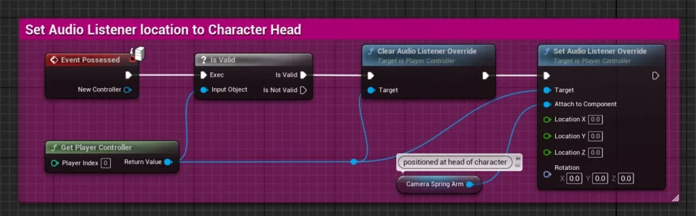

Please note that setting the **Audio Listener** to the location of the head may impact the spacialization of your footsteps.  
It may make left and right foostep sounds feel like they are coming from either side of the character.  
To fix this, you’ll need to modify the **Non-Spacialised Radius** value of your foostep sounds to be large enough reach the Audio Listener’s location.  
We have created a Sound Attenuation actor with these settings already configured. It is located at **Content / AlienPhysicsWorld / Sounds / Footsteps / SA_Footsteps**

---

# Preparing Custom Meshes for Wind

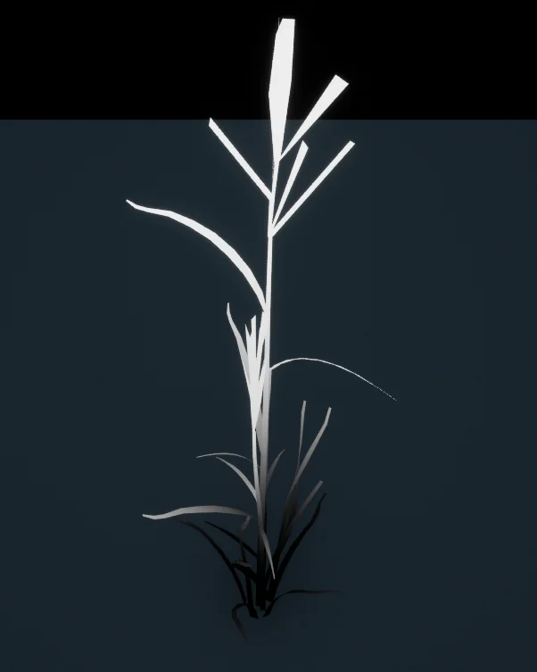

Next, ensure that each custom mesh has a designated UV Channel with vertical alignment to apply a gradient texture.  
  
We recommend utilising **UV Channel 2** or **UV Channel 3** for your foliage gradient map.  
_(Note: These channel names are as listed in Unreal Engine; technically, they are the 3rd and 4th UV channels_ in other softwares_)_  
  
The UV map should be vertically upright, so it appears like the image to the left when a gradient map is applied.  
  
This setup is required for wind masking to prevent the roots of a plant from moving with the wind.

Foliage **Skeletal Meshes** and **Static Meshes** must have this vertical UV channel.

---

# Preparing Custom Materials for Wind

Setting up wind inside your foliage material is very easy.  
Add **MF_Etherion_GrassWind** to your material.  
It is located in **Content / AlienPhysicsWorld / Materials / MaterialFunctions**

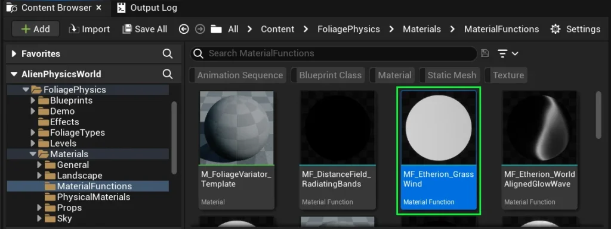

In your material, you must ensure that your vertical gradient is applied at the **TreeWind_Mask** input node.  
If you do not create nodes for this, it will automatically apply a vertical gradient to **UV Channel 0**. This is not ideal for most meshes.

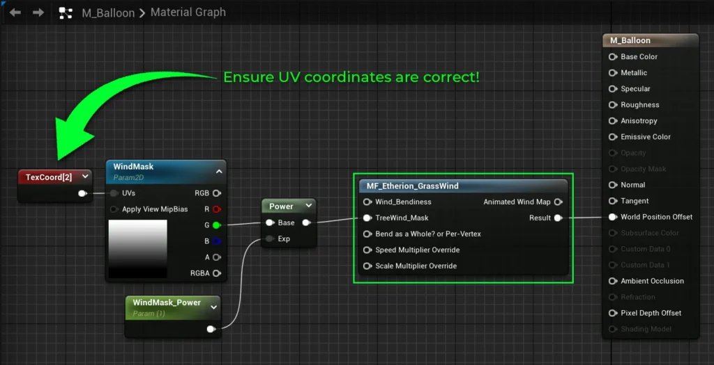

Here are the details of **MF_Etherion_GrassWind**

- **Wind_Bendiness** controls the intensity of the wind.  
    If you leave this blank, it will create a variable in any material instance parented from this material, called **Wind_Bendiness**.  
    You can edit this value in the material instance.
- **TreeWind_Mask** – The mask applied to the wind
- **Bend as a Whole? or Per-Vertex** – By default, this is set to true, as you’ll want your plants bending as a whole.  
    If you place a **FALSE** boolean here, it will move each vertex independently of each other, which may cause stretching.  
    It is useful in some cases, but only if you want stylized effects.
- **Speed Multiplier Override** simply replaces the speed value set by **BP_WindController**. Leave it blank if you dont wish to override it.
- **Scale Multiplier Override** simply replaces the scale value set by **BP_WindController**. Leave it blank if you dont wish to override it.

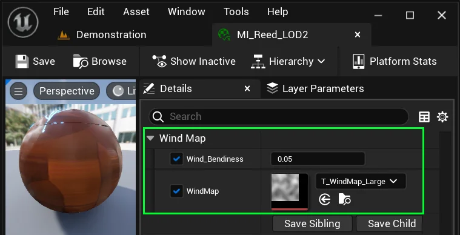

Once you have applied the wind fuction to your Material, please modify the values of any material instance you create from it.

> IMPORTANT!!!!

You’ll notice the **WindMap** texture variable is editable in the Material instance.  
Each foliage material should be assigned a specific wind map, according to the intended size of the mesh in the world.

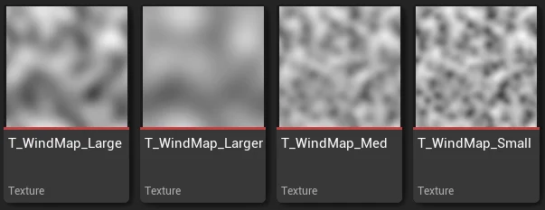

  
Select from one of these maps provided.  
They are located in:  
**Content / AlienPhysicsWorld / Textures / Atmosphere / Wind**

---

# Masking Wind Underwater

If you have a lake or ocean in your game, you may want to prevent wind from blowing plants that are underwater.

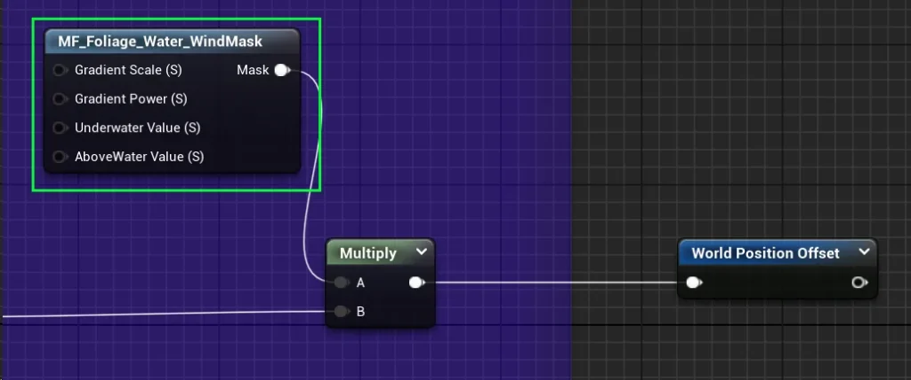

To do this, open your custom foliage material.  
You will need to add **MF_Foliage_Water_WindMask** to your material, and Multiply your World Position Offset nodes.

This material function will black-out anything below the water height.  
“_But how does it know where the water height is?_“ – you might ask.

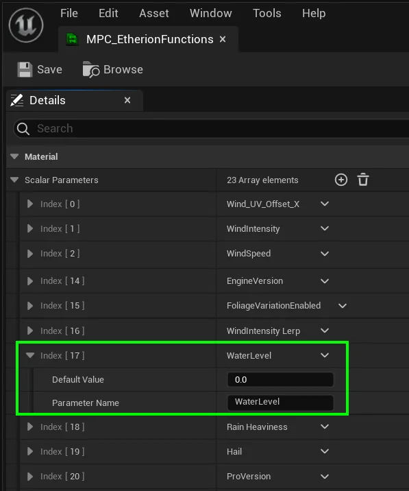

The Water height in your wind material mask is determined by a value is set in **MPC_EtherionFunctions**. This value is called “**WaterLevel**“  
  
You can find **MPC_EtherionFunctions** in **Content / AlienPhysicsWorld / Materials**  
  
By default, it is set to 0 – that is unless you have **BP_RisingWater** in your level.  
In that case, it will automatically set the water height based on **BP_RisingWater**‘s water height.

# Troubleshooting

A few customers had issues with no grass wind because their entire level was around -10,000 Z height, so all wind was disabled due to our automatic water masking feature. This feature has its default setting to 0, and the customers grass was below this. Please read the **Masking Wind Underwater** section above to learn more about how to prevent this.