# 2D Background Lightning {#2d-background-lightning}

Background lightning is a perfect way to add some dynamic ambience to your sky.  
This lightning blueprint will animate lightning on a 2D transparent plane very far off in the distance at random intervals.  
  
To add some 2D background lighting to your scene, open **Content / AlienPhysicsWorld / Blueprints / Atmosphere / Lightning**  
and drag in **BP_Lightning2D_Background** to your level.

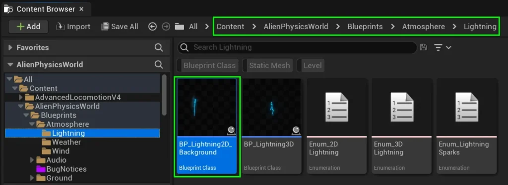

After you add this to your level, select the lightning actor and then go to the details panel.

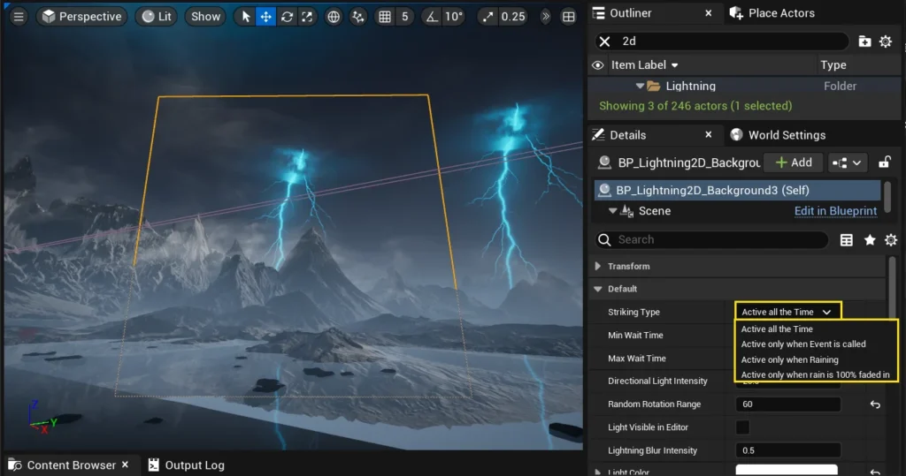

You’ll first want to select the **Striking Type**.  
  
If you are unsure about what each option does, simply leave your mouse hovered on it, and a popup will tell you.

  
Blow this, you will find a range of variables that will help you adjust the timing, color, location, and light intensity of your lightning.

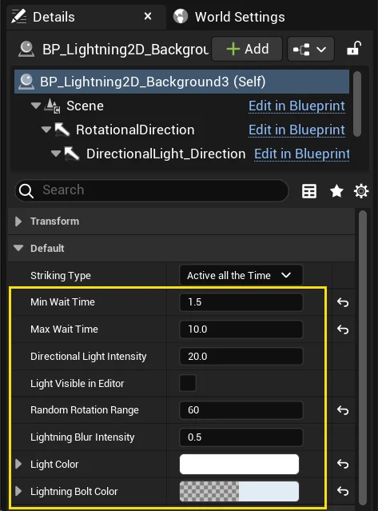

**Min Wait Time** & **Max Wait Time** set the range for the random delay that occurs before lightning strikes.  
  
**Directional Light Intensity** controls the intensity of the light that occurs when the lightning flashes. To preview this, tick the **Light Visible in Editor** checkbox.  
  
**Random Rotation Range** changes how much the lightning can rotate from its initial placement before striking. For full randomness, set it to 360. This will ensure it will randomly strike anywhere on the horizon in 360 degrees.  
  
**Lightning Blur Intensity** just adjusts the background cloud brightness of the lighting. It applies to some lightning strikes but not all.  
  
Finally, you can adjust the **Light Color** and **Lightning Bolt Color**.  
These may not preview in-editor, but they will be applied once the game starts.

If you wish to adjust the settings of the light that turns on when lightning strikes, please open up the component section of the blueprint and select **Directional Light**.  
  
You can then edit any of the details of this light.  
  
Once completed, feel free to duplicate this blueprint and rotate it across your horizon

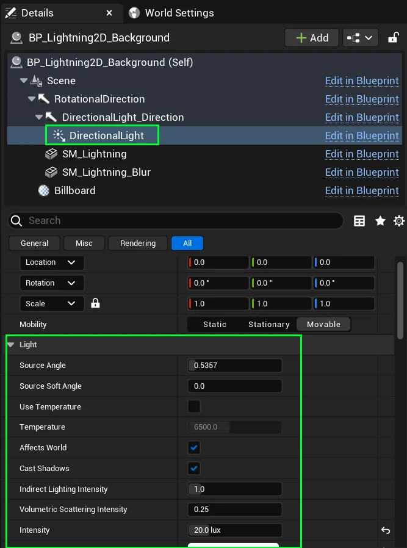

---

# 3D Foreground Lightning {#3d-foreground-lightning}

Spice up your level with some 3D Foreground lightning!  
This lightning blueprint will strike at random locations, causing sparks and leaving a hit decal mark in its place that fades over time.  
This system has tonnes of customisable settings, so lets jump right in!

Start by adding **BP_Lightning3D** to your level.  
You can find this in **Content / AlienPhysicsWorld / Blueprints / Atmosphere / Lightning**

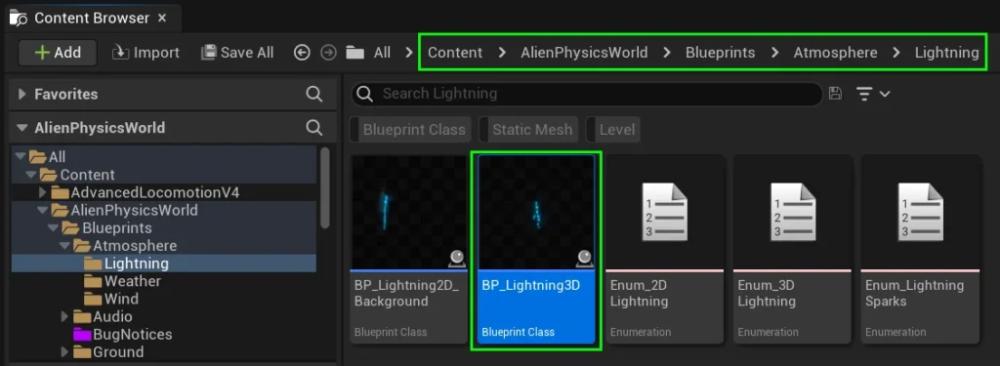

## Striking Types

Before we modify any of the settings, we’ll first need to discuss the two main categories of **Striking Types** and how to apply them.

### **1.) Random Point in Navigable Radius + Strike on Roofs**

This striking type will cause lightning to randomly strike in any position within your **Nav Mesh Bounds Volume**.  
If it detects a static mesh above the random navigable point that it selected, it will do a line-trace to detect the top of this mesh and strike in that location – leaving a hot decal mark where it struck.  
This simulates what would happen in real life if lightning strikes a roof.  
  
To get this working, all you need to do is ensure you have a Nav Mesh Bounds Volume in your level that is positioned in the areas you’ld like lightning to strike.

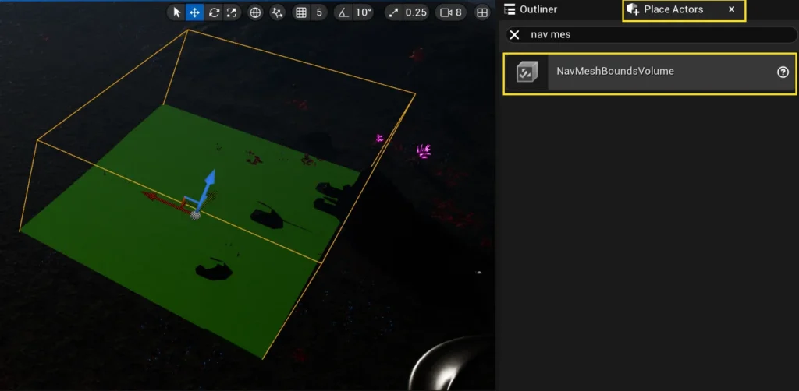

If you do not have a **Nav Mesh Bounds Volume** in your level, you can add one via the **Place Actors** toolbox.

Next, select your **BP_Lightning3D** Actor, and ensure that your Striking Type variable is set to:  
**Random Point in Navigable Radius + Strike on Roofs**

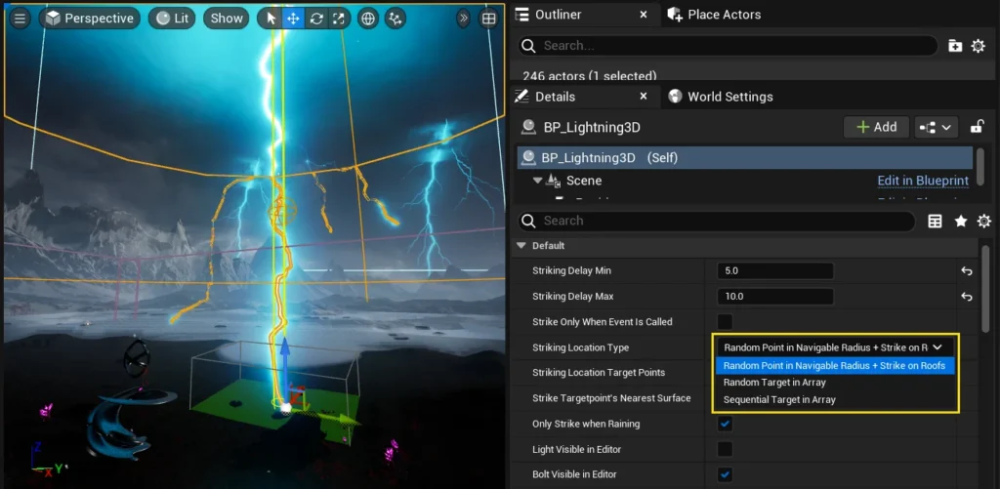

### **2.) Random Target in Array** / **Sequential Target in Array**

If you want to manually control where lightning strikes in your level, you will want to use one of these two settings:  
  
**1.) Random Target in Array:** Randomly strikes at a location specified by targetpoints listed in the ****Striking Location Target Points**** array  
**2.) Sequential Target in Array:** Strike the locations specified by targetpoints listed in the ****Striking Location Target Points**** array, in order from first to last.

_**IMPORANT NOTE:** If there are no **Target Points** set in the ****Striking Location Target Points**** array, lightning will only strike in the location of the **BP_Lightning3D** Blueprint!_

To use this method, begin by adding some target points into the level, and position them where you would like lightning to strike.

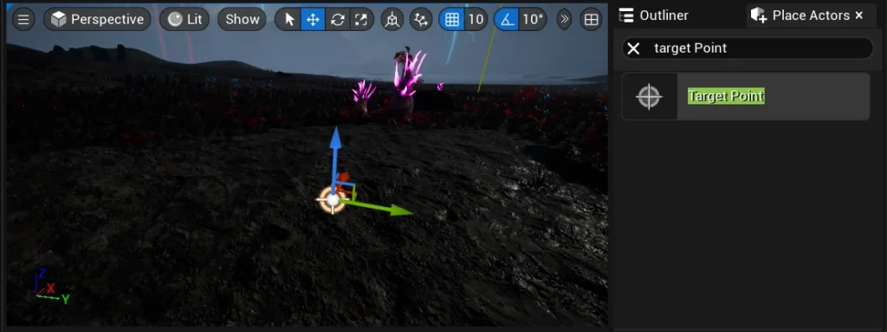

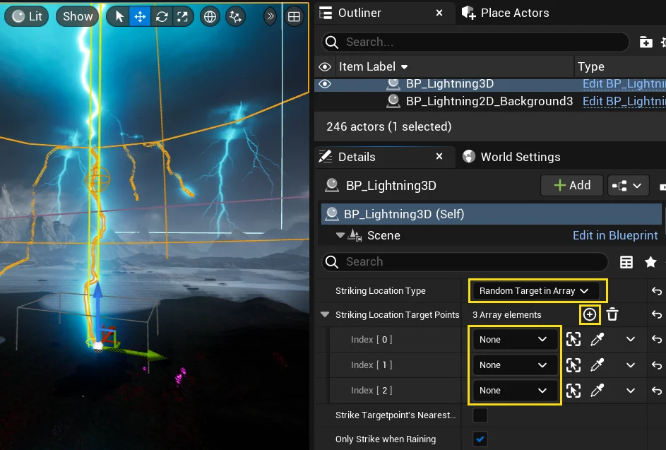

Now, select your **BP_Lightning3D** Actor.  
  
In the details panel, select the **Striking Location Type** as either **Random Target in Array** or **Sequential Target in Array**.  
  
Next, Expand the **Striking Location Target Points** array by clicking on the **+** icon.  
Expand it to the number of target points that you placed in the level.  
  

Then reference the target points that you placed in the level.

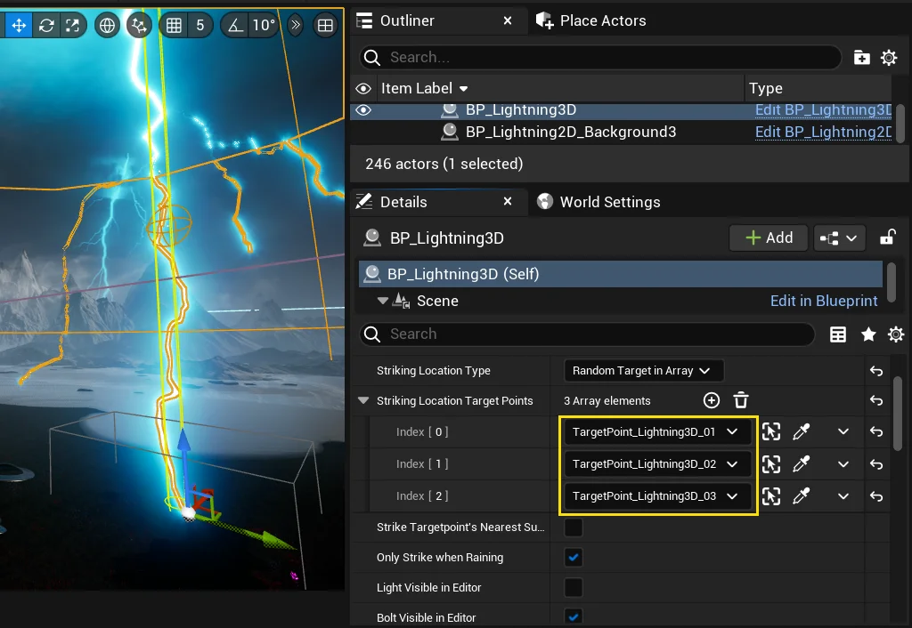

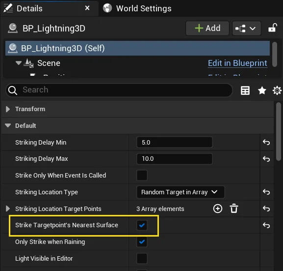

Finally, the **Strike Targetpoint’s Nearest Surface** checkbox lets you decide whether the lightning should perform a collision trace.  
  
If enabled, the lightning will attempt to find a surface below the targetpoint (within 1000 units) and strike if a collision is detected.

## Timing & Activation

Lets expand on the settings that control when your lighting should strike.

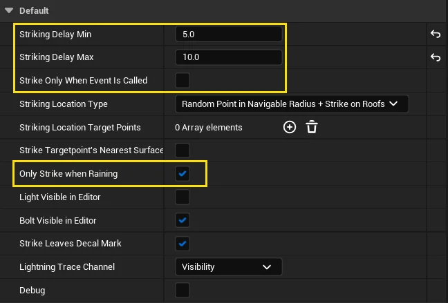

**Striking Delay Min** and **Striking Delay** **Max** determine the time between lightning strikes. After each strike, a random delay within this range is applied before the next strike occurs.  
  
**Only Strike when Raining** prevents the lightning from striking when it is not raining. Rain is controlled by **BP_WeatherController**.  
  
**Strike Only When Event Is Called** is a checkbox that turns off randomly-timed automatic lightning strikes.  
If checked, lightning will only strike when **Event_Lightning_Strike** is called.

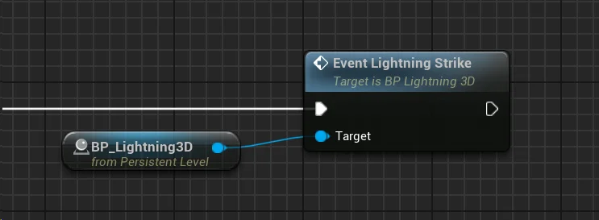

## Appearance & Color

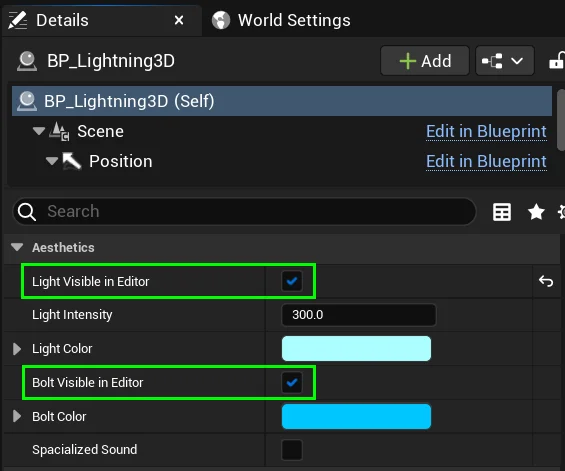

In the details panel, if you scroll down to the section titled **Aesthetics**, you will find a range of variables adjusting the intensity and color of your lightning.  
  
However, before you modify the light or the lightning, you’ll want to ensure that you can see them in the editor.  
  
Tick the **Light Visible in Editor** while editing the **Light Intensity** and **Light Color**.  
  
Tick the **Bolt Visible in Editor** while editing the **Bolt Color**.  

**Spacialized Sound –** If this is checked, the sound will be spacialized, meaning that your left and right hearing channels will hear it in 3D. If you want your game to be realistic, leave this disabled _(as lighting that strikes very close to you is so loud you wouldn’t normally be able to hear its direction)._

## Particles / Sparks

If you scroll down to the section titled **Particle Sparks**, you will evertything you need to customise the particles that activate when lightning hits a surface.

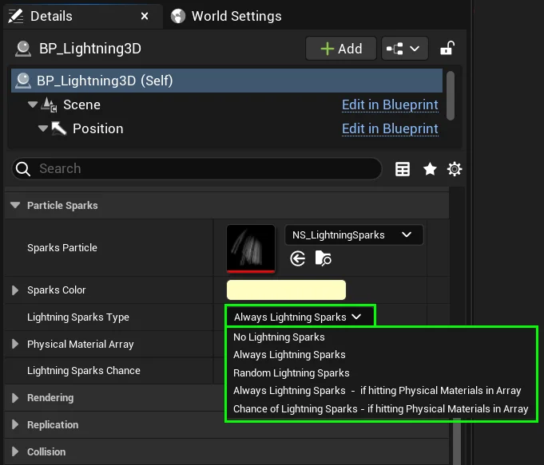

You’ll first want to choose the Sparks Type.  
Your selection will determine when lightning sparks activate.

- **No Lightning Sparks**
- **Always Lightning Sparks**
- **Random Lightning Sparks**  
    
- **Always Lightning Sparks – if hitting Physical Materials in Array**
- **Chance of Lightning Sparks – if hitting Physical Materials in Array**  
    

- Will never spawn lightning sparks.
- Will spawn lightning sparks every strike, regardless of what physical material it hits.
- Will spawn lightning sparks randomly, regardless of what physical material it hits.  
    Set the **Sparks Spawn Chance** variable to control the frequency.
- Will spawn lightning sparks every strike – but only if it hits an object with one of the physical materials listed in the **Physical Material Array**.
- Will roll a Chance to spawn lightning – but only if it hits an object with one of the physical materials listed in the **Physical Material Array**.  
    Set the **Sparks Spawn Chance** variable to control the frequency.

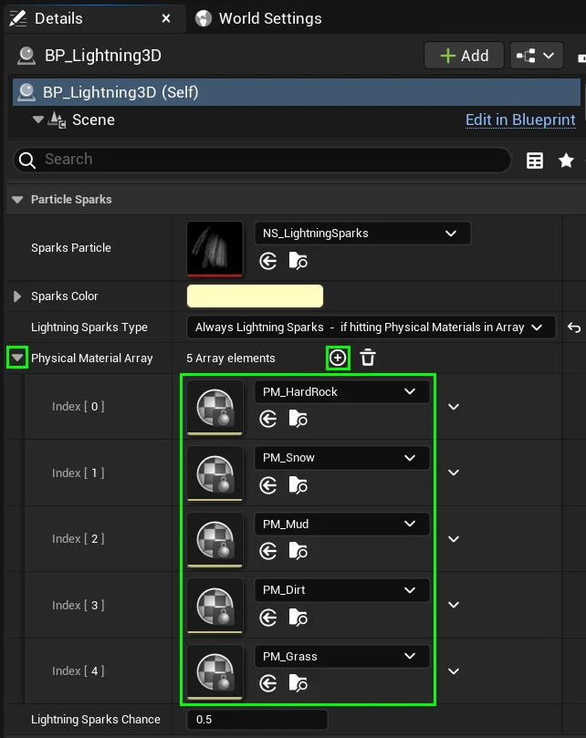

If you chosen **Lightning Sparks Type** mentions Physical Materials, this means we must add some to the **Physical Materials Array**!  
  
This ensures that sparks will activate whenever the lightning strikes one of these physical materials found in this array.

Feel free to swap out the Sparks Particle for a different one, adjust the Sparks Color, and modify the Sparks Chance to your liking!

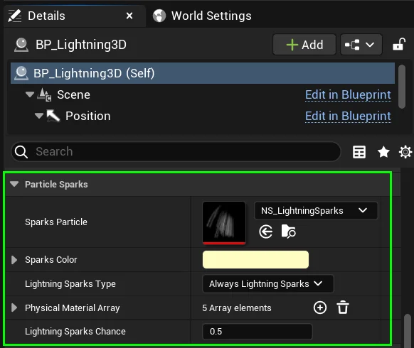

_Note: If you want to replace the Sparks Particle while retaining the functionality of editing the **Sparks Color**, you’ll just need to make sure that you create User Exposed Niagara Color Variable called **SparksColor** – and plug this into your particle color and particle material. See **NS_LightningSparks** and **M_LightningSparks** for reference._

## Damage

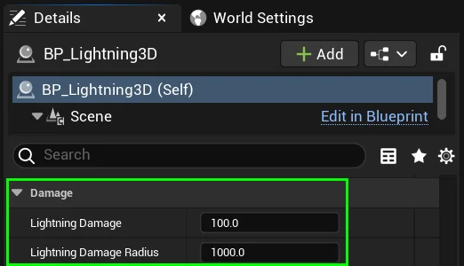

The lightning has the option to cause damage where it strikes.  
  
This Damage has a linear falloff.  
  
Feel free to adjust the damage intensity or radius.  
If you do not want it to damage anything, set the **Lightning Damage** to 0.  
  
This will disable any functions associated with damage.

---

# Parallax Occlusion Landscape Shadows

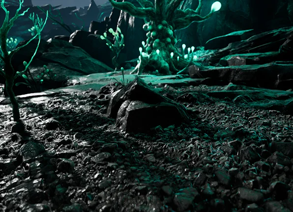

Both **2D Background Lighting** and **3D Foreground Lightning** integrate in a way that allows you to cast shadows on any Parallax Occlusion Mapped material.  
  
This is especially useful for adding realism to any landscape materials that use Parallax Occlusion Mapping _(POM)_.

## Lightning P.O.M Shadows

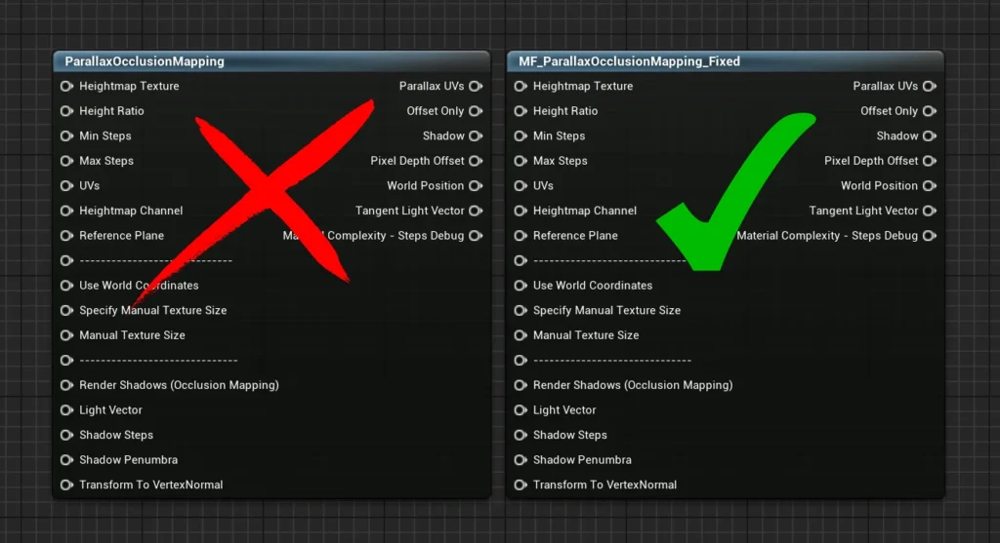

Unreal’s Parallax Occulsion Mapping node doesnt work with shadows, and the Administrators are too lazy to fix it.  
  
However, we developed a fix which you can implement into your own materials.  
  
So the first step in getting Shadows working is to replace your **ParallaxOcclusionMapping** node with **MF_ParallaxOcclusionMapping_Fixed**

You can find this in **Content / AlienPhysicsWorld / Materials / MaterialFunctions**

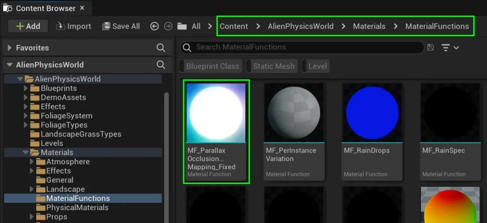

Next, you will need to apply these material nodes to your POM function to enable shadow casting from your lightning blueprints.

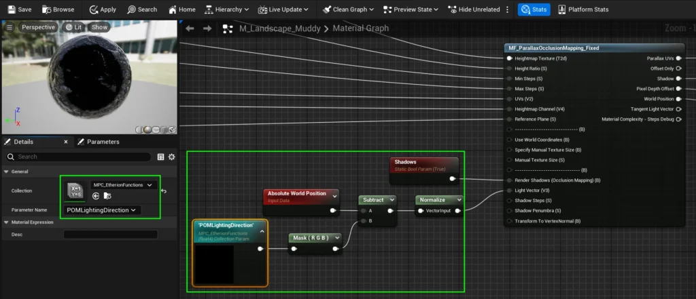

## Sunlight P.O.M Shadows

Beyond lightning strikes, you can also set the light direction of your parallax occlusion shadows using **BP_POMLightingDirection**.  
It is located at **Content / AlienPhysicsWorld / Blueprints / Atmosphere**  
  
Drag this blueprint to the far horizon in the direction of your sunlight, and when you play the game, it will cause the POM shader to cast shadows from that direction.  
You may also adjust the shadow intensity from the blueprint’s details panel as seen in the image below:

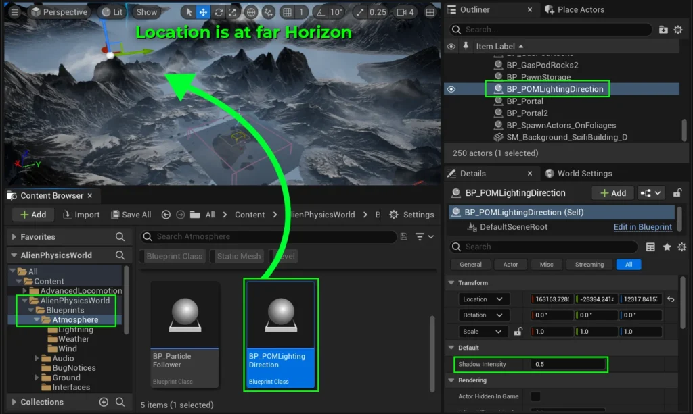