# Grass & Landscape Effects - PRO
If you have the Pro Version, you’ll notice one of the coolest features is the ability to leave grass and mud trails behind your player or any object.  
If you want to add these effects to your own foliage, landscapes, and characters, this guide is for you!

---

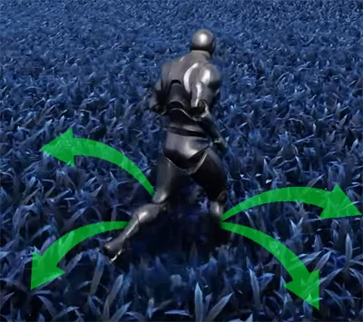

## **Rotating Grass out from Player** 

First, let’s make your custom grass rotate out from your player. Here’s how:

1. Open your player blueprint.
2. Navigate to **Content / AlienPhysicsWorld / Blueprints / Ground**.  
    Add **BP_PlayerLocationTracker** to your character mesh, ensuring that it moves with your player.
3. **Position the Tracker:**  
    The vertical location of the tracker component isn’t important, but it should be centered with your character.

As long as the player remains on the ground, this blueprint reads the player’s world position into a material parameter collection called **MPC_EtherionFunctions**.  
If you’re using any Etherion Designs environment featuring the Etherion Foliage Plugin, grasses will now rotate away from the player!

### **Adding Grass Rotation to your Custom Materials** 

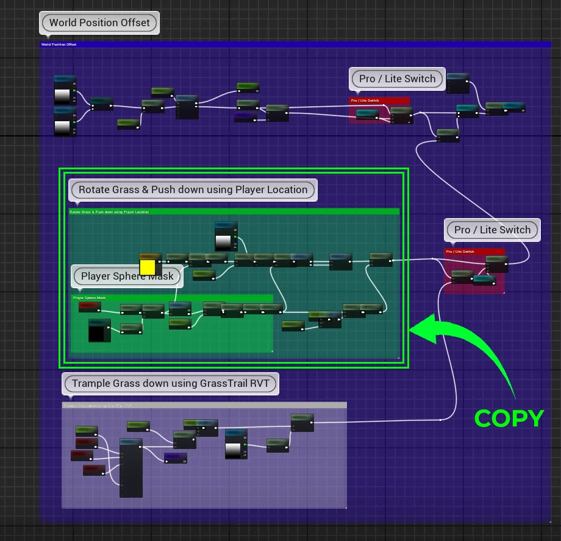

If you’d like to add this grass-rotation effect to your own grass materials, you’ll have to add some functions.  
  
Navigate to:  
**Content / AlienPhysicsWorld / Materials / Props / Grass**  
  
Open **M_LongGrass**.  
  
Copy the nodes shown in the provided image, then paste them into your own grass material. Ensure they are connected to the **World Position Offset**.  
  
If your material already has World Position Offset functions, simply use the **Add** node to combine the grass-rotation effect with your existing functions.  
  
Lastly, you can fine-tune the intensity and radius of the rotation by adjusting the variables under the **Player Trample** category in your material instances.

---

## **Grass Trails Setup** 

The primary actor that is used to create grass trails is a blueprint called **BP_GrassTrailCapture**.  
It captures the **SceneCapture** post-processing layer into a **Render Target**, which feeds into the grass material and is used to cause grass displacement.

### Adding the Grass Trail Blueprint

Navigate to **Content / AlienPhysicsWorld / Blueprints / Ground / GrassTrails**.  
Add **BP_GrassTrailCapture** to your level, and position it at the world origin, roughly 2000 units below your landscape.

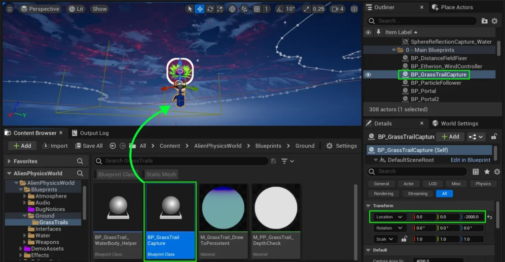

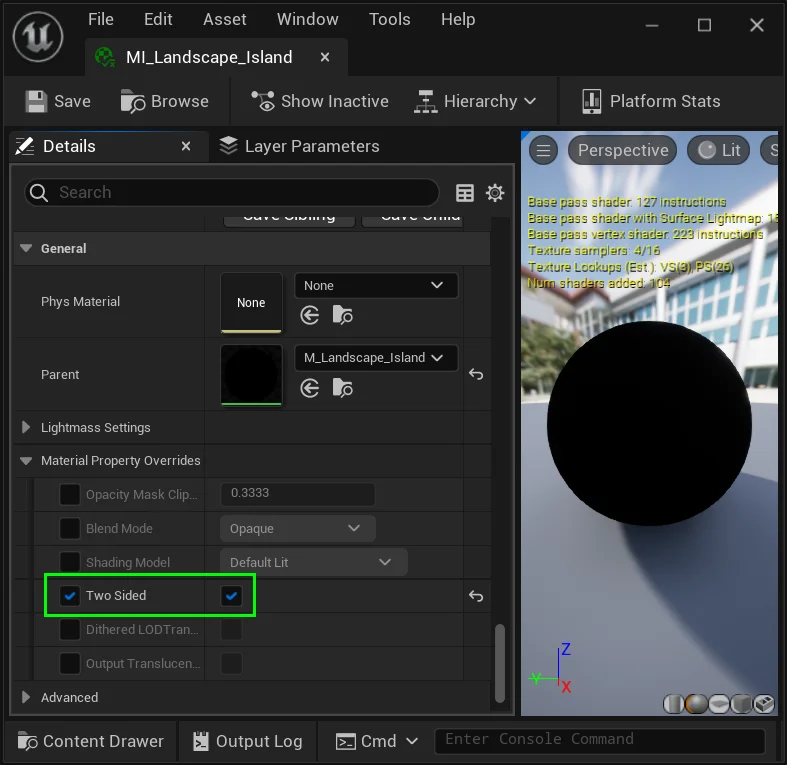

### Landscape Material

If your environment has a landscape, make sure that the **Two Sided** option is checked in your Landscape **Material** or **Material Instance**.

This is crucial because **BP_GrassTrailCapture** will be tracing from the back side of the material.

### Hiding Problematic Objects

Since **BP_GrassTrailCapture** uses **Scene Capture** to check the depth of objects relative to your player, some objects in your level might interfere with your grass trails.  
Objects that might cause issues may include but not be limited to:

- Static Meshes
- Skydomes
- Clouds,
- WaterMeshActors
- WaterZones
- and much more.

To stop these objects from affecting your grass-trail effect, select them, and check **“Hidden in Scene Capture”** in its details panel.  
The only object types must never be hidden in the scene capture, are **landscapes** and **water bodies**.

Note: _If you have issues with grass trails appear in some areas but not others, it’s likely because an object isn’t hidden in the scene capture and is interfering with the system.  
So always come back to this step if you encounter issues!_

### **Adding Custom Depth to Meshes**

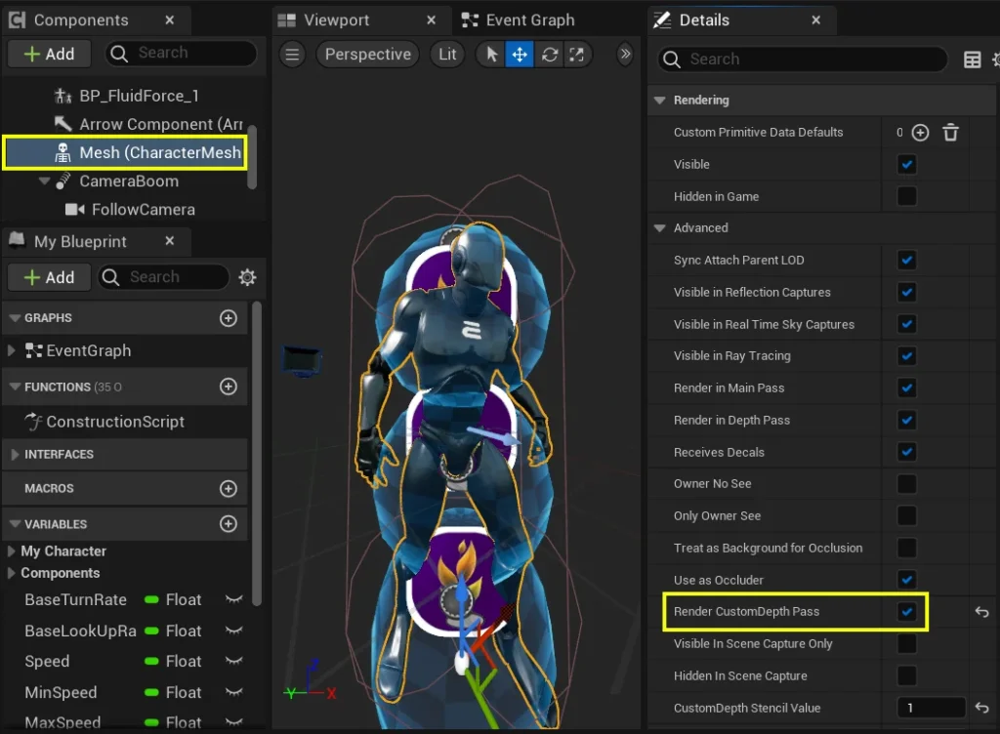

Meshes with **CustomDepth** enabled are visible to the render target, and will cause grass-trails to appear on any supported materials.  
So naturally, you’ll want to select any **character meshes** or **simulated objects** and go into their details panels, and check “**Render Custom Depth Pass**”.  
Do this for any meshes you want affecting grass trails regardless of whether they are inside blueprints, or just placed in your level.

---

## Water Plugin Compatibility {#water-plugin-compatibility}

The underwater fog post-processing material that comes with Unreal’s **Water Plugin** overrides the scenecapture that we use to create grass trails.  
It stops our system from working.

To fix this, we created a blueprint that automaticlly detects if the camera is above or below water.  
If the camera is above water, **disables Water post-processing** and **enables the Grass Trails** effect.  
If the camera is below water, it does the opposite.

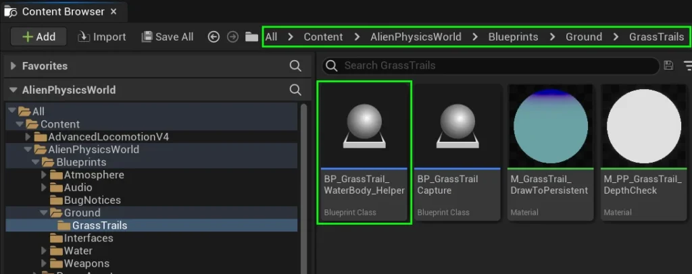

To apply our solution, navigate to  
**AlienPhysicsWorld / Blueprints / Ground / GrassTrails**  
  
Add **BP_GrassTrail_WaterBody_Helper** to your level.  
The fix should now apply to any of our Etherion Designs underwater postprocess materials.

#### Custom Underwater Postprocess Material

Waterbody postprocess materials must have our material function applied to allow the **BP_GrassTrail_WaterBody_Helper** to work correctly.  
So if you have a custom water postprocessing material, please open it.  
Then in the **content browser**, navigate to **Content / AlienPhysicsWorld / Materials / Water** **/ Underwater**

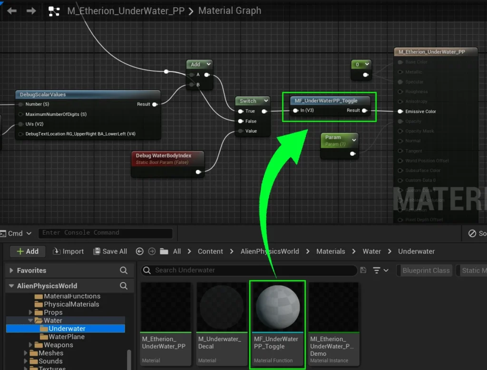

Drag **MF_UnderWaterPP_Toggle** from the content brownser into your custom postprocess material and connect it to the end of your nodes.

By default, our Etherion Designs materials and environments already have these fixes applied, so you’ll only need to do this with your own custom levels and materials.  
If you followed these steps correctly, your grass trails will work with the water plugin.

---

## **Applying Grass Trails to Custom Materials**

If you’d like to apply trails to your own custom grasses, you might want to copy the **World Position Offset** and **Glow** functions from our example material.  
Navigate to **Content / AlienPhysicsWorld / Materials / Props / Grass**.  
Open **M_LongGrass**.  
Copy and apply the following nodes and implement them into your custom grass material:

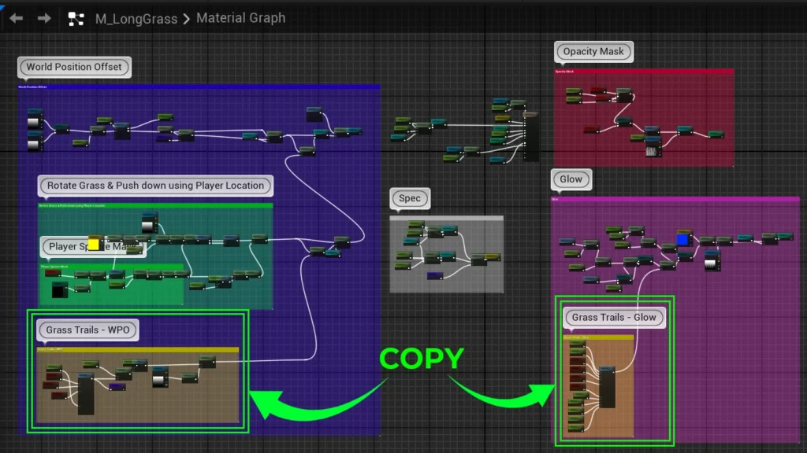

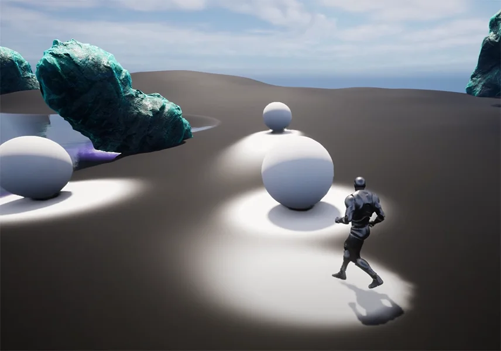

You’ll notice that the core material function used between both the **WPO** and the **Glow** function is **MF_GrassTrail**.  
  
This material function outputs the animated grass trail effect as a black and white texture.  
  
You can use this function to lerp between values or textures to create various effects.  
  
The LongGrass material uses it to create a glow effect and also tramples down the mesh with a vertex offset function.

  

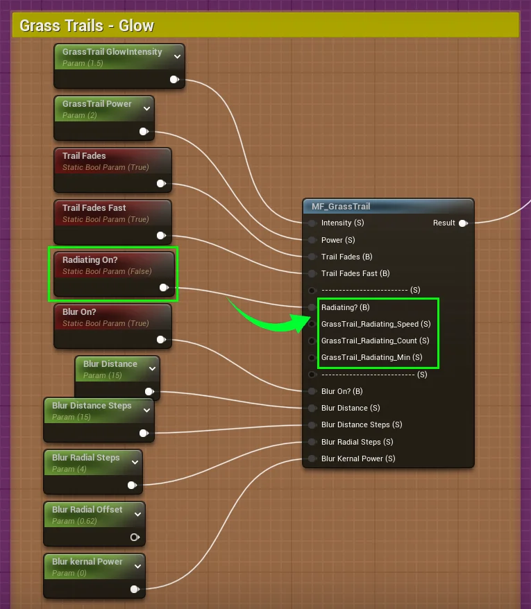

You might also notice that this material function has a few **Radiating** variables.  
  
Feel free to play around with these variables to create a number of interesting effects.

![[docs/assets/Documentation_GrassTrailEffects_BlackAndWhite_Bands.webp]]

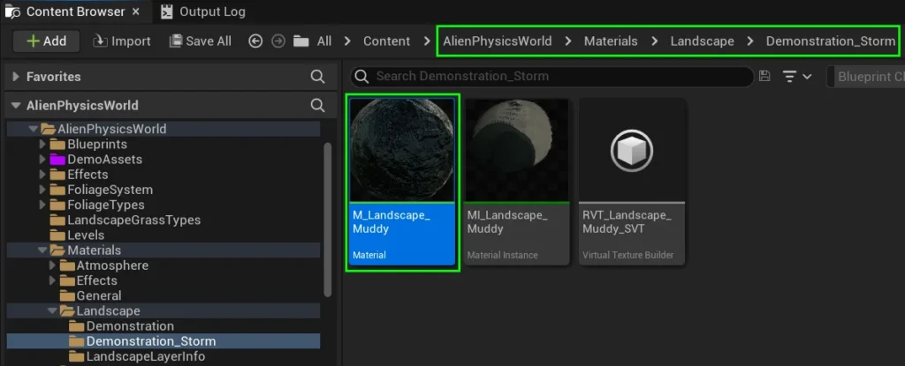

If you want to apply a trail effect to your landscape itself (Rather than the grass), you can also take a look at **M_Landscape_Muddy** for a reference.  
  
This can be a useful reference for implementing this effect into mud, sand and snow.

If done correctly, you should now have your player making shitloads of trails all over your environments!
