# Water & Fluid Simulation - PRO

The environment that comes with our plugin, and many others on our store, all use Unreal Engine’s native **Water Plugin**.  
In this tutorial, I will teach you how to get Unreal’s Waterbody Plugin set up with your custom environment, and how to implement the Etherion Designs assets into the waterbody.

---

# Water Setup

First, make sure the **Water Plugin** is activated.  
Open your **Plugins** directory (Edit > Plugins), and search for “**Water**“.  
Check that the **Water** plugin is ticked. Restart the engine when it asks you to do so.

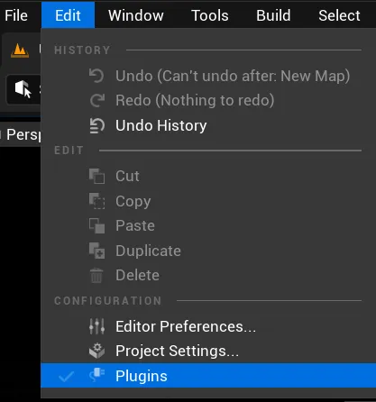

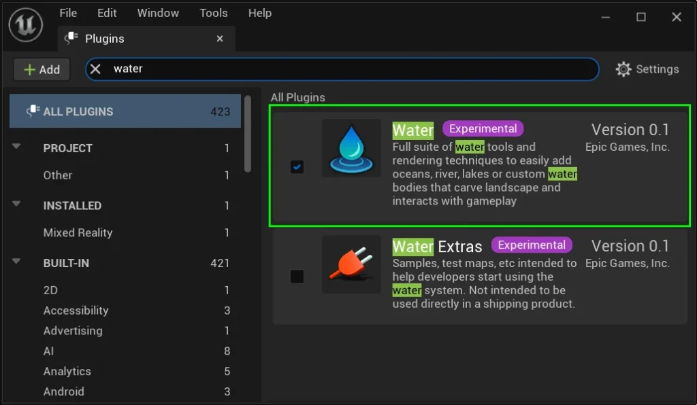

Next, add a waterbody to your level.  
You can find more information about the waterbody types from the **[official Unreal Engine Waterbody documentation](https://dev.epicgames.com/documentation/en-us/unreal-engine/water-body-actors-in-unreal-engine)**.

---

## Moving the Waterbody [Important]

If you plan on using Fluid Simulation with your waterbody, please note that it will not work unless your waterbody has its Z-Height set to a value of 0. If you have already designed your level with a waterbody in it, you will have to move the location of your entire level for the purpose of getting fluid simulation working.

There are two methods of doing this. The first is to create a reference plane at 0 height, and select everything in your level excluding this reference plane. Then, you can manually move everything in your level until your waterbody roughly matches the height of this reference plane. Note that the waterbody does not have to be exactly 0, but can still be around 10 units away from it while still retaining its functionality.

The second method is more useful if you have thousands of objects in your level with varying heirarchies.  
Naturally, a level this complicated would prove difficult to move manually. So this guide will explain how to do this with relative ease.

Before continuing with this method, please note that doing this will result in you transplanting all your level actors into a new level, which means your level blueprint will not be copied across with them.

First, select your waterbody and take note of the exact Z height. In this example, it is **-240**. We recommend pasting it somewhere such as a notepad app to store it for later.

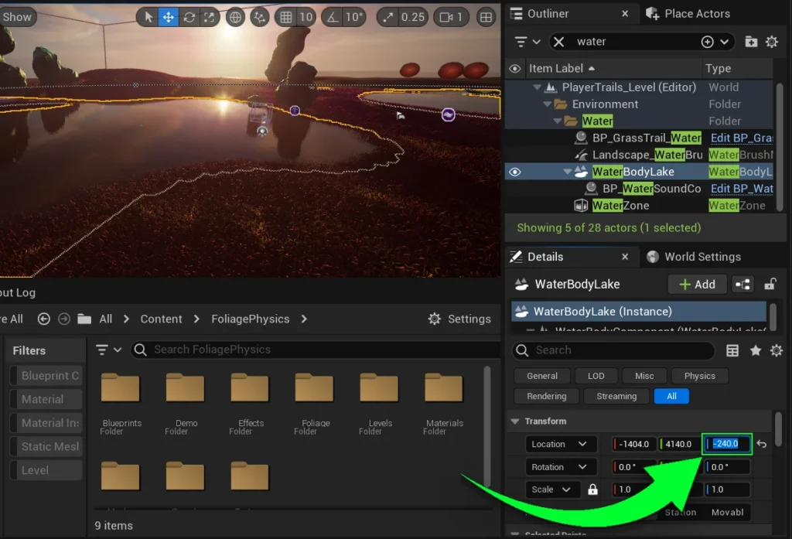

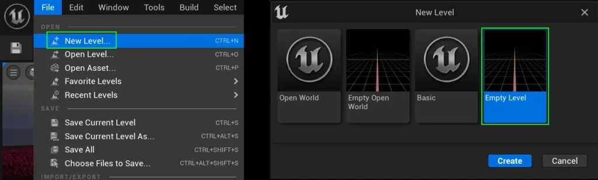

Create an empty level.

Then use the Levels tab to add the level you want to adjust the Z height of.

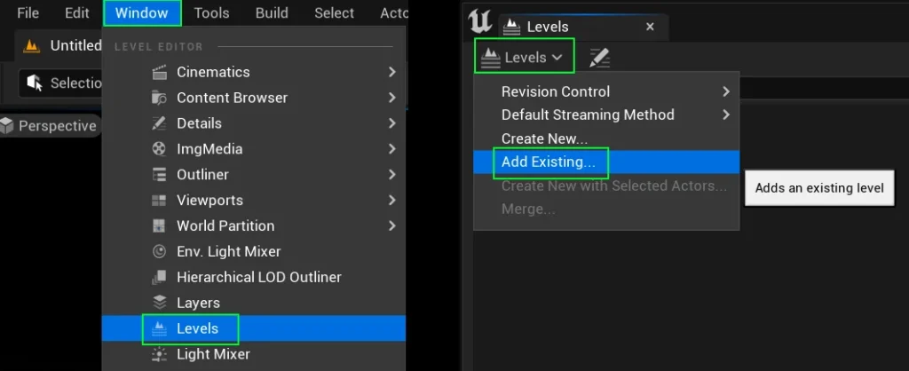

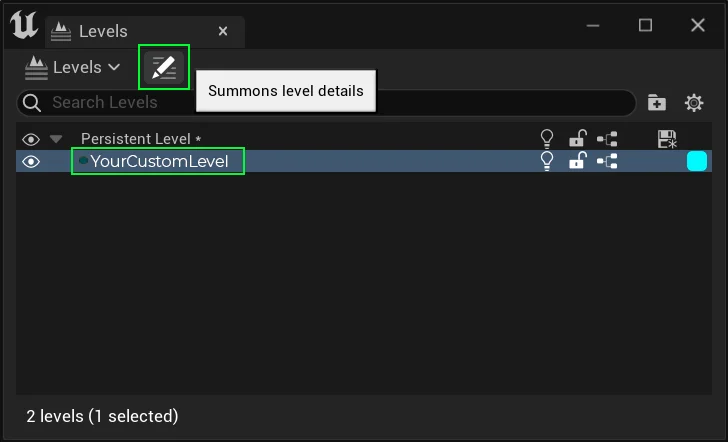

Select your level, then click the **Summon Level Details** button

Next, use the Z Position box to add the correct value so that the waterbody in your level has a Z height of 0.  
  
In this example, our previous waterbody z height was -240, so in order to get 0 we put 240 in this box.  
  
Confirm that the height is correct by selecting the waterbody and checking its Z position.

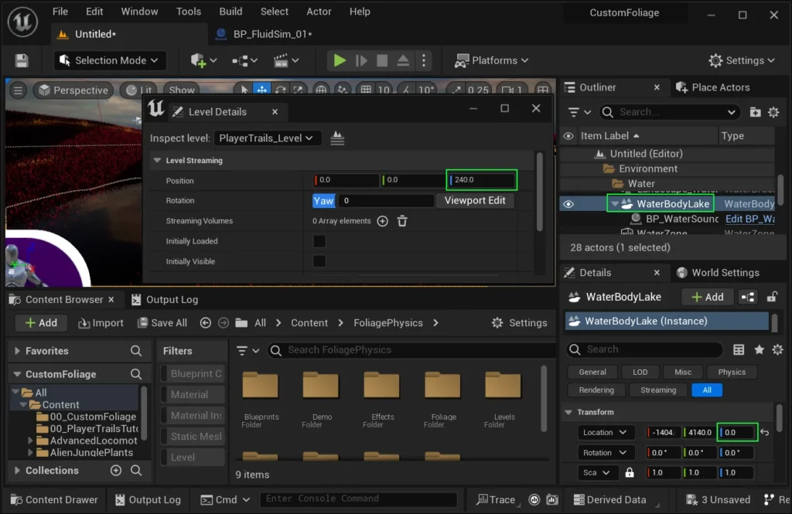

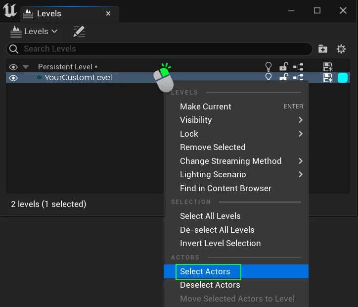

In the Levels tab, right click your level and click  
**Select Actors**

Right click **Persistent Level** and click  
**Move Selected Actors to Level**.  
  
Click “Yes” to any confirmation warnings.

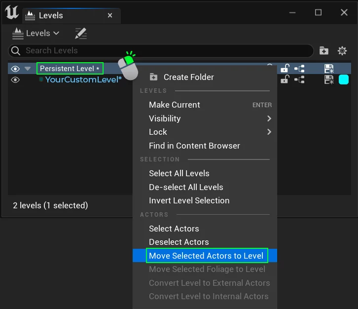

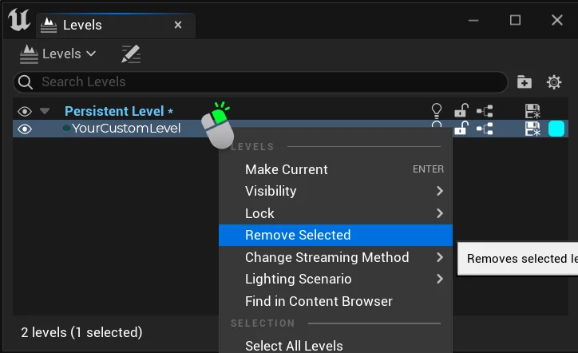

In the Levels tab, right click your original level and click  
**Remove Selected**

Save your level with a new name.  
Afterwards, you may open up the old level and copy over anything from the Level Blueprint that you wish to keep.

---

## Editing Wave Intensity

You can adjust the wave intensity, by selecting the waterbody and modifying the W**ave Attenuation Water Depth** value.  
  
Increase it by a large value to eliminate waves entirely (_For example 100000_).

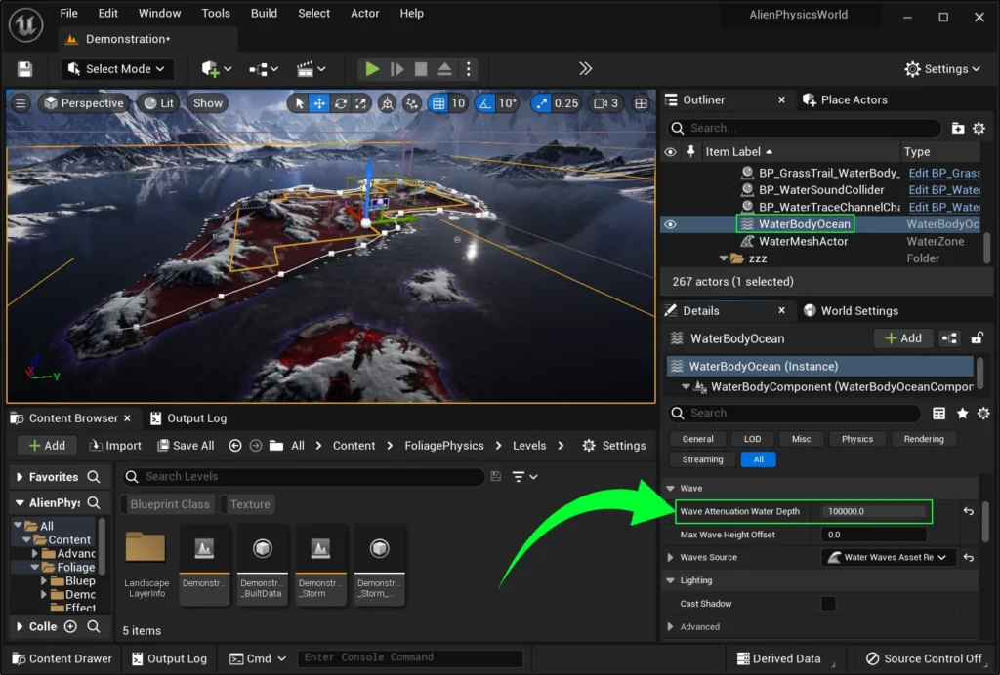

---

# Fluid Simulation Fix {#FluidSimFix}

## Our solution to an Unreal problem

Unreal’s native fluid simulation is a fantastic tool for adding realism to your levels, but it comes with serious limitations.  
There’s a hard-coded limit of 6 fluid simulation actors per level and 3 per blueprint.  
If you have more than 6 in your level, Unreal will randomly choose which simulations work, leading to unpredictable results.  
**NOT GOOD ENOUGH!**

That’s why we’ve developed an **enhanced version** of Epic’s fluid simulation blueprint just for you!  
Our version dynamically **activates the nearest 6 fluid simulations** during gameplay, while **disabling the rest**.  
This clever solution creates the illusion that more than 6 simulations are active at once.

Additionally, we’ve improved the way fluid impulses are triggered for explosions.  
Our blueprint **prioritizes impulse-based fluid-simulations** for the split second needed to apply its force.  
Our method works with the default Waterbody Material, and any Etherion Designs waterbody materials.  
Ready to enjoy a more powerful and flexible fluid simulation experience in your Unreal projects? Lets dive right in!

## Fluid Sim Level Setup

Before we begin, we need to make sure you can see the necessary actors in the Content Browser.  
  
Ensure your content browser’s view options have **Show Engine Content** and **Show Plugin Content** checked.  
  
This will make plugin folders visible in the content browser.

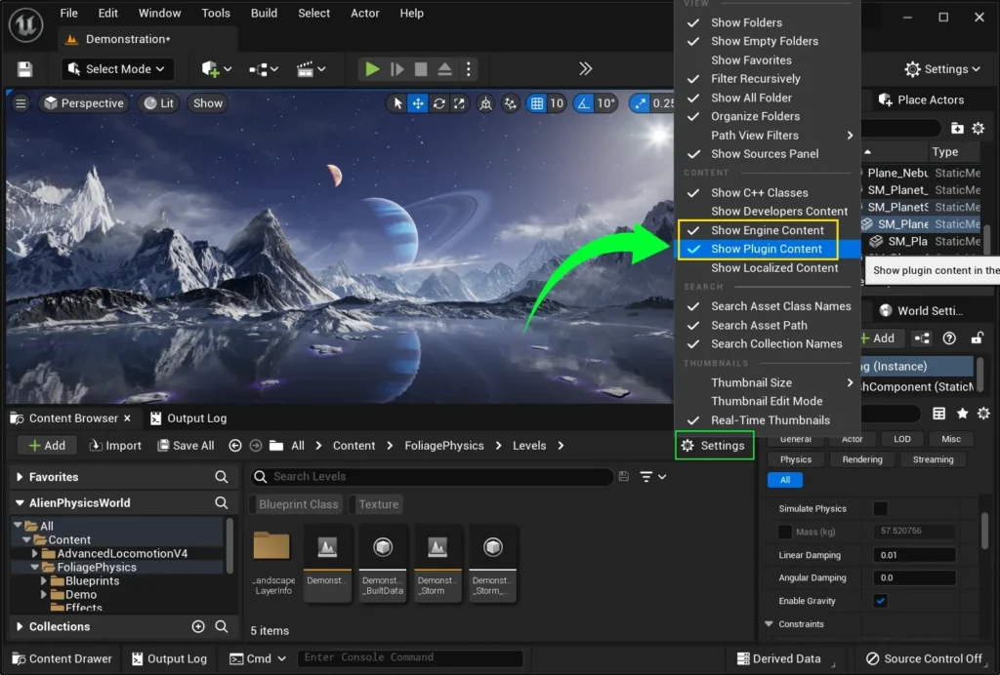

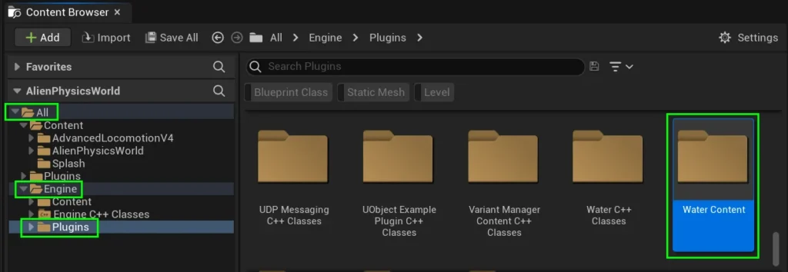

Next, we want to access the “**Fluid simulation folder**”.  
  
Do this by going to the **All** folder, which is is one directory above the **Content** folder.  
You should now be able to see and navigate to:  
**Engine / Plugins / Water Content**

Navigate to this directory:  
**All / Engine / Plugins / Water Content / Fluid Simulation / Blueprints**

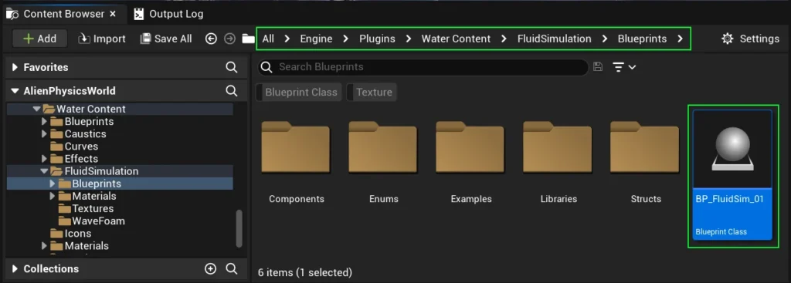

Drag **BP_FluidSim_01** into your level.

With this blueprint selected in the level, go to the **details panel** and ensure that “**Follow Player**” is checked.  
This blueprint acts as a grid for simulating fluid, which is then applied to the Water Material.

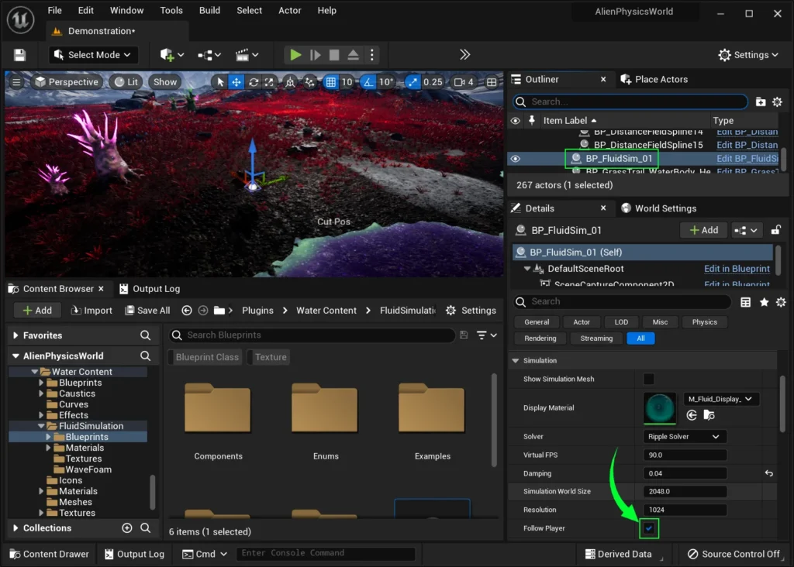

---

## Fluid Sim Player / Object Setup

Next, open **Content / FoliagePhysics / Blueprints / Environment / FluidSimHelper**.

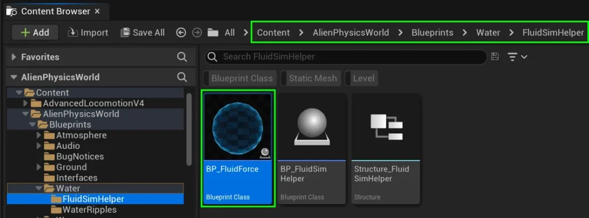

**BP_FluidForce** is the blueprint we designed which applies fluid force to **BP_FluidSim_01**, and therefore creates ripples on the waterbody.  
This blueprint can be attached to any item that you want to create ripples with the waterbody.  
  
For example purposes, we’ll nowshow you how to add it to your **Player Blueprint**.

Open your player blueprint, and drag in **BP_FluidSim_01**, attaching it to your **Capsule Component** or **root actor**.  
With **BP_FluidForce** selected, go to the the details panel and check the “**Show Mesh**” variable to ensure that you can see the fluid mesh.  
Duplicate it to create up to 3 copies, and move them to cover the total area of your player.

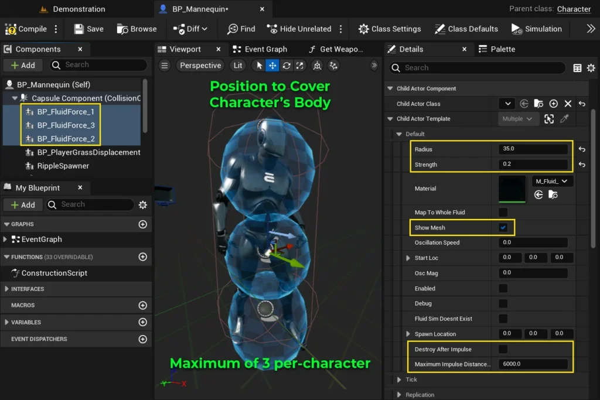

Adjust the **Radius** variable to scale the size of the fluid mesh.  
  
Adjust the **Strength** value to increase or decrease the ripple intensity on your water.

  
**Destroy After Impulse:**  
If this option is checked, the **BP_FluidForce** component will automatically destroy itself when Event_Impulse is called. This is particularly useful for scenarios like explosions. However, it’s less beneficial for characters or physics objects.

**The Maximum Impulse Distance**:  
This is the farthest distance from the camera at which an impulse can be triggered. For instance, if **BP_FluidForce** is more than 6000 units away from the camera, impulses will not be activated. This feature helps optimize performance by preventing impulse events, like explosions, from consuming resources when they occur far from the camera’s view.

## Fluid Sim – Triggering Impulses

Fluid Impulses are a great way to add realism to explosions that occur on your water surface.

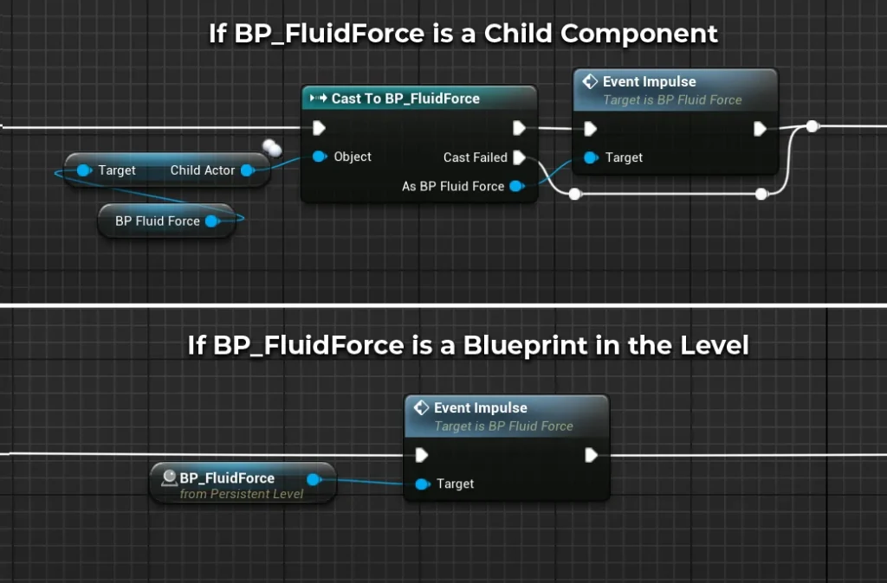

  
To trigger an Impulse, simply call **Event_Impulse** from your **BP_FluidForce**.

This will prioritize this fluid force above the others, ensuring it is enabled. The fluid force will then animate, moving rapidly downward for a split second before deactivating.

The effect is none other than a ripple splash!  
And a very performant one at that!

---

# Improving Visuals

No doubt you’ll want to customize your water, add some stunning glow effects, and eliminate any annoying visual issues.  
This guide is here to help you do just that!

## Applying Water Materials

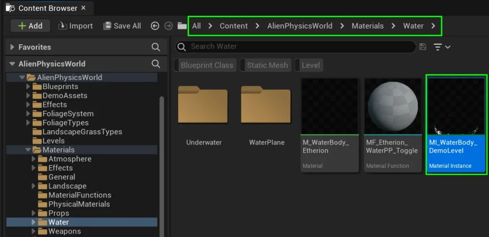

If you want to make use of our water materials,  
simply use the Content Browser to navigate to  
**Content / AlienPhysicsWorld / Materials / Water**  
  
Here you will find:  
**MI_WaterBody_DemoLevel  
M_WaterBody_Etherion**  
  
And inside the “Underwater” Folder, you will find:  
**M_Etherion_Underwater_PP  
MI_Etherion_UnderWater_PP_Demo**

You can use these materials as a template for your own.  
  
Duplicate **MI_WaterBody_DemoLevel**  and  **MI_Etherion_UnderWater_PP_Demo**  
  
Move them to your custom folder, and apply them to your waterbody.

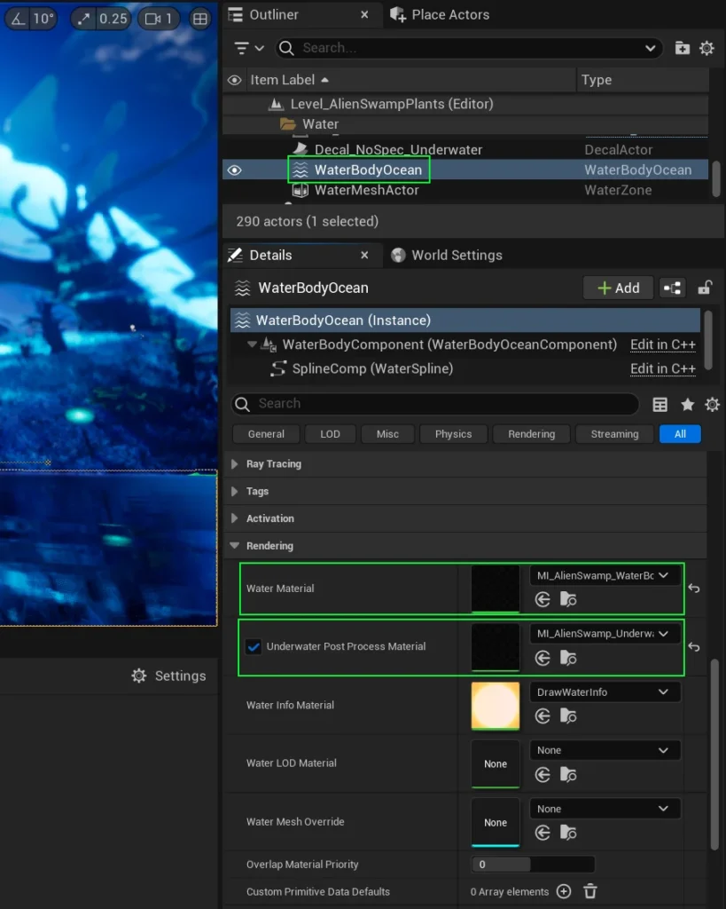

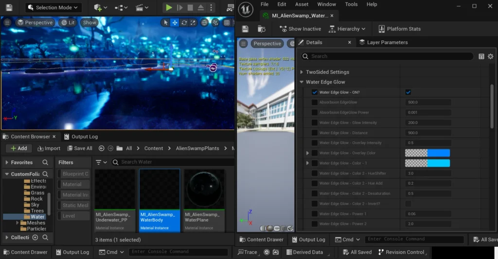

You can then edit these new material instances to your liking.

---

## Shoreline Glow Helper

If you are using **Grass Trails** or **Landscape Trails**, you’d need to disable distance fields on your landscape in order for those effects to function correctly.  
Because of this, the water material wont be detecting any distance fields from the landscape, and wont display any glowing edges around the shoreline.  
To get these glowing edges to appear, we created a blueprint tool called **BP_DistanceFieldSpline**.  
**BP_DistanceFieldSpline** procedurally generates cylinders along your custom spline path, which will cast distance fields without being visible to the player.

To use this tool, navigate to **Content / AlienPhysicsWorld / Blueprints / Water**  
Drag **BP_DistanceFieldSpline** into your level, and start using the spline tools to trace around the edges of your landscape where it meets the water.  
You can adjust the spacing and scale of the cylinder in the details panel.

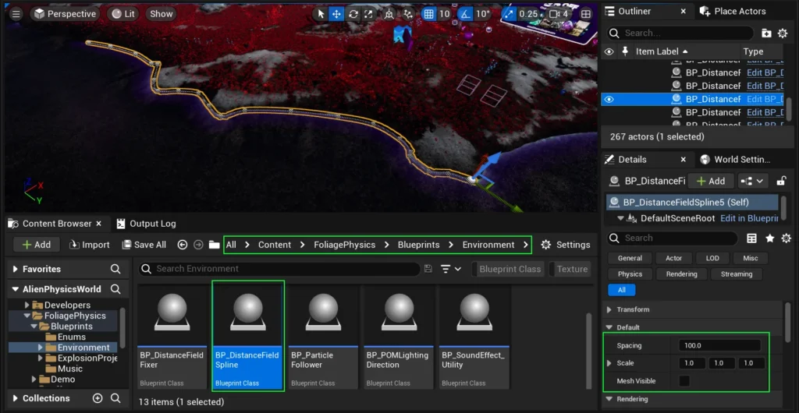

---

## Fixing Blocky Water Glow Issue {#WaterPixellation}

When Unreal engine upgraded form 4.27 to 5.0, they downgraded the appearance of their distance fields. They now look very pixelated and blocky, which affects the look of our water’s material edge glow.  This issue is noted on the Epic Games **[Official Bug List](https://issues.unrealengine.com/issue/UE-150397)**, and has yet to be fixed.

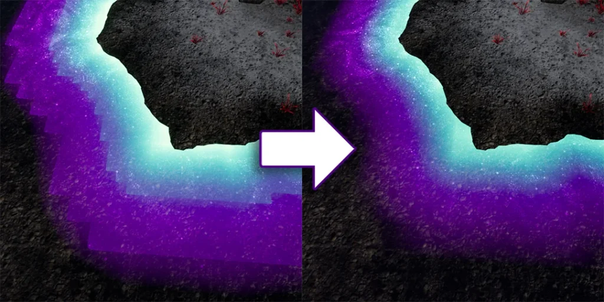

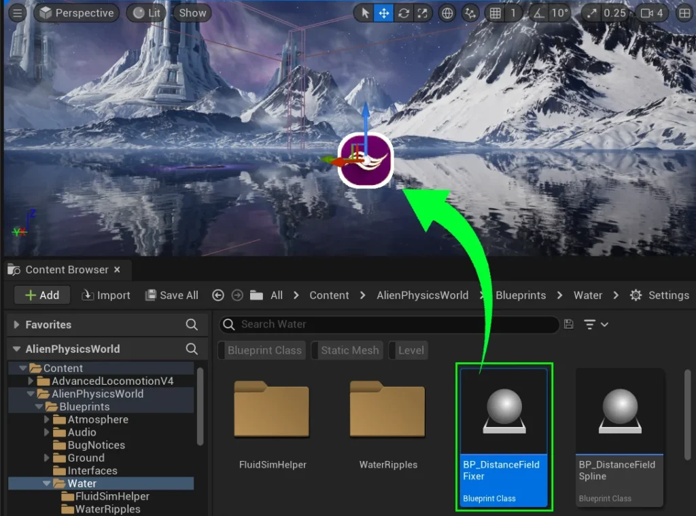

We developed a fix for this issue.  
Navigate to **Content / AlienPhysicsWorld / Blueprints / Water**  
Drag in **BP_DistanceFieldFixer** to your level.  
  
When you play your game, this blueprint will run some console commands which will smooth out distance fields and correct the issue.  
  
If you wish to undo this fix, simply delete **BP_DistanceFieldFixer** from your level and **restart** your project.  
  
_Note: We have not thoroughly tested the performane impact of this on lower-end machines._

---

## Water Material Guide

Feeling overwhelmed by the endless list of variables for your water material? This guide is for you.  
Please read below for a comprehensive explanation for each material variable and what it does.

### WaterBody Material

- **Water Roughness** – The roughness value of the water surface.
- **Detail Normal Settings** – This catagory of variables allows you to adjust the wave intensity, speed, size, etc..
- **Absorption** – defines how easily light penetrates the volume of water. Pay attention to the alpha value!
- **Scattering** – The amount of scattering affects how light travels through the medium, and that directly impacts the way things look when an object is within its volume. Pay attention to the alpha value!
- **Rain ON?** – This allows the **[[4 Environment Features/2 Weather System - PRO|Weather Blueprint]]** to fade in and out raindrops depending on whether it is raining. Disabling this for levels that do not contain rain will reduce shader complexity and improve performance slightly.
- **Water Edge Glow – ON?** – Enables distance field glow for the water surface.
- **Absorption EdgeGlow** – The amount of Absorption to multiply for the edge of the water.
- **Absorption Power** – Extends or shortens the edge mask for the Absorption EdgeGlow
- **Water Edge Glow – Glow Intensity** – How bright the edge glow will be.
- **Water Edge Glow – Glow Distance** – How far the edge glow will stretch out from the shore.
- **Water Edge Glow – Overlay Intensity** – adjusts the intensity of a color overlay that is applied to the water edge glow.
- **Water Edge Glow – Overlay Color** – Customize the color of the overlay that is applied to the water edge glow.
- **Water Edge Glow – Power 1** – Affects the contrast of the Edge Glow Mask.
- **Water Edge Glow – Power 2** – Affects the contrast of the Edge Glow Mask.
- **Water Edge Glow – Ambient Light – Distance** – This distance blends between the Edgeglow that has Noise applied to it, and the edge glow that does not have noise applied to it.
- **Water Edge Glow – Ambient Light – Intensity 1**– Adds an ambient light to the edge glow that is not affected by noise.
- **Water Edge Glow – Ambient Light – Power 1**– Adjusts the contrast / distance of the **Ambient Light Intensity 1**.
- **Water Edge Glow – Ambient Light – Intensity 2**– Adds an ambient light to the edge glow that is not affected by noise.
- **Water Edge Glow – Ambient Light – Power 2**– Adjusts the contrast / distance of the **Ambient Light Intensity 2**.
- **Water Edge Glow – Add – Intensity**– This value adds an overall glow to the entire waterbody.
- **Water Edge Glow – Add – Color**– This color is the glow that is applied to the entire waterbody.  
    It is multiplied by **_Water Edge Glow – Add – Intensity_**.
- **Ripples – Glow Intensity** – The intensity of glow caused by Fluid Simulated actors _(like the player)_.
- **Ripples – Glow Intensity** **Min** – This is the amount of glow that is not affected by noise, caused by Fluid Simulated Actors.
- **Ripples – Glow Color** – The color of the ripples caused by Fluid Simulated Actors.
- **Water Edge – Fixing White Issue – Intensity** – This value adds glow to the overalpping distance fields. If set to 1, it will be white.
- **Water Edge – Fixing White Issue – Power** – This affects the power of the glow applied to overlapping distance fields.

### Water Postprocess Material

- **Fog** – The thickness of underwater fog.
- **Absorption** – defines how easily light penetrates the volume of water. Pay attention to the alpha value!
- **Band Color** – Changes the color of the waterline that the camera sees when passing from above water to underwater.
- **Fog Ambient Color** – The Color of the Fog in unlit dark areas
- **Fog Scatter Color** – The Color of the Fog when light shines through it

---

# Grass Trails Compatibility

The Grass Trails system that we have designed utilises a postprocess layer called **Scene Capture**.  
Unfortunately, Unreal Engine’s underwater post-process materials override the **Scene Capture**, disabling the grass trails!  
To view how to fix this, please navigate to the Grass Trails documentation page:

**[[4 Environment Features/4 Grass & Landscape Effects - PRO#Water Plugin Compatibility|Grass Trails Compatibility]]**

---

# Packaging with Unreal 5.5 (Issue Solution)

Unreal 5.5 is quite new, and so it has a lot of undocumented issues.  
If you are using a waterbody, and it is not appearing in your packaged game, try the following:

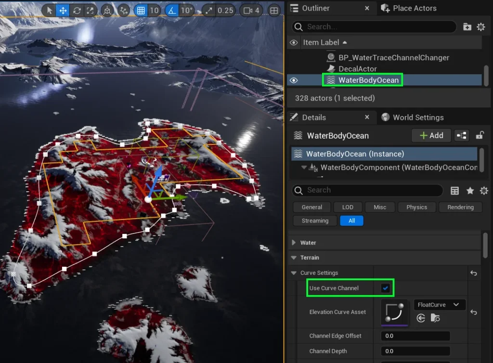

1. Open your level and select the waterbody
2. Toggle the “Use Curve Channel” checkbox.
3. Save the level.
4. Toggle the “Use Curve Channel” checkbox back to its original state.
5. Save the level.

Doing this for each level will reset the waterbody, and help fix the packaging issues. Good luck!

---

# 3rd Party Links & Related Content

[Unreal Engine Water Documentation](https://dev.epicgames.com/documentation/en-us/unreal-engine/water-system-in-unreal-engine)

[WaterBody Video Tutorial Series by NumenBrothers](https://youtube.com/playlist?list=PL8_QdDwbYqgR-ku_oUo_99D9UwZ0xiuyK&si=_MuaJ4fhhlQMtqlm)