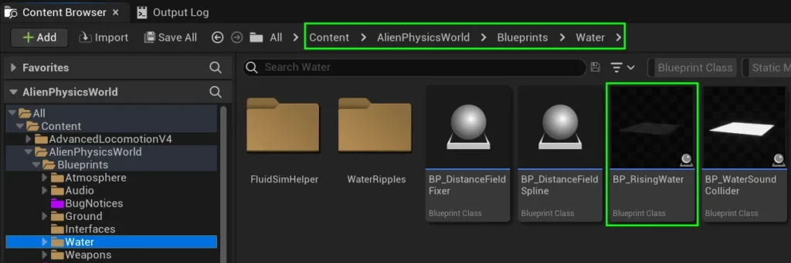
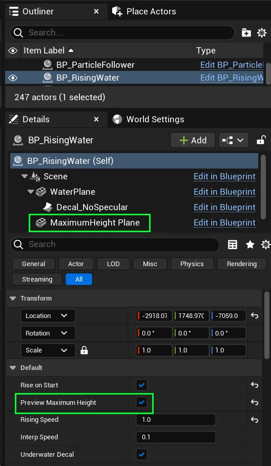
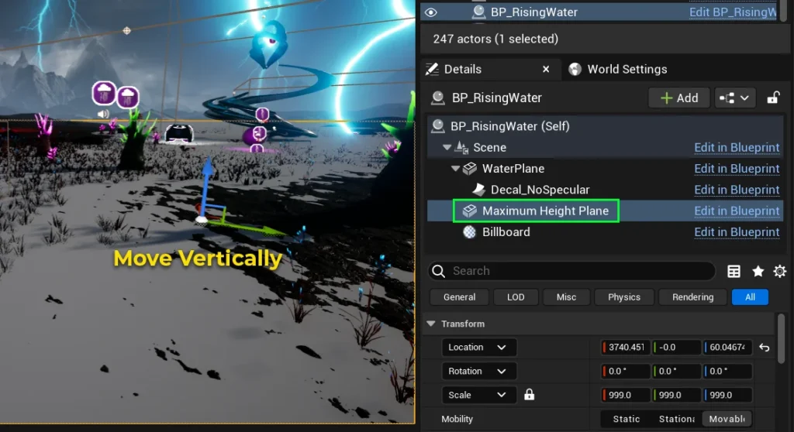
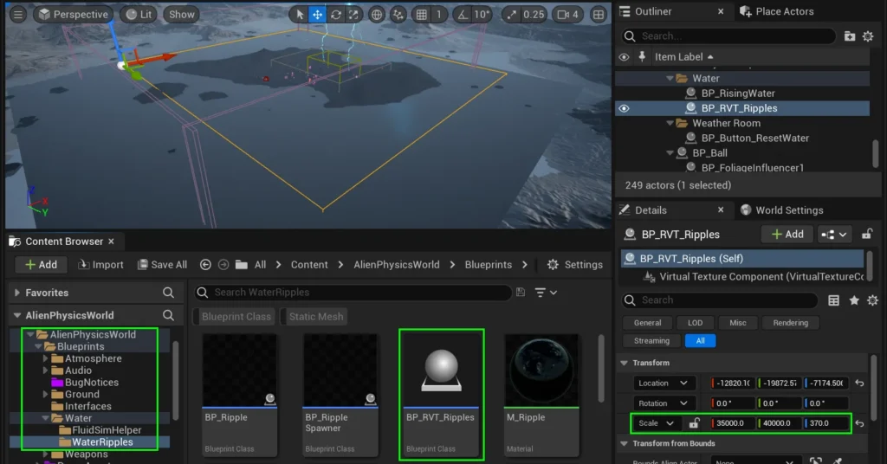
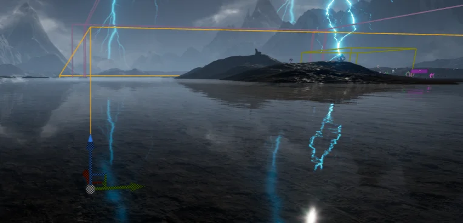
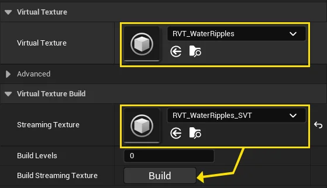
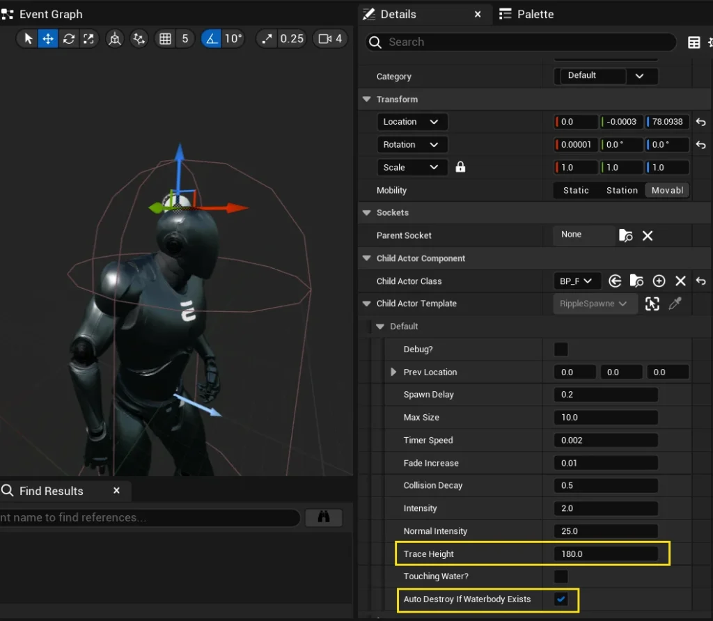
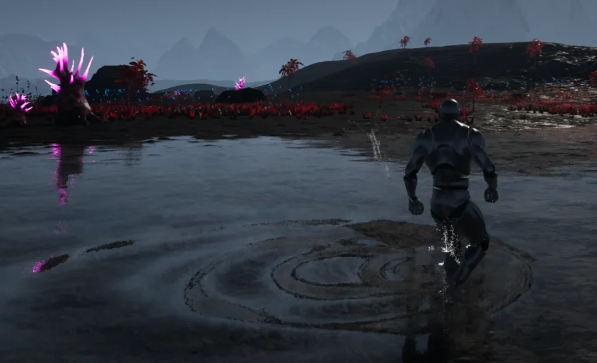
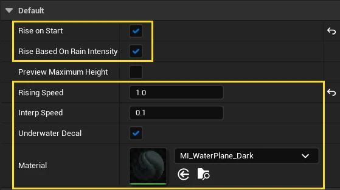

# Rising Water Blueprint - PRO

**Unreal Engine’s built-in water plugin struggles to simulate rising water levels.**  
While [community solutions](https://forums.unrealengine.com/t/water-plugin-movable-water-bodies/157949/10) exist, they often break with engine updates.  
To address this, we’ve developed a simpler system that reliably handles rising water, regardless of engine version.

Our approach sacrifices full water simulation, including waves.  
However, it still contains ripples and is suitable for most scenarios involving rising water levels.

---
  
**Note: Runtime Virtual Textures must be enabled for Ripples to work with this system**.  

---

# Adding the Rising Water Blueprint

Begin by dragging  
**BP_RisingWater** into your level.

It can be located at: **Content / AlienPhysicsWorld / Blueprints / Water**

Next, select the BP_RisingWater blueprint in your level.  
Go to the details panel and check **Preview Target Height**.  
This will make the **Maximum Height Plane** visible.

Select the **Maximum Height Plane** component, and move it vertically in the level, until it is at the highest point that you want the water to rise to.

When you are finished, uncheck  
**Preview Target Height**

---

# Adding Ripples – Level Setup

To add player and object-generated ripples, you will first need to add the Runtime Virtual Texture volume to the level.  
Navigate to **Content / AlienPhysicsWorld / Blueprints / Water / WaterRipples /**  
Drag **BP_RVT_Ripples** into your level, and modify its **position** and **scale** so that it overlaps the area that you want water ripples to apply to.

The placement of this blueprint should overlap the water,  
similarly to the image on the left.  
It’s vertical scale should cover the maximum height area that the water will rise to.

Please select the Blueprint in your level, and ensure that it has a **Virtual Texture** and a **Streaming Texture** assigned.

If there is no Streaming Texture, simply click the **Build** button just below it, and create one.

---

# Adding Ripples – Character Setup

To ensure that ripples are spawned by your character or any other object, you’ll need to ensure that **BP_RippleSpawner** is added to your **Character Blueprint**.

**BP_RippleSpawner** can be located at **Content / AlienPhysicsWorld / Blueprints / Water / WaterRipples /**

Place this blueprint at the top of your character.  

You can play around with different settings for Size, Strength, Fade Increase, etc.. However – the default settings are recommended.

The main two settings to be aware of are **Trace Height** and **Auto Destroy if Waterbody Exists**

**Trace Height** must be set to the height of the character, so that the ripples spawn when the feet touch the water.

**Auto Destroy if Waterbody Exists** is a checkbox that automatically destroys the **BP_RippleSpawner** actor if a Waterbody exists in the level. This is useful if you have multiple levels which have varying water solutions.  
Some levels may not have a Waterbody, in which case the **BP_RippleSpawner** might be used.  
While other levels may have a Waterbody and do not contain BP_RisingWater.  
If so, the actor should be auto-destroyed to save performance.

**Congrats!**  
Your ripples should now be working with **BP_RisingWater**

---

# Final Adjustments

There are a few other settings you may have noticed.  
I’ll explain what they do!

| Property                     | Description                                                                                                                                                |
| ---------------------------- | ---------------------------------------------------------------------------------------------------------------------------------------------------------- |
| Rise on Start                | If **TRUE**, it will animate the water immediately upon game start. If **FALSE**, it will require **Event Start** to be called before water begins rising. |
| Rise Based on Rain Intensity | If **TRUE**, it will rise according to rain intensity. If **FALSE**, it will rise regardless of rain.                                                      |
| Rising Speed                 | The speed at which the imaginary target-height will rise to.                                                                                               |
| Interp Speed                 | The speed at which the water plane will try and meet the imaginary target.                                                                                 |
| Underwater Decal             | If **TRUE**, a decal will span across the water plane and turn off specularity for anything underwater. If **FALSE**, this decal will be disabled.         |
| Material                     | The material to apply to the water plane.                                                                                                                  |