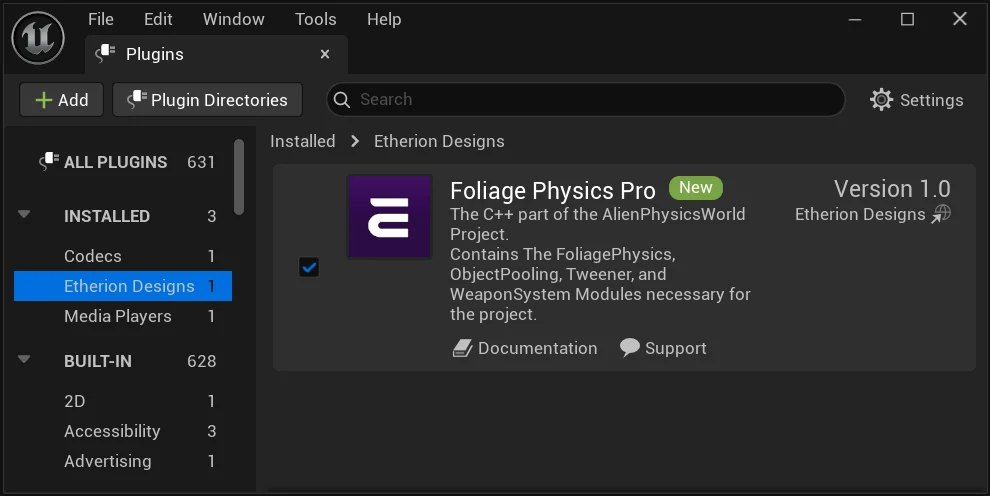

# FAB – Environment Installation

If you’ve purchased an environment from FAB that includes our Foliage Plugin, you may notice that upon opening it, its full of errors.  
Relax! This is totally normal. We had to move some folders in order to pass FAB’s submission guidelines for environments.  
Just follow these instructions and it’ll be fixed in not time!!

  <iframe 
    src="https://player.vimeo.com/video/1107343955?badge=0&amp;autopause=0&amp;player_id=0&amp;app_id=58479" 
    frameborder="0" 
    allow="autoplay; fullscreen; picture-in-picture; clipboard-write; encrypted-media; web-share" 
    style="position: absolute; top: 0; left: 0; width: 100%; height: 100%;" 
    title="FAB Installation Tutorial">
  </iframe>

# Written Instructions

First, open your Environment folder, and then right click **0_MoveToProjectFolder**
Click **Show in Explorer**
![[Documentation_FABEnvironment_01_ShowInExplorer.webp]]

Next, close your project as we will be moving some folders.  
Your PC won’t allow you to move them unless your project is closed.
![[Documentation_FABEnvironment_02_CloseProject.webp]]

Select both folders, and cut them.
![[Documentation_FABEnvironment_03_Cut.webp]]

Navigate to your **Project’s root folder**.  
(Note: this is **not inside the Content folder**. Its one layer above)
Paste the folders here.
![[Documentation_FABEnvironment_04_Paste.webp]]

**The next step requires you to re-open your project.  
But when you do this, you may be prompted to rebuild the plugin modules.**  
**  
Please Note: This can only be done on a C++ Project not a blueprint project.  
If your project is a blueprint project, please create a new C++ project using the same engine version.**  
**Cut your ‘Plugins’ folder into your new C++ Project directory, and open the C++ Project.**  
**When prompted, please rebuild the modules .**  
**Once the build is complete, please cut the ‘Plugins’ folder back into your Blueprint folder and open the project.**

Next, open the **Plugins** editor, and ensure the **Etherion Foliage Plugin** is enabled.
![[Documentation_FABEnvironment_05_EditPlugins.webp]]

Restart your project if required

All done! Now your environment should be functioning correctly, without any material referencing issues – and it should also now work with the Etherion Foliage Plugin!