# Object Pooling {#advanced-object-pooling}
# Overview

Object Pooling is a system that reuses objects instead of constantly spawning and destroying them when the game needs those objects.  
It maintains a pool of reaty-to-use assets by borrowng and returning them from a memory ‘pool’ as the game requires them.  
  
Without object pooling, games encounter bad performance from frequent allocations and deallocations – especially when it comes to large numbers of dynamic objects appearing and dissapearing on-screen.

Examples of this might be rapid-fire weapons projectiles, explosions or particle effects, and… you guessed it… dynamic foliage!

Our object pooling system, called **ED Object Pooling**, is a lightweight, flexible object pooling framework that can optimize performance for a large variety of actors.  
It utilises a soft cap to keep an optimal number of objects in the pool, and a hard cap to prevent resource overuse.

This page will walk through the entire process, step by step, explaining how to work with Poolable Actors and what happens internally in the Object Pooling System when acquiring and returning poolable actors. We will cover the pooling system’s logic and how components/child actors, soft limits, and hard limits come into play.

_Note: This system is a **Pro only** feature.  
In the **Lite** version it will just create a new object each time user acquires an actor and destroys it when returned to the pool.  
Only the **[hard limit][hard-limit]** applies in the **Lite** version._

## Key Components

- **AEDPoolableActor**: The base class for all poolable actors in the system. It handles the initialization and uninitialization logic.
- **IEDPoolableChild**: An interface for poolable child components or actors, ensuring they follow the same initialization and uninitialization procedures as their parent actor.
- **UEDObjectPoolingStatics**: A set of utility functions available to interact with the pooling system in Blueprints or C++.

---

# Creating a Poolable Actor

## Create a Blueprint Class

In Unreal Engine, go to **Content Browser** > Right-click > **Blueprint Class**.

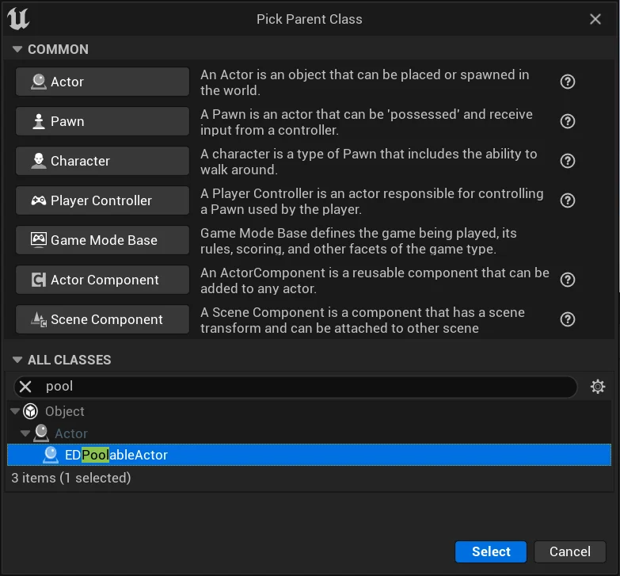

Select **EDPoolableActor** as the parent class.

Open the newly created actor and configure the limit values in the **Class Defaults** section

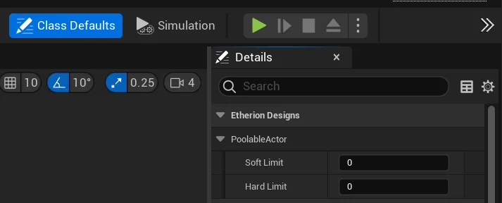

#### Soft Limit

The soft limit is the target number of objects in the pool.  
If more objects are needed, the pool can create them, but it will try to return to this limit over time.  
When the soft limit is exceeded, unused actors are destroyed gradually, one by one, across frames to avoid performance issues.  
This helps reduce memory usage without affecting gameplay.  
  
Think of the soft limit like hosting a party.  
If you expect a steady flow of guests, you keep extra chairs around so people aren’t left standing (a higher soft limit).  
But if it’s a smaller gathering of less people, you only keep a few extras nearby, knowing you can gradually remove them if the crowd thins out (a lower soft limit).

To disable the **Soft Limit**, set it to `0` in the poolable actor’s details panel.

#### Hard Limit {#hard-limit}

The hard limit is the maximum number of actors the system can pool, similar to setting a firm cap on how many guests can attend your party.  
Once this limit is reached, no new actors will be spawned by the system, and it will a return null/invalid actor on acquire, signaling that it cannot provide a new actor.  
This strict enforcement ensures that the pool does not grow beyond the allocated memory capacity, protecting the system from runaway resource consumption.  
  
The key is finding a balance where you’re not overwhelming the system but also avoiding unnecessary limits on how many objects can be spawned.

To disable the **Hard Limit** set it to `0` in the poolable actor’s details panel. (**Warning:** this can cause huge performance drops)

## Initialization Logic

In the Object Pooling System, proper initialization is key to making sure that actors (or objects) work well when they are reused multiple times.

The **EDPoolableActor** class includes events that help make sure an actor is ready to use when it’s taken from the pool and properly reset when it’s returned. This prevents issues like old data (such as position, state, or animations) from sticking around and causing bugs.  
_(These events are also implemented for **EDPoolableChild** for components or child actors.)_

If you’re using foliage actors, they handle this initialization process for you. However, if you add custom features or use object pooling for something else, you might need to add your own logic. To do that, you can use these events and add your code.

In object pooling, the **BeginPlay** event is only called once when the actor is first created. If you need initialization to happen every time the actor is reused, move that logic to the **Initialize** event. For cleanup, instead of using **Destroyed**, use the **UnInitialize** event, which is called every time the actor is returned to the pool.

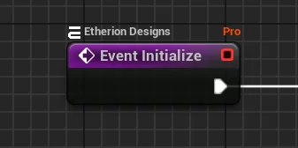

When you get an actor from the pool, you want to make sure it’s in a fresh, default state, with no leftover data or settings from the last time it was used. The **Initialize** event runs each time an actor is taken from the pool, resetting its properties and setting up any components, effects, or particle systems it needs. If you have custom logic in your blueprint, you’ll want to use this node to reset all your variables to their default state.  
_(For example, a countdown integer for a landmine should have its timer variable reset here)_

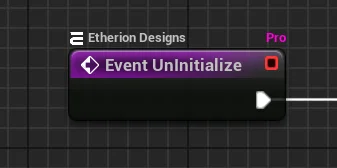

When an actor is no longer needed and returned to the pool, the **UnInitialize** event is called to help clean it up. This makes sure that no leftover effects, particle systems, or timers remain after the actor is done being used. It essentially “shuts down” the actor, getting it ready for the next time it’s needed.  
If you created custom logic in your blueprint, you’ll want to connect the shutdown processes of that logic to this node.

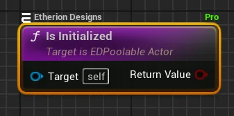

If you need to check whether a poolable actor is currently initialized within your Blueprint logic, use the **Is Initialized** node. This node returns **True** if the **Initialize** event has been called and the **UnInitialize** event hasn’t happened yet, meaning the actor is active and not in the pool. Keep in mind, if you use this node in the **Begin Play** event, it will return **False** because the actor hasn’t been initialized yet at that point.

---

# Child Actor / Component Blueprints

If your Blueprint Actor has **Components** or **Child Actors**, they also need to be reset when the actor is reused. You can handle their reset within the parent actor, but a better way is to implement the **EDPoolableChild** interface on each component or child actor. This lets each child handle its own reset, while staying in sync with the parent actor. This approach makes your code easier to understand and ensures that all child elements are properly reinitialized or cleaned up when the parent is taken from or returned to the pool.

You can Implement this interface in the **Class Settings** section of your actor / component blueprints.

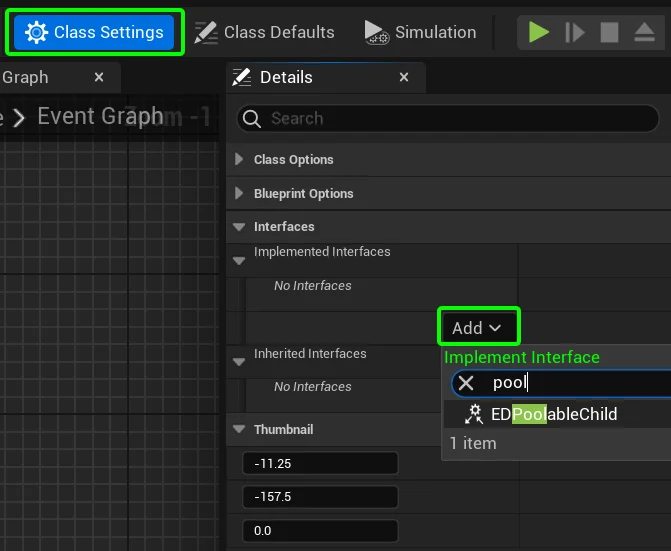

When the **Initialize** event is called on the parent actor, all its child actor / component blueprints that implement **EDPoolableChild** will also have their own **Initialize** and **UnInitialize** events called to reset their states.

You can implement these events in your **Child Actor / Component** blueprints by navigating to the **My Blueprint** tab. Expand the **INTERFACES** foldout and **right-click > Implement Event** to bring the event into the **Event Graph**.

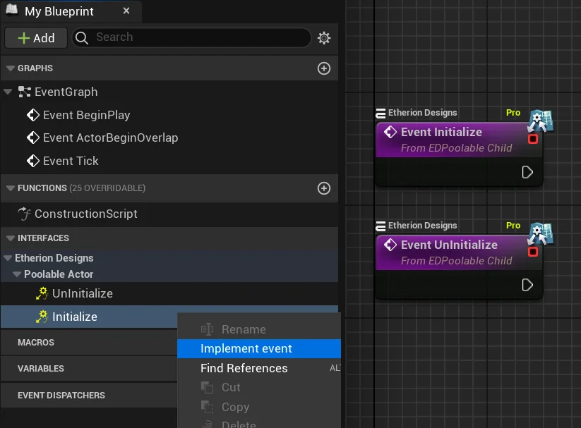

---

# Acquiring a Poolable Actor

When the game requests an actor, it is not always created from scratch.  
Instead, the Object Pooling System checks if the requested actor is available in the pool to reuse.  
If there isn’t one available and the pool allows it, the system will create a new one.  
What we mean when we say “**Aquire**” a poolable actor, is to get an actor out of the pool, or create one if there arent any in the pool. Remember this!

  
To acquire a poolable actor, use the **Acquire** nodes from the **ObjectPoolingStatics** blueprint function library, as seen below:

### Can Acquire a Poolable

You can check if the system can give you a poolable actor by the **Can Acquire Poolable Actor** node. It will return **True** if a poolable actor of the specified **Class** can be acquired and **False** otherwise.

The class drop down will only include actor classes that inherit from **EDPoolableActor**.

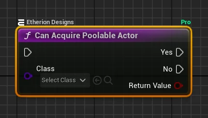

### Acquire a Poolable Actor

Use this node to acquire a poolable actor without changing any of its variables.  
If there’s an available actor in the pool, it will call the **Initialize** event and return that actor.

If no unused actors are available, are available and the limits allow, a new actor will be created. This process runs the **ConstructionScript** and **BeginPlay** before calling **Initialize** to make sure the actor is ready to use. However, if pool limits prevent new actors from being created, a null/invalid object will be returned instead.

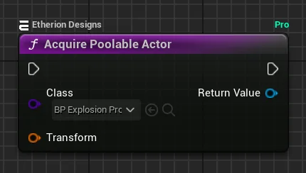

### **Acquire with Parameters**

If you use the above-mentioned **Acquire a Poolable Actor** node and then try to set its variables afterwards, it can cause problems.  
That’s because the **Initialize** event is called before the variables can be set, so it won’t get the right values.

To acquire a poolable actor, but also set its variables before the **Initialize** event is called, use the **Acquire a Poolable Actor And Set Parameters** node instead.  
  
If there aren’t any actors in the pool and the system created a new actor, the variables will be set even before the **ConstructionScript** and **BeginPlay** are called, ensuring the poolable actor’s events run with the correct variables.

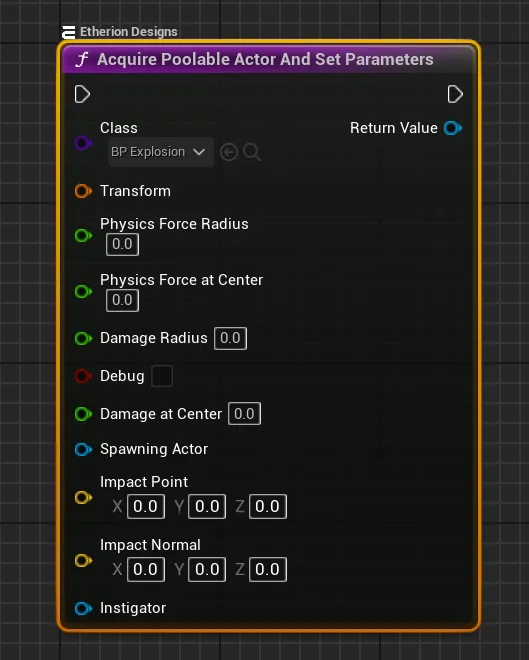

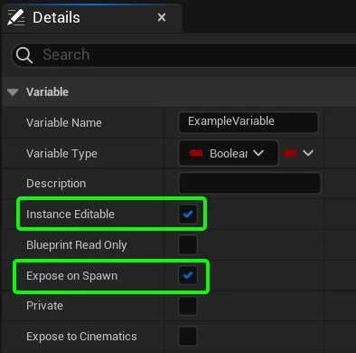

For a variable to show up on the **Acquire a Poolable Actor And Set Parameters** node, you need to make its variable public, by enabling the **Expose on Spawn** flag.

To do this, select your variable, go to the **Details** panel, and set both **Instance Editable** and **Expose on Spawn** to **True**.

If you don’t see the variable on the node, it’s because the **Expose on Spawn** flag is set to **False**.

### **Acquire Deferred**

Sometimes, you might need to do extra setup or run specific functions on a poolable actor before its Initialize event runs. Keep in mind that acquiring an actor also triggers the Construction and Begin Play events if the actor is being created from scratch, so this applies to those events too.

The **Acquire Poolable Actor Deferred** node lets you get an actor without turning it on right away, unlike the **Acquire Poolable Actor And Set Parameters** node. This gives you time to set its variables, make changes, or run special functions before it starts doing anything.

After you’re done, you must use the **Finish Acquiring Poolable Actor** node to turn it on and let it do its normal actions in the game. If you forget to do this, the actor won’t show up or work properly, and it might not respond when the player interacts with it.

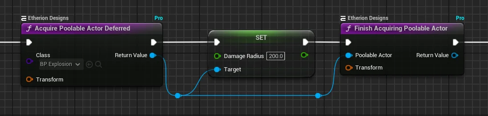

---

# Returning an Actor to the Pool

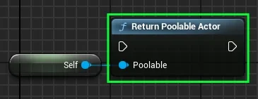

When an actor is done with its job and isn’t needed anymore, it should be returned to the pool instead of being destroyed.  
This helps manage resources better and gets the actor ready to be used again. To do this, use the **Return Poolable Actor** node.  
This triggers the **UnInitialize** event, which resets the actor so it’s ready for the next time it’s needed.

If you’re working inside the poolable actor itself,  
you can call the **Return Self to Pool** node instead, which performs the same function but simplifies the process by not needing a **self reference** node.

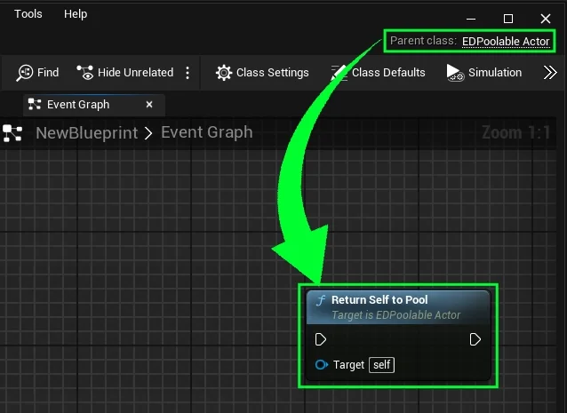

---

# Logging System

The `EDObjectPoolingLogger` helps you easily log messages about the object pooling system in Unreal Engine.  
This can be useful for keeping track of when poolable actors are created, acquired, or destroyed.  
To turn logging on or off, press the **~** key to open the console.  
Then, type **“EDObjectPoolingLogger true”** to enable logging or **“EDObjectPoolingLogger false”** to turn it off.

---

# Best Practices

This is a great checklist for making sure that your blueprints are following the correct principals!

- **Avoid Manual Destruction:**  
    If you manually destroy an actor (like using Unreal Engine’s normal destroy method), it won’t go back to the pool.  
    The system will have to create a new one next time, which is less efficient. Always use the pool’s return method to avoid creating unnecessary new actors.  
    
- **Avoid Returning Active Actors:**  
    Make sure the actor is no longer being used before returning it to the pool. Returning an actor that’s still active in gameplay can cause problems and unexpected behavior.  
    
- **Handling Child Components:**  
    If the actor has child components or child actors using the **EDPoolableChild** interface, their **UnInitialize** methods will automatically be called when the parent actor returns to the pool. If they don’t use this interface, you’ll need to reset them manually in the parent actor’s **UnInitialize** event. This ensures everything is properly reset and ready for reuse, preventing leftover data or issues.

- **Use Initialization and UnInitialization Properly:**  
    Always ensure that initialization logic (resetting properties, states, etc.) is placed in the **Initialize Event**, and cleanup logic is placed in the **UnInitialize Event.** This guarantees that actors will behave as expected each time they are reused from the pool.  
    
- **Avoid Over-Instantiating Actors:**  
    Be mindful of the **soft limits** and **hard limits** you configure for your poolable actors.  
    The soft limit should allow for enough actors to be reused without excessive memory consumption, while the hard limit should ensure that your game does not run out of memory or processing power.  
    
- **Monitor Performance with Logging:**  
    Use the logging system to track actor lifecycles and pool limits, especially during performance-critical moments of your game. This can help you identify areas where your pools may need adjustment or if actors are being created or destroyed too frequently.  
    
- **Optimize Actor Complexity:**  
    If your poolable actors contain complex child components or sub-actors, make sure each child follows the proper initialization and cleanup procedures by implementing the **IEDPoolableChild** interface. This ensures that the entire hierarchy of actors and components is correctly reset, preventing unexpected behavior.  
    
- **Use Deferred Acquisition for Complex Setup:**  
    When an actor requires a detailed setup before initialization (e.g., complex parameters or external references), use the **Acquire Poolable Actor Deferred** node. This ensures you have full control over the actor’s configuration before it is used in the game world.
