# Foliage Blueprint – Advanced
Every great game has its own unique touch, and no doubt you’ve got plenty of creative ideas to enhance your player’s experience.  
In this section, we’ll dive into advanced techniques and features to help you create more complex **Foliage Blueprints**.  
Please note that most of these features are only available in the **Pro Version** of our **Etherion Foliage Plugin**.

---

# Foliage Object Pooling

Before creating custom logic in your **Foliage Blueprint**, you must first understand how its object pooling system functions!

### How it Works

Object Pooling creates a set number of objects at the start of the game, and then reuses these objects each time they are needed in the level, instead of constantly spawning and destroying them. The **Foliage Blueprint Parent** is built on this system, so your foliage blueprints **must follow the same logic to function properly**.  
  
Proper **initialization** is key for ensuring that foliage blueprints work correctly when taken from and returned to the pool.  
Your foliage blueprint should utilise specific events to make sure it is **ready for use** when taken from the pool, and **properly** **reset** when returned to the pool.  
This will preventing old data like position, state, or animations from causing bugs in your game.  
  
Without any custom logic, the initialization will be managed automatically.  
However, if you add custom features, you might need to implement your own initialization logic to ensure it works with the pooling system  
  
In a Foliage Blueprint, the **Construction Script** and **Event BeginPlay** is triggered only once, when the Blueprint is first created.  
Since [the set number][object-pooling] of **Foliage Blueprints** are pre-loaded into the pool at the start of the game, the **Construction Script** and **BeginPlay** is usually called while they’re still in the pool, not in the level.  
  
The **Foliage Blueprint** will only be placed in the level to become interactable, when a **Foliage Influencer** touches a Foliage Instance.  
At this moment, the influencer will get the Foliage Blueprint from the Pool, and swap it out with the Foliage Instance.  
Once this swap has occurred, the **Event Initialize** is called, ensuring the blueprint is properly set up for interaction.

### Event Nodes

If you need initialization to happen each time the actor is reused, you should move that logic to **Event Initialize**.  
For cleanup, instead of using the **Destroy** node, use **Event UnInitialize**, which is called every time the actor is returned to the pool and swapped back to being a Foliage Instance.

Following these practices will help maintain performance and functionality when developing foliage blueprints that align with object pooling.

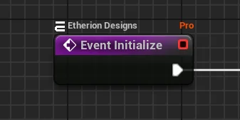

**Event Initialize**  
When you get an actor from the pool, you want to make sure it’s in a fresh, default state, with no leftover data or settings from the last time it was used. The **Initialize** event runs each time an actor is taken from the pool, resetting its properties and setting up any components, effects, or particle systems it needs. If you have custom logic in your blueprint, you’ll want to use this node to reset all your variables to their default state.  
_(For example, a countdown integer for a landmine should have its timer variable reset here)_

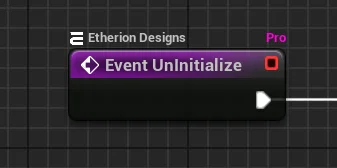

**Event UnInitialize**  
When an actor is no longer needed and returned to the pool, the **UnInitialize** event is called to help clean it up. This makes sure that no leftover effects, particle systems, or timers remain after the actor is done being used. It essentially “shuts down” the actor, getting it ready for the next time it’s needed.  
If you created custom logic in your blueprint, you’ll want to connect the shutdown processes of that logic to this node.

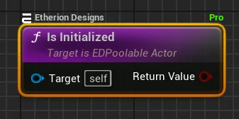

**Is Initialized**  
If you need to check whether a poolable actor is currently initialized within your Blueprint logic, use the **Is Initialized** node. This node returns **True** if the **Initialize** event has been called and the **UnInitialize** event hasn’t happened yet, meaning the actor is active and not in the pool. Keep in mind, if you use this node in the **Begin Play** event, it will return **False** because the actor hasn’t been initialized yet at that point.

---

# Futureproofing your Assets

One of our best qualities as a Studio is that we continue to provide updates to all our products.  
And we want to make sure your assets remain compatible with those updates!

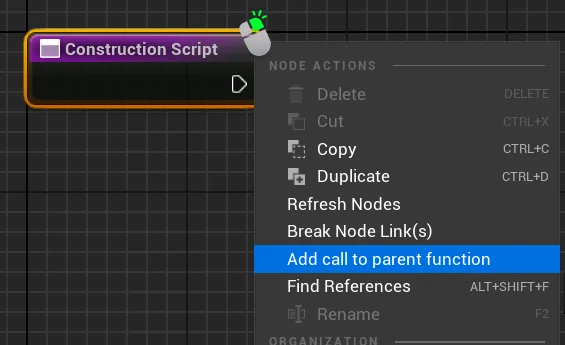

To ensure your **custom Foliage Blueprint** remains compatible with any potential updates to the foliage system, there is one simple trick you must follow.  
  
You must attach a Parent Node to the start of your **Construction Script** and **Begin Play** events.  
  
This Parent node ensures that any changes we make to the **BP_FoliageParent** also get reflected to this **Child Blueprint** of yours.  
  
To do this, simply right click the Event **BeginPlay** or **Construction Script** and click “**Add call to Parent Function**“.

## Examples

We added the Parent Function to the start of the **Construction Script** of **BP_Plant_Bush**, to ensure future compatibility.  
We then create and apply a **Dynamic Material Instance** to allow us to animate the plant’s material.

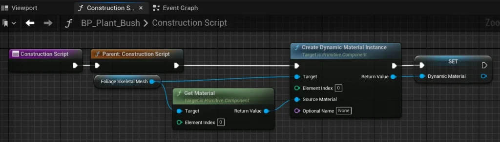

This process only needs to occur once, whether the plant is in the pool or in the level, so it’s best suited for the **Construction Script** or **Begin Play** of the foliage blueprint. This ensures the setup happens early, without needing to repeat it during pooling or reuse.

  
For this blueprint, we needed the sound effect to change based on the foliage’s size. There will be plenty of foliage instances painted in the level, each varying in size.

Since each Foliage Instance has a different scale, we need to find out what that scale is and adjust the sound each time the Foliage Blueprint is pulled from the pool and placed in the level.  
  
This means that any sound adjustments must be made within the **Event Initialize** to ensure they reflect the correct size of the foliage!

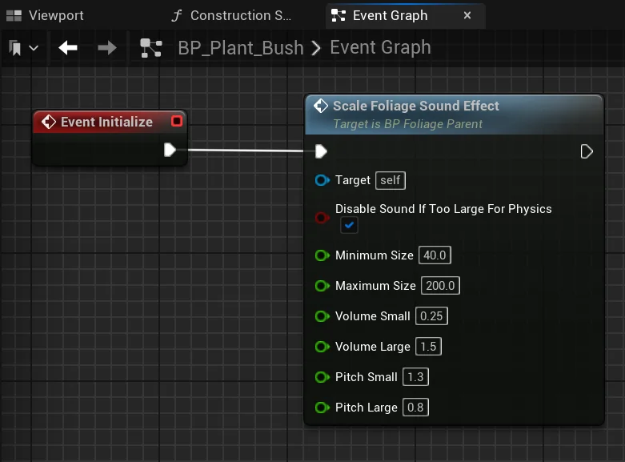

You can find plenty of other example Foliage Blueprints in **Content / AlienPhysicsWorld / FoliageTypes**

---

# Advanced Nodes

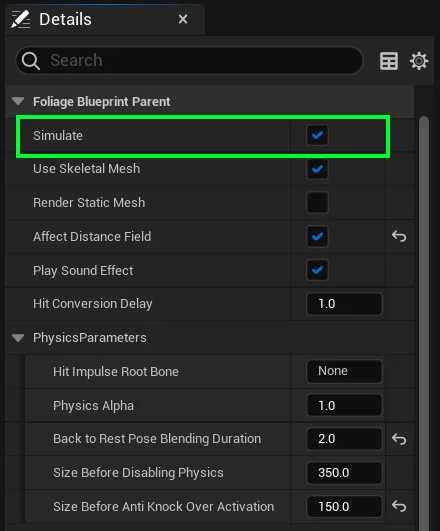

## **Simulate**

The **Simulate** checkbox determines whether the **Skeletal Mesh** is allowed to **simulate physics** when a Foliage Instance is converted to a Blueprint.

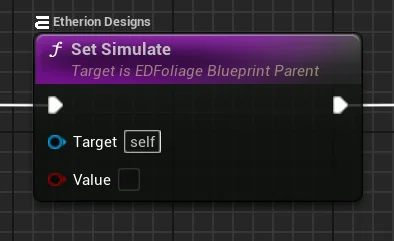

If **Simulate** is not checked, the skeletal mesh will remain static, and any physics simulation must be manually triggered with the **Set Simulate** node.  
  
_Please be aware that this will only function if **UseSkeletalMesh** is also checked!_

**How might this be Useful?**  
Disabling **Simulate** can be particularly useful for performance optimization and specific gameplay mechanics.  
By ensuring simulation is turned off when a **Foliage Instance** gets converted to a **Foliage Blueprint**, you can avoid unnecessary physics calculations for foliage that doesn’t need to react dynamically straight away. You can use this feature to ensure it wont have physics until a gameplay element requires it.  
For example, a plant could remain static until the player uses a special tool or ability (_e.g., a magic spell or environmental scanner_) that “activates” the foliage, making it react physically.  
  
_Remember, the **Set Simulate** node will only work if **UseSkeletalMesh** is checked!_

---

## Static or Skeletal {#static-or-skeletal}

If you want the standard type of foliage with a simulated skeletal mesh, the default settings will ensure that **Simulate** and **Use Skeletal Mesh** are turned on, while **Render Static Mesh** is turned off. This ensures that your foliage skeletal mesh is visible and simulating physics, while the associated staticmesh is not visible.

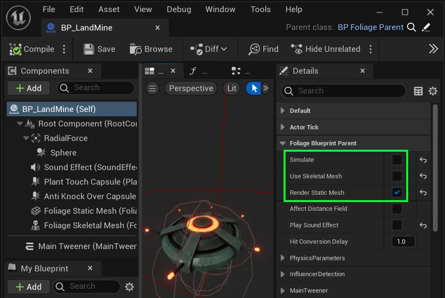

However, there are some cases when you may want a **static** type of foliage which utilizes the blueprint functionality rather than needing physics.  
  
A good example of this is a landmine, or a simple foliage that gets crushed underfoot.  
In that case, you’d want to ensure that **Simulate** and **Use Skeletal Mesh** are turned off, while **Render Static Mesh** is turned on.  
  
This will ensure that the skeletal mesh is non-simulated, invisible, and has no collision.  
The Static mesh will be visible and be able to be collided with, which is important for when you shoot it!

---

## Can Convert To Instance

Sometimes you may not want your **Foliage Blueprint** turning back into a **Foliage Instance** while it is still animating, or still in the middle of a particle effect.  
We designed a Function called “**CanConvertToInstance**” for the purpose of allowing you to control when your blueprint’s conversion is allowed to take place.  
This function is called when **Skeletal Mesh** returns back to its static reference pose.

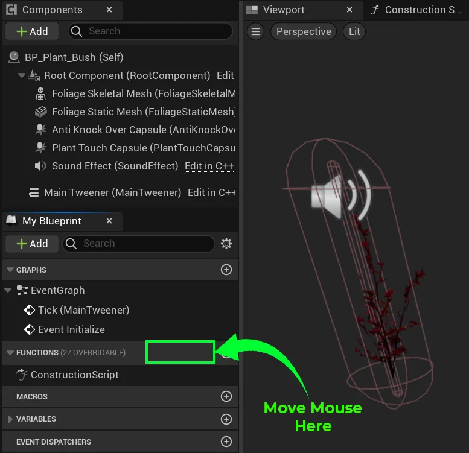

To get access to this function, start by moving your mouse to this location.

Click the new box called “Override” when it appears.  
  
Find the function called “**Can Convert to Instance**” and click it.  
It will now have created the function, which you can then open.

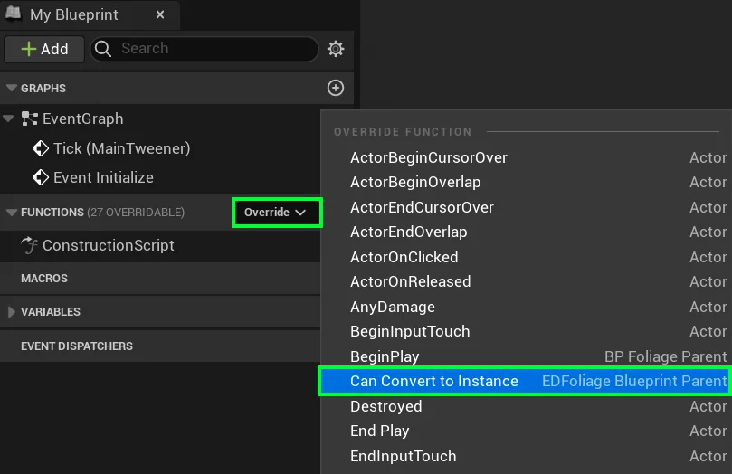

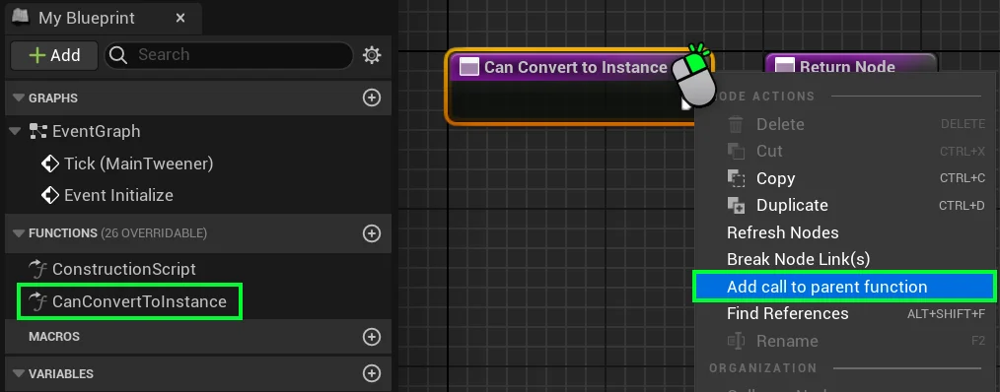

Once opened, you will want to right click the “**Can Convert to Instance**” entry node, and click “**Add call to parent function**“.  
  
Adding this parent function at the start of your nodes will ensure that your blueprint will remain compatible with all future updates to our Foliage System. It is currently not required, but highly recommended.

After that is complete, you can add any blueprint logic you want to ensure that your plant only converts back into a Foliage Instance after your requirements are met.

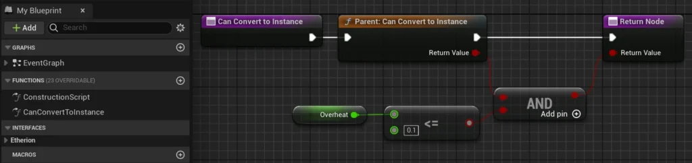

In the example found in **BP_AlienPlant**, we had logic that animated the foliage’s material when hit by a beam weapon.  
  
The variable used to animate the material was called **Overheat**.

We used the **CanConvertToInstance** node to ensure that it did not convert back into a foliage until the **Overheat** variable was 0.1 or less  
_(as this was when the material effect was no longer visible)_.

---

## Get Foliage Size

You can use a specialized function to get the size of your Foliage, which can be used for an number of different effects.  
In this example, we will show you how we used it to scale the foliage sound effect.

Navigate to **Content / AlienPhysicsWorld / FoliageTypes / AlienPlant**  
Open **BP_AlienPlant_Basic**

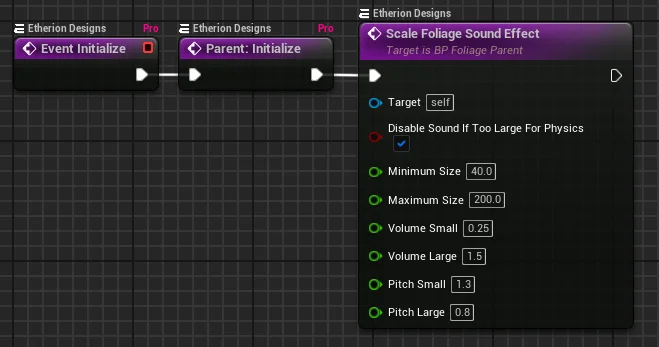

Upon the “**Initialize**” event,  
open up the node called “**Change Sound Effect’s Pitch Based On Foliage Size**”.

[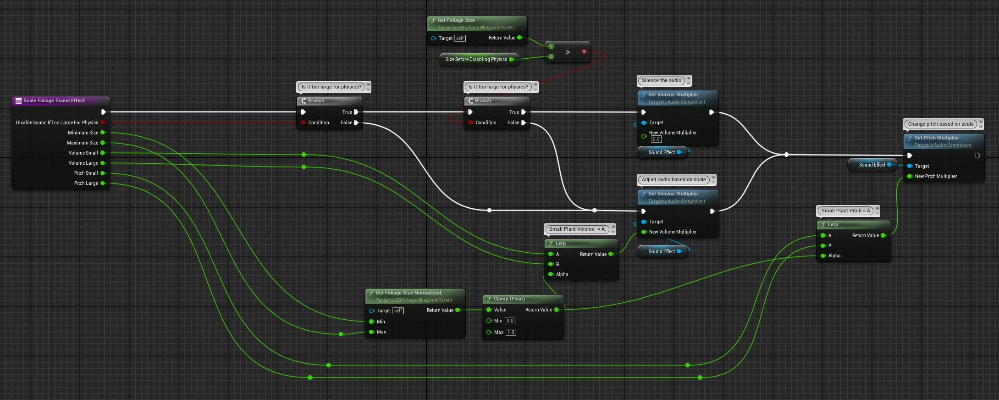](../assets/Documentation_BPAdvanced_Sound.webp)

Here you will see the inner workings on how this function changes the sounds pitch and volume based on the foliage’s size.  
Some key nodes you might find useful in creating your own functions are:

**Get Foliage Size**  
This retrieves the size of the foliages skeletal mesh in world units based on its bounding radius.  
This is useful for determining the size of the foliage within the game world.

**Get Foliage Size Normalized**  
This retrieves the size of the foliages skeletal mesh, and normalizes it within a defined range.  
Simply put, you can enter in a minimum and a maximum size, and it will give you a value between 0-1 based on these parameters.

In the above example, we used **Get Foliage Size Normalized** to lerp between the minimum and maximum volume, and pitch variables for our foliage sound.  
You can do similar functions to change a whole range of effects within your foliage.

---

## Is Actor Pawn or has Physics Tag

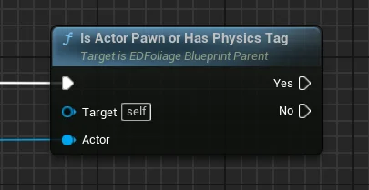

This blueprint helps determine if an actor is a Pawn, or if it has a tag labelled “Physics”.  
It is helpful for determining whether certain functions should activate.  
For example, if a blueprint with a Foliage Influencer interacts with the Foliage Blueprint, and it is not either of these things, you may not want it to activate a certain function..

---

# Animation Effects

If James Cameron’s Avatar is even slightly inspirational to you, we know you’ll want your foliage materials to light up harder than Jake Sully when he first saw Neytiri’s USB ponytail port. So lets go ahead and add some animatable, interactable effects to your custom foliage!  
  
To make things faster and easier, we developed the **ED Tweener Component** – a versatile Blueprint tool that allows you to create smooth transitions and animations between values. It is highly efficient, and provides a wide range of easing types.  
_Note: The **ED Tweener Component** is only available in the **[Pro Version](https://www.fab.com/listings/a3f7729e-c68e-4533-9b51-2106357b2316)**_.

Since it’s packed with features, we’ve handled the documentation on a different page.  
However, once you’ve finished reading, feel free to return to this page to see examples of how it can be used.

**[[Advanced Features/3 Tweener Component - PRO|Tweener Component Documentation]]**

## Basic Material Example - PRO

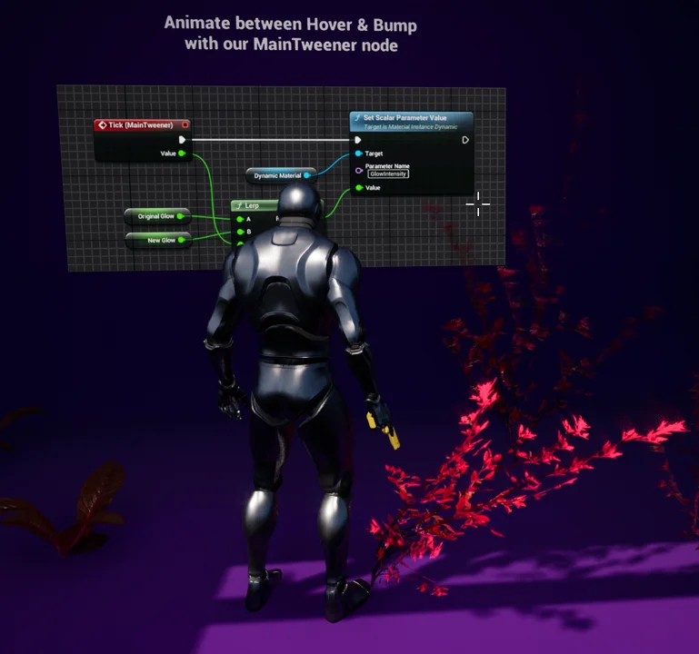

In this example, you’ll learn how to make your plant’s material react with a **bump** or **hover** animation when interacted with.  
  

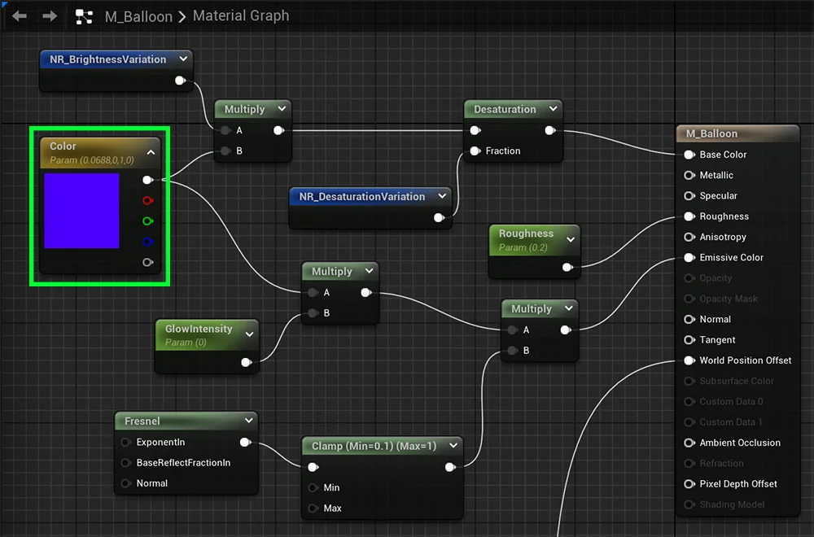

To begin, you’ll need to ensure you create a material with vector or scalar parameters you can animate with.  
  
Here we used a **Vector Parameter** called “**Color**“.  
  
As long as your material contains an editable variable, you can animate it by using a **Dynamic Material Instance** in your **Foliage Blueprint**.  
  
Next, let’s navigate to:  
**Content / AlienPhysicsWorld / FoliageTypes / Balloon**  
open up **BP_Balloon_Standard**  

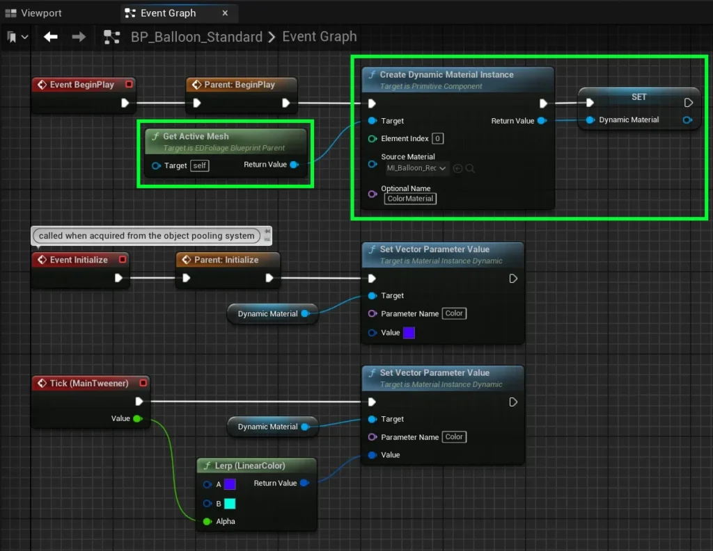

Here you can see that upon **Event Begin Play**, we have two notable nodes:  
  
**1.) Get Active Mesh**  
This node retrieves either the **Static Mesh** or **Skeletal Mesh** from the blueprint, depending on whether the **_Use Skeletal Mesh_** variable is set to true or false.  
  
**2.) Create Dynamic Material Instance**  
This node will create an apply a dynamic material instance to the Target (the active mesh).  
  
We then set the Dynamic Material Instance as a variable, allowing adjustments in other areas of the blueprint.

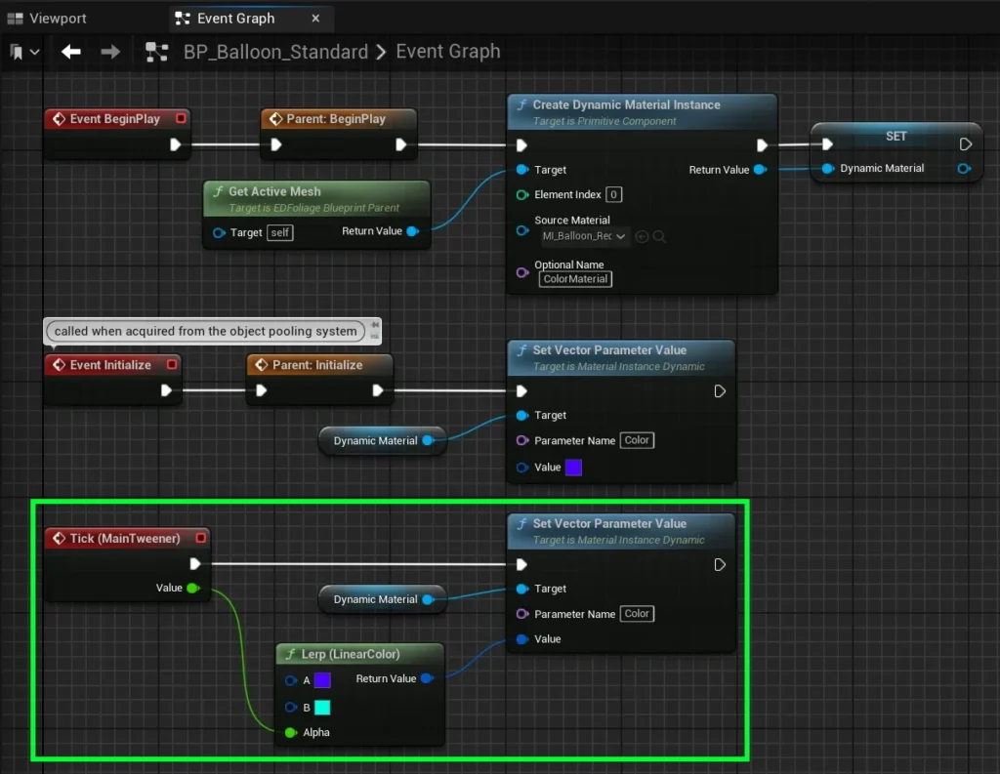

The **Tick (Main Tweener)** outputs the animation value created by the _Tweener Component_.  
  
This value animates as a **bump** or **hover** when interacted with. We use a **Lerp (LinearColor)** node to animate between two colors, and then apply this to the Dynamic Material to create the animation effect.

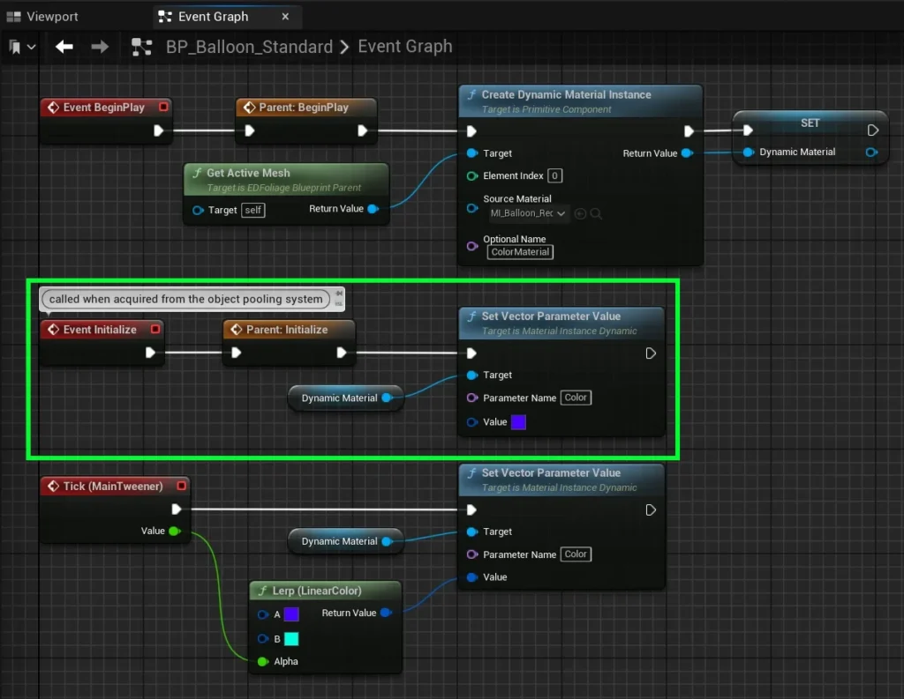

Finally, the **Event Initialize** node must reset the **Dynamic Material** to its default color. This ensures that each time a foliage blueprint is pulled from the Object Pool, its animation starts from the beginning, with the material color correctly matching the foliage’s default appearance.

---

## Material Hit Example - PRO

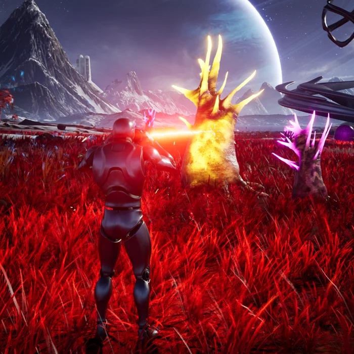

Sometimes you might want a specific animation effect to occur when a foliage is being hit by a specific source – such as a lazer weapon. We created an example for just that.  
  
Navigate to **Content / AlienPhysicsWorld / FoliageTypes / AlienPlant**  
and open up **BP_AlienPlant_Basic**

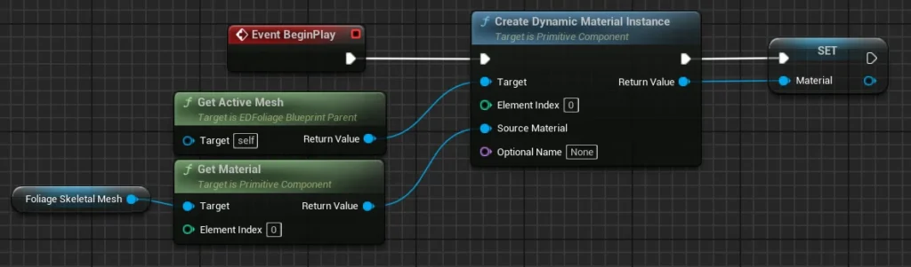

On the Begin Play we create the **Dynamic Material Instance**, apply it to the **Active Mesh**, and set it as a **variable** so it can be animated elsewhere in the blueprint.

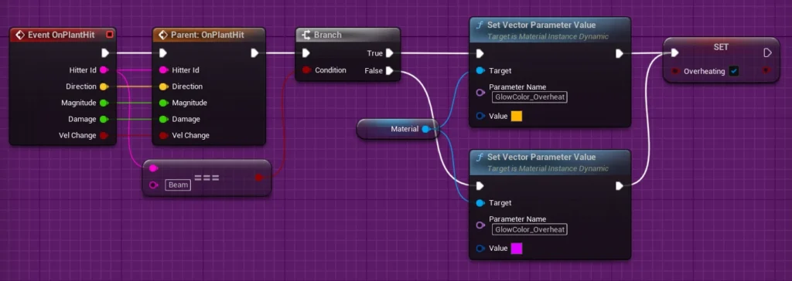

To react when a plant is hit by a **Foliage Influencer**, we use the **Event OnPlantHit** event to determine whether the name of the **Hitter ID** matches the same ID listed on the **Beam** weapon. _(BP_Weapon_Beam had a Hitter ID called “**Beam**” )_  
  
If the hit is from the beam weapon, we change the color to orange; otherwise, we set it to purple.

After changing the color, we set the **Overheating** boolean to **true**, signaling the **Event Tick** to animate the overheating effect.

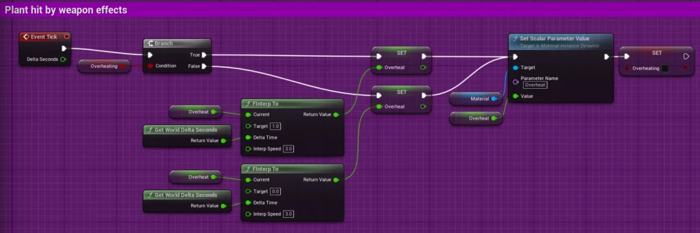

In the Event Tick logic, we first check if **Overheating** is **true**:

- If **Overheating** is true, we use **FInterp To** to gradually increase the **Overheat** float value to **1** over time. This **Overheat** variable controls the intensity of the material’s glow effect.
- If **Overheating** is false, we use **FInterp To** to gradually decrease the **Overheat** float value to 0 over time.

We then apply the animated **Overheat** float value to the **Dynamic Material Instance** to adjust the designated scalar parameter and create the intended effect.  
  
At the end of these nodes, we set the **Overheating** boolean to **false**, allowing the Overheating effect to automatically turn off. This works because **Event OnPlantHit** sets **Overheating** to **true** each time a hit occurs, ensuring the branch that checks **Overheating** will return **true** as long as the plant is actively being hit. When the hits stop, **Overheating** is set to **false**, and the effect gradually deactivates.

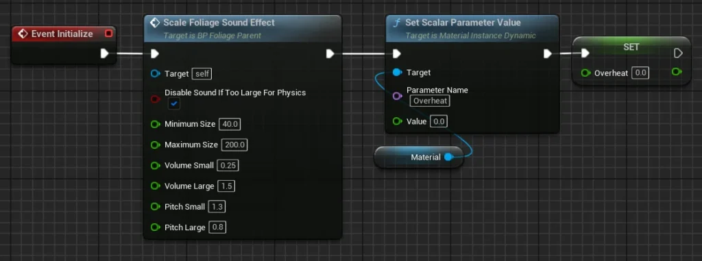

Finally, we use **Event Initialize** to reset the **Scalar Parameter** of the **Dynamic Material Instance** and set the **Overheat** float variable back to **0**. This ensures that, each time the foliage blueprint is reused, both the material appearance and any overheating effects reset to their default states.

## Mesh Animation Example

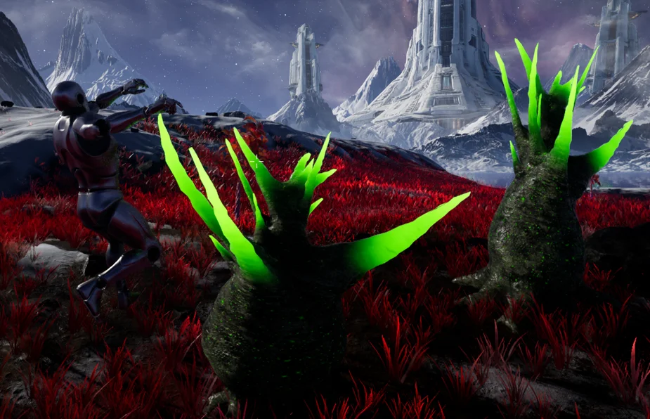

This example will domonstrate the “bouncy plant” – a plant that plays a bounce animation while throwing the character in the air.  
  
To see its contents, navigate to to  
**Content / AlienPhysicsWorld / FoliageTypes / AlienPlant_Bouncy**  
and open **BP_AlienPlant_Bouncy**.

This blueprint should be nearly identical to the BP_AlienPlant_Basicexample that we covered in the above **Material Hit Example** section.  
The main difference will be the nodes flowing from **Event OnPlantTouched**.

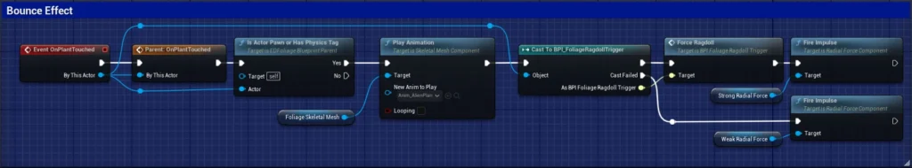

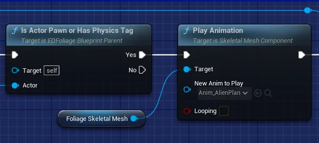

First, we use the “**Is Actor Pawn or Has Physics Tag**” node to determine whether it should play the bounce animation or not.  
If the criteria is met, we play an animation on the **Foliage Skeletal Mesh**.

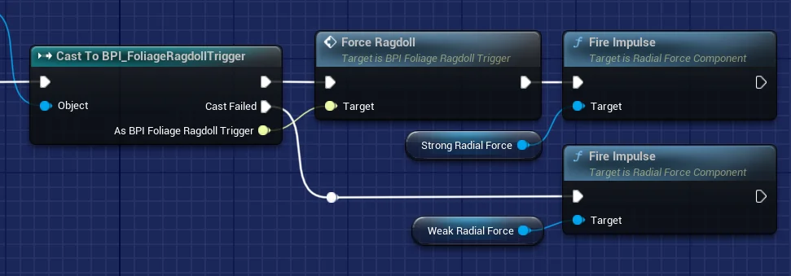

Next, we get the actor that touched the plant, and cast to a custom **Blueprint Interface** (_BPI_FoliageRagdollTrigger_) which manages our character’s ragdoll trigger. Using a **Blueprint interface** allows you to issue the same command to numerous classes of actors without needing to reference them directly. We did this so that it would work with the Advanced Locomotion System V4, but not cause issues if the Locomotion system were to be removed from the project.

If the cast succeeded, we trigger the Force Ragdoll event to make compatible actors flop around as if they have been bounced. Then we fire an impulse to send them flying.

If the cast failed, it means the actor that touched the foliage does not have our **BPI_FoliageRagdollTrigger** in its class, so we cant trigger ragdoll. Instead we just fire an impulse to send them flying.

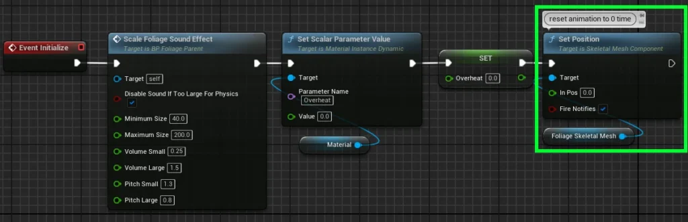

The Initialization of a skeletal mesh animaiton only requires that it be set back to its original state. In this example, we get the **Foliage Skeletal Mesh** and use the **Set Position** node to ensure its animation timeline is reset to **0 seconds**.
