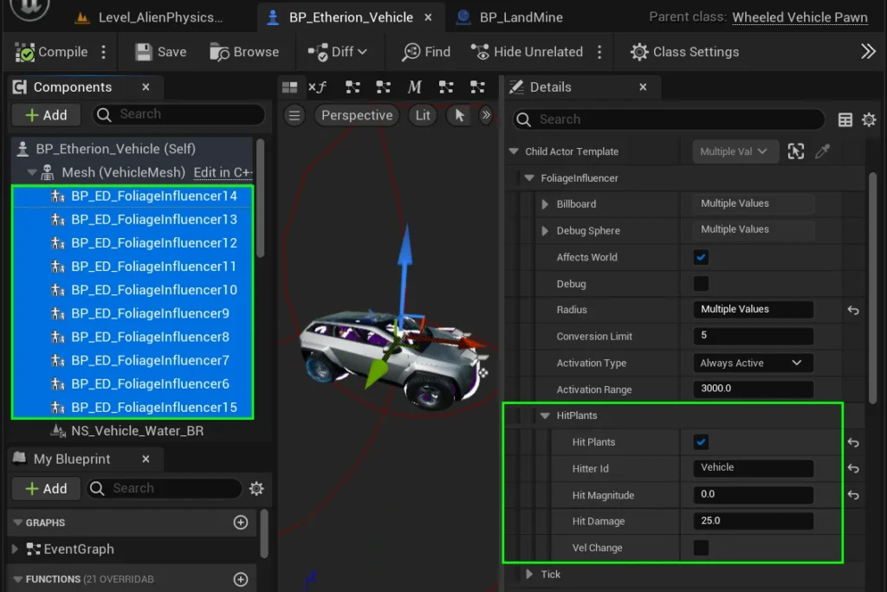
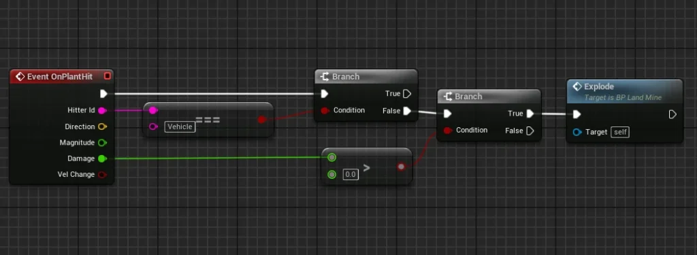
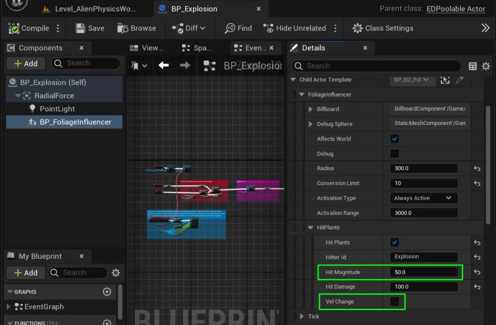
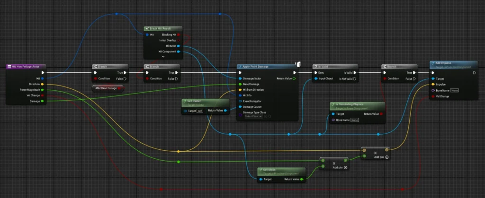
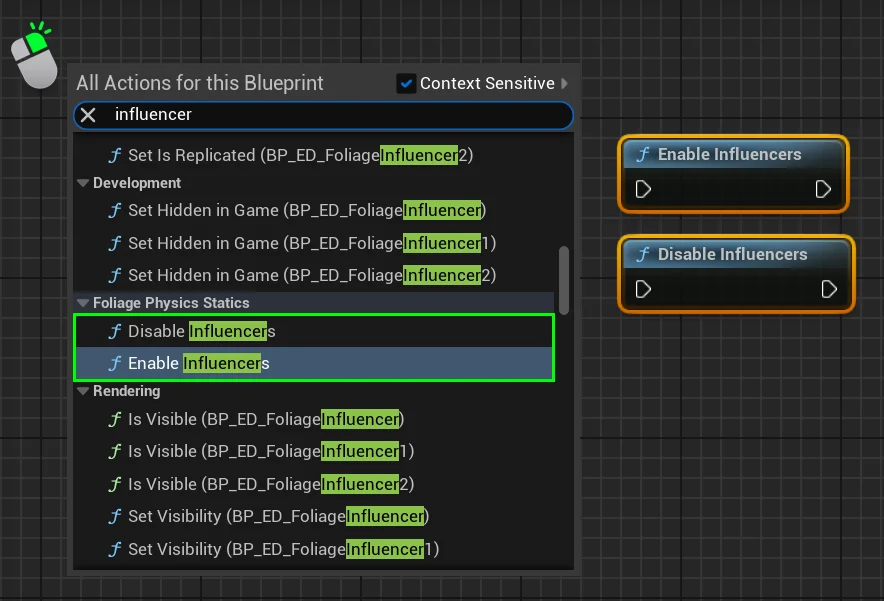
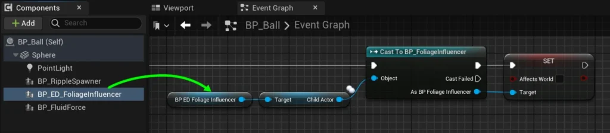
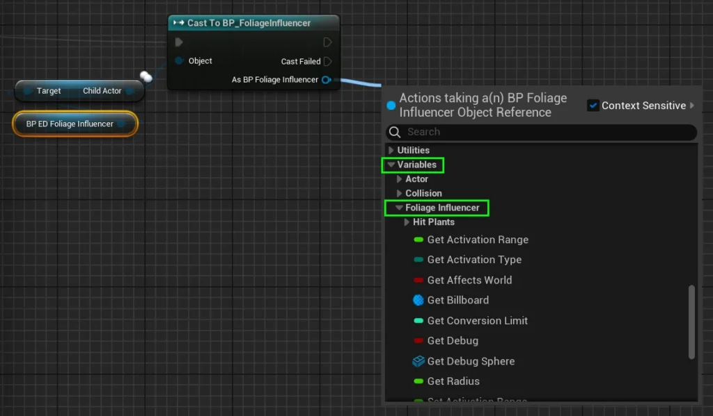

# Foliage Influencer – Advanced
Foliage Influencer’s have some advanced settings that you may want to utilize to add some more customizable effects to your project.  
In this page, we will summarize each of these advanced features and explain how to use them.

---

## Hit - PRO

Foliage Influencers can trigger a **OnPlantHit** event when they come into contact with a Foliage Blueprint.  
This **OnPlantHit** event makes it easier to apply damage, trigger physics forces, or activate custom functions in your foliage, enabling unique reactions or behaviors.  
Essentially, it allows specific data to be sent from particular Foliage Influencers to the Foliage Blueprint upon interaction.

To enable this feature, simply select your Foliage Influencer components, and look to the **Details Panel**.  
  
Under **Child Actor Template > FoliageInfluencer > HitPlants**, you will see all the relevant settings.  
  
Enable the “**Hit Plants**” checkbox to enable the **Hit** feature.  
  
Also, feel free to change the **Hitter ID**, **Hit Magnitude**, **Hit Damage** and **Velocity Change** _(which will be explained below)_

#### Hitter ID & Damage {#hitter-id-damage}

The **Hitter ID** is a name assigned to the Foliage Influencer, which can be accessed within the Foliage Blueprint during the **Event OnPlantHit**.  
You may use other nodes with **Hitter ID** to verify if the Influencer causing the Hit is the specific one you want. In short, it lets you trigger unique functions for particular influencers. The **Hitter ID** is stored as a string.

**Damage** is a float variable that is passed to the Foliage Blueprint when the Influencer touches it.  
  
For example, In the **BP_Landmine** Foliage Blueprint, it will only trigger an explosion function if the **Hitter ID** is named “**Vehicle**“, and the damage is above 0.

#### Hit Magnitude & Vel Change

**Hit Magnitude** is a float value that represents the strength of the impact an Influencer can have on a Foliage Blueprint. It’s particularly useful when your **Event OnPlantHit** applies a physical force to the foliage, allowing you to control the impact’s intensity based on the specific data of the influencer.

**Vel Change** is a Boolean checkbox that helps determine whether the **Hit Magnitude** should ignore the mass of any simulated meshes when a physical force is applied.

In the **BP_Explosion** blueprint example, we set a **Hit Magnitude** of 50 and left **Vel Change** off, which helps foliage react accordingly.

**Important Note! These variables do not automatically cause anything to happen in your Foliage Blueprints!  
They are simply variables that can be sent to them using Event PlantHit.**

#### Hit Direction

The Hit Direction is automatically determined based on how the Foliage Influencer interacts with the Foliage Instance.  
his is particularly useful for projectiles, as it allows the system to use this directional data to add an impulse and apply physical force to the foliage.  
  
For example, in **BP_Weapon_Projectile**, you can see it utilizes all the **Hit Data** from the Foliage Influencer component stored within the projectile blueprint.  
In short, you can use **Hit Direction** for realistic physics in your foliage interactions!

---

## Enabling and Disabling Influencers

Enabling and Disabling foliage influencers effectively turns off Foliage Physics in any project.  
It can be useful if you want to turn off physics for the sake of lowering graphics quality in your game.

To enable or disable all foliage influencers, simply right click any blueprint canvas, search for **influencer**, and choose between the following nodes:

- Enable Influencers
- Disable Influencers

Please be aware that these functions will apply to **all** influencers in your game.

To enable or disable individual **Foliage Influencers**, you will ned to get a reference to the **FoliageInfluencer component** inside your blueprint.  
Then get it as a **child actor**, and cast to **BP_FoliageInfluencer** before editing the boolean variable “**Affects World**“.

---

## Editing Influencer Settings during Runtime

To edit settings while the game is running, do the same method as above, but set any of the associated variables under this category:  
**Variables > Foliage Influencer**
