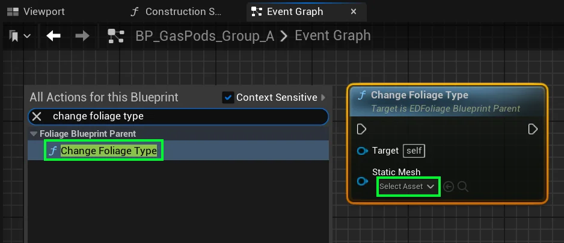
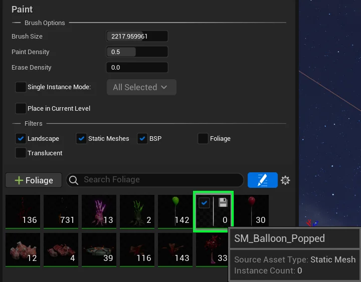
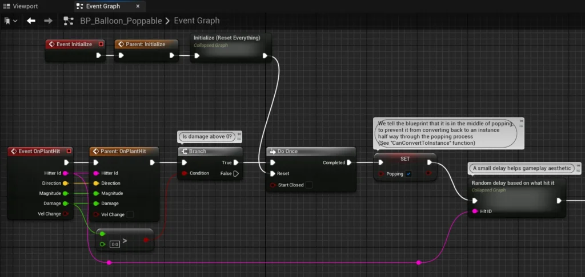
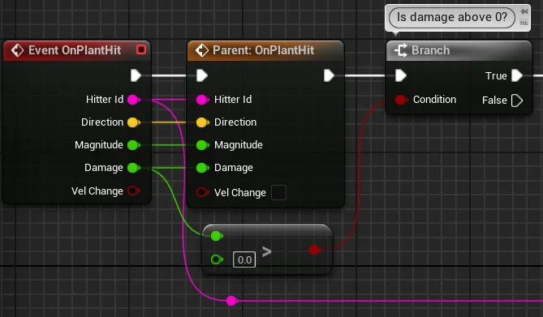
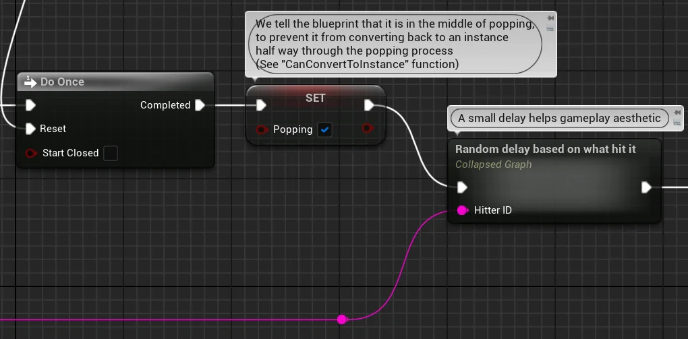
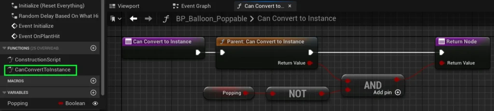
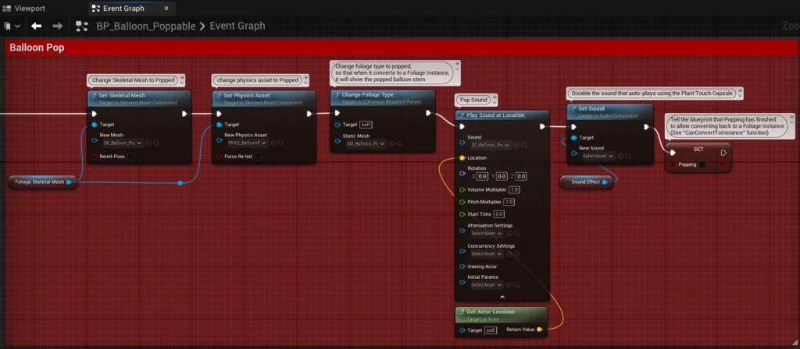
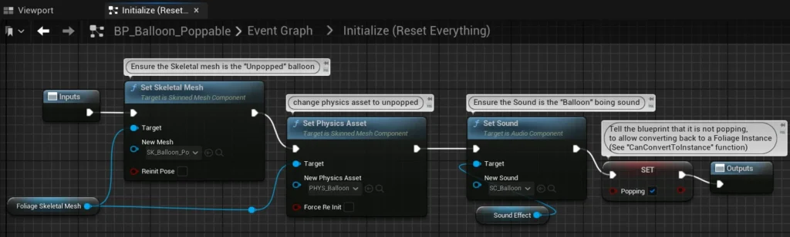

# Destructible Foliage - PRO
## Overview

We get it. You want to blast those leaves harder than your parent’s blood pressure when you said you wanted to be a “game developer”.  
Adding destructable foliage is simple in principal. The only difference in assets, is that you’ll require another set of Foliage assets for the destroyed version of your foliage.

**REQUIRED:**

- Foliage Blueprint
- Static Mesh
- Skeletal Mesh & Physics Asset
- Destroyed – Static Mesh

**OPTIONAL BUT NOT NECESSARY:**

- Destroyed – Blueprint
- Destroyed – Skeletal Mesh & Physics Asset
- Destruction Particle Effect
- Destruction Sound Effect

The logic flow should of your blueprint look something like this:

1. **Recieve Hit** or **Touch** interaction_, such as being stepped on or shot by a projectile_
2. **Prevent conversion** to **Foliage Instance** using the **“CanConvertToInstance**” function to allow destructible effects and animations to play
3. **Trigger** your destructible Effects / Animations
4. **Change Foliage Type** (_This will ensure that when it gets converted back to a foliage instance, it is the destroyed version of the foliage_)
5. **Uninitialize** & Allow conversion to Foliage Instance.

We mentioned Change Foliage Type in the list above.  
This is actually a node we created, to make your Foliage Blueprint turn into a different type of foliage instance after it completes its **Uninitialization**.  
  
Set the **Static Mesh** in this node to be the destroyed version of your **Destroyed Static Mesh** asset.

Also, you must ensure that you have added this **Destroyed Static Mesh** to your **Foliage Painter**, so that Unreal Engine knows that it can use it as a replacement for your Foliage Blueprint.

You are not required to paint it on your landscape, but it must be included in the foliage painter’s list of foliages.

## Popping Balloon Example

For a simple reference on how to create destructive foliages, take a look at our Balloon popping example.  
Navigate to **Content / AlienPhysicsWorld / Foliagetypes / Balloon_Poppable**  
  
Here you will see all of the assets related to the popped balloon. There are also some assets for the unpopped balloon stored in  
**Content / AlienPhysicsWorld / Foliagetypes / Balloon**  
  
Open up **BP_Balloon_Poppable** and navigate to the **Event Graph**.

Despite **Event Initialize** being at the start of our blueprint nodes, lets ignore it and look at it later.  
This is because the **Initialize** functions are often last thing you want to create, since it only exists to “**clean up and reset**” all the variables and changes to the blueprint that occur during the foliage’s interaction.

Instead, lets start by taking a look at the **Event OnPlantHit**.  
In our logic, you can see that we used the **Parent: OnPlantHit** node to ensure that our blueprint is futureproofed and **remains compatible** with future versions of the Etherion Foliage Plugin.  
  
Next, we used a branch node to determine if damage is above 0.  
If true, then it means the Balloon should run the logic relevant to popping.

Since balloons should only pop once, we use a **Do Once** node (_which resets during Initialization_).  
  
Next, we set a custom Boolean variable called “**Popping**” to true. This boolean is used in our “**CanConvertToInstance**” function seen in the image below.

By setting it to true, we prevent the **Foliage Blueprint** from converting to a **Foliage Instance** while the popping function is being run.

Navigate to the “**CanConvertToInstance**” function.  
You can see that it will only return true if the Parent blueprint returns **True**, and the **Popping** variable is false.  
Its standard practice to use a custom variable to prevent conversion while a foliage is being destroyed, and to then allow conversion after the destruction is completed.

Navigate back to the **Event Graph**.  
  
After setting the **Popping** variable to prevent conversion, we added a random delay that varies based on the **HitterID**. This randomness improves the game’s aesthetic, avoiding the unnatural effect of multiple balloons popping at the exact same time.

We adjusted the delay for vehicles since they can pop too many balloons when moving quickly, requiring a slightly longer delay for better visual and audio effects. This adjustment is purely for aesthetic purposes.

After the random delay, a series of nodes control the destruction and popping of the balloon.  
Feel free to click on the image below for a closer look at the nodes and their purpose.

- **Set Skeletal Mesh** – changed the balloon’s skeletal mesh to the Popped Balloon’s Skeletal Mesh
- **Set Physics Asset** – changed the balloon’s Physics Asset to the Popped Balloon’s Physics Asset
- **Change Foliage Type** – Ensured that when uninitialization occurred, the **Foliage Blueprint** would be replaced by the Popped Balloon **Foliage Instance**
- **Play Sound at Location** – Played the popping noise
- **Set Sound** – The Sound Effect component is the sound that plays when the **PlantTouch Capsule** gets triggered. We cleared the entry to this node to ensure there was no sound at all when touching the **PlantTouch Capsule**.
- **Set Popping** – We set the ‘Popping ‘variable to false to allow the **Foliage Blueprint** to convert to a **Foliage Instance**, since all of our popping logic is completed.

**Initialization**  
Now that we have completed covering the rest of the Destructible Balloon example, we’ll explain what we did to Initialize the blueprint.

- **Set Skeletal Mesh** – changed the balloon’s skeletal mesh to the **Unpopped** Balloon’s Skeletal Mesh
- **Set Physics Asset** – changed the balloon’s Physics Asset to the **Unpopped** Balloon’s Physics Asset
- **Set Sound** – We reset the sound effect back to the original baloon sound.
- **Set Popping** – We set the ‘Popping ‘variable to false to allow the **Foliage Blueprint** to convert to a **Foliage Instance**, since the popping logic will not be running when the blueprint is taken from the pool and placed in the level.

When the balloon is popped, it returns to a foliage instance after uninitialization.  
That new foliage instance mesh is connected to the **BP_Balloon_Popped** asset in the Foliage Map.  
So when you interact with the popped balloon, it will showcase basic foliage physics functionality for the stem.