# Installation

## Getting Started
Before starting, be sure that your Plugin is enabled.  
Go to **Edit > Plugins**.

![[docs/assets/Documentation_Installation_OpenPluginsMenu.webp]]

Activate the Etherion Foliage Plugin.
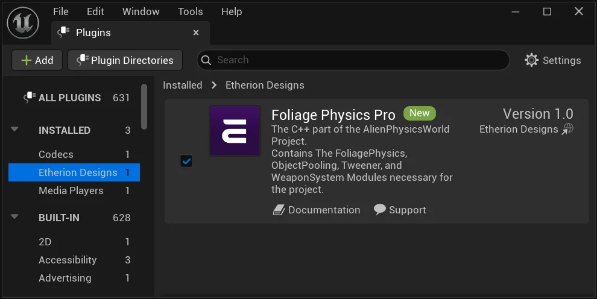

Go to the content browser and look for the Plugins folder. If you cannot see our Plugin folder, go to the content browser. Click Settings, then make sure **“Show Plugin Content”** is checked.  Sometimes you may also have to click **“Show Engine Content”**.
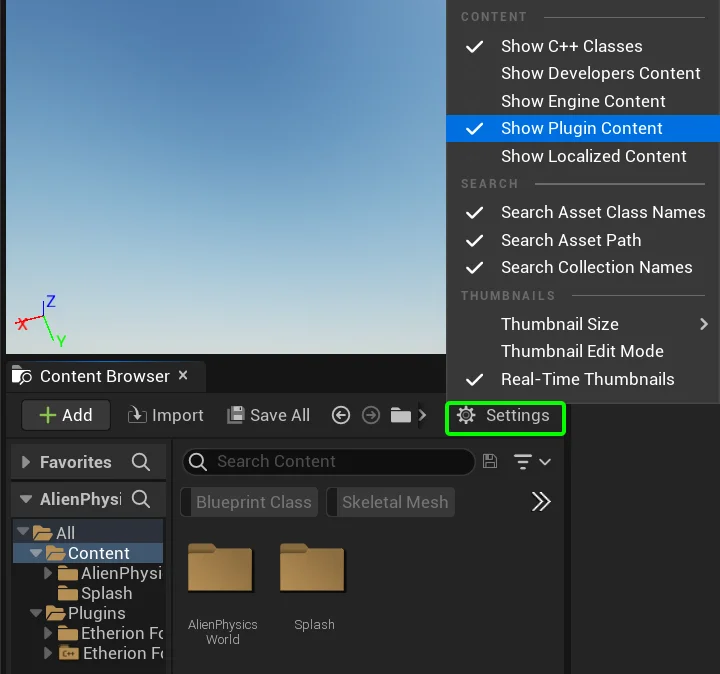

Open up the Level called **“EtherionFoliagePlugin_Examples**“.
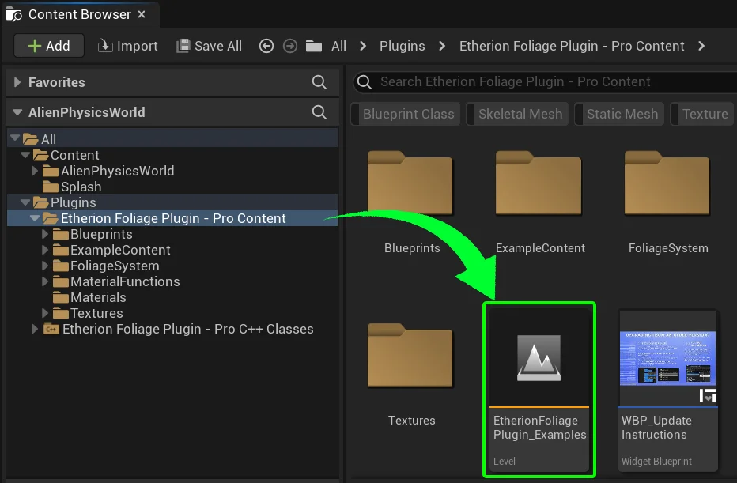

This is where all your content examples and installation notes are located. Please be sure to read any notes included here before continuing!
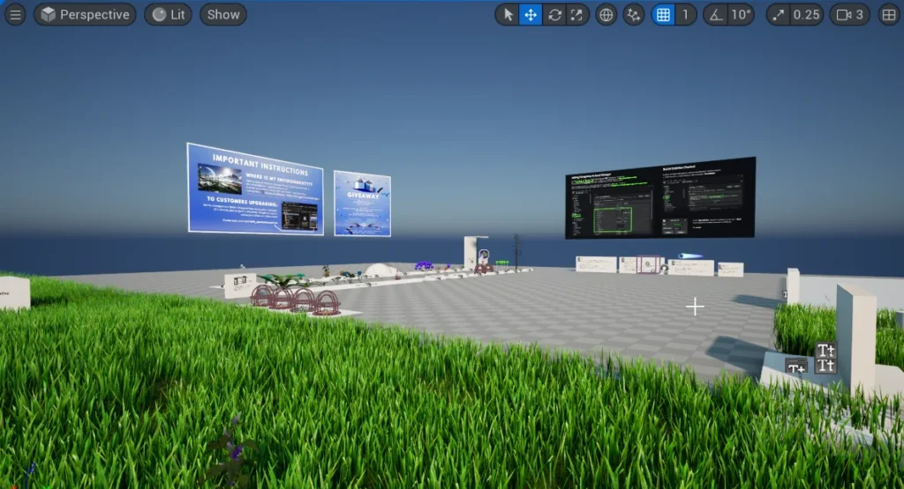

---

## Required Project Settings

**Your plugin wont work correctly unless you do the following:**

Under **Project Settings > Asset Manager**, there must be the following settings under **Primary Asset Types to Scan**  
This ensures that the **Foliage Map** asset type is packaged along with the rest of the game.
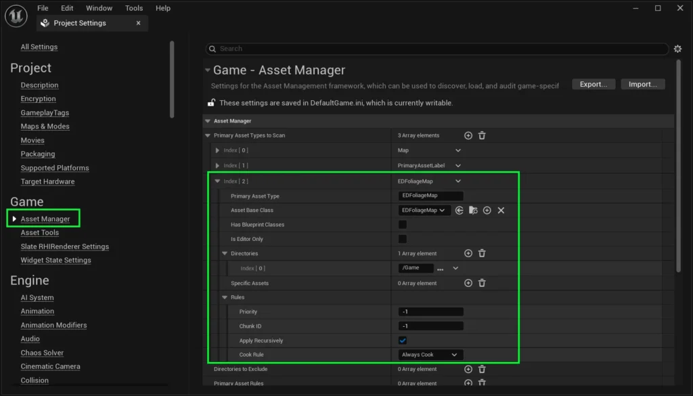

---

If you are using the Pro Version of the plugin, you will also need to create collision for Weapons.  
Go to **Edit > Project Settings > Collision**, and add a new **Object Channel**.

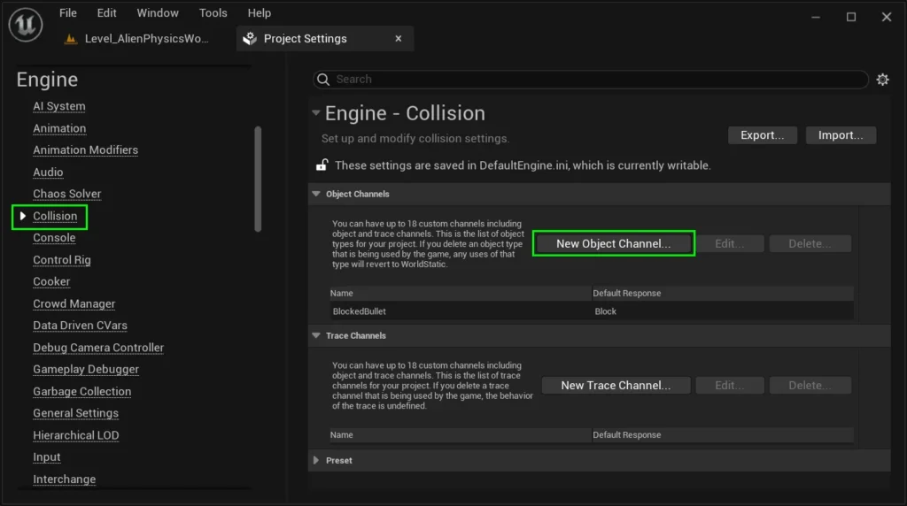

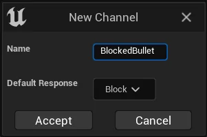

Name it “**BlockedBullet**”, and ensure the default response is set to “**Block**”.  
_(Please ensure there is no space between Blocked and Bullet)_  
  
Click **Accept**.

## Bonus Content Project Settings - PRO

Our bonus Alien Physics World content includes a vehicle and water. To get it working, be sure to enable the **ChaosVehiclesPlugin** and the **Water** Plugin.

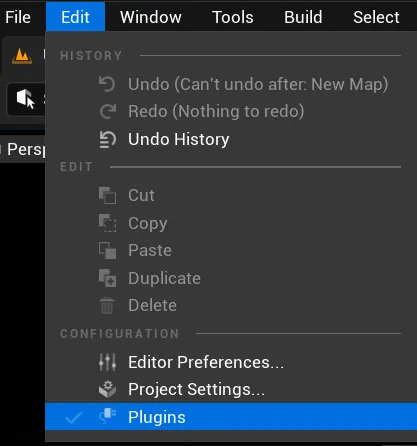

To do this, click **Edit > Plugins**.  
  
Then use the search bar and type in “**Chaos Vehicle**“.  
  
Tick **ChaosVehiclesPlugin**.

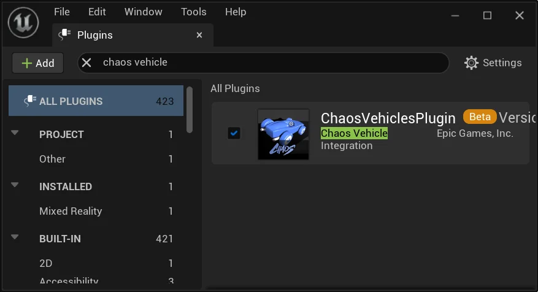

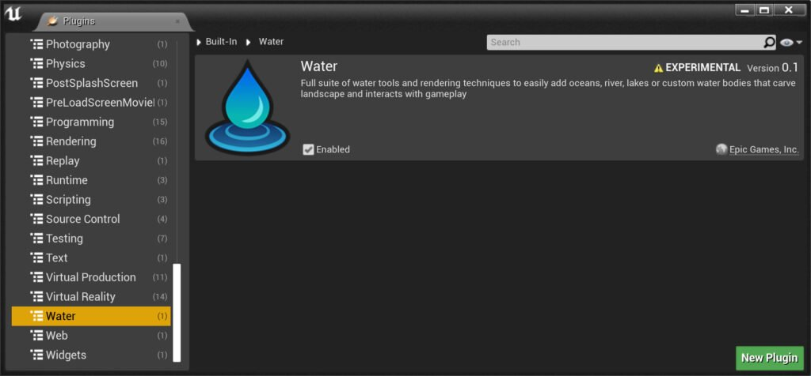

Enable the **Water** Plugin

## Other Settings

These settings should come by default in Unreal Engine 5, but its worth mentioning in case your project was upgraded from 4.27.

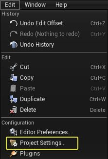

If you plan on using our water decal, which disables the specularity of everything that is underwater, please turn on “**DBuffer Decals**” in the project Settings

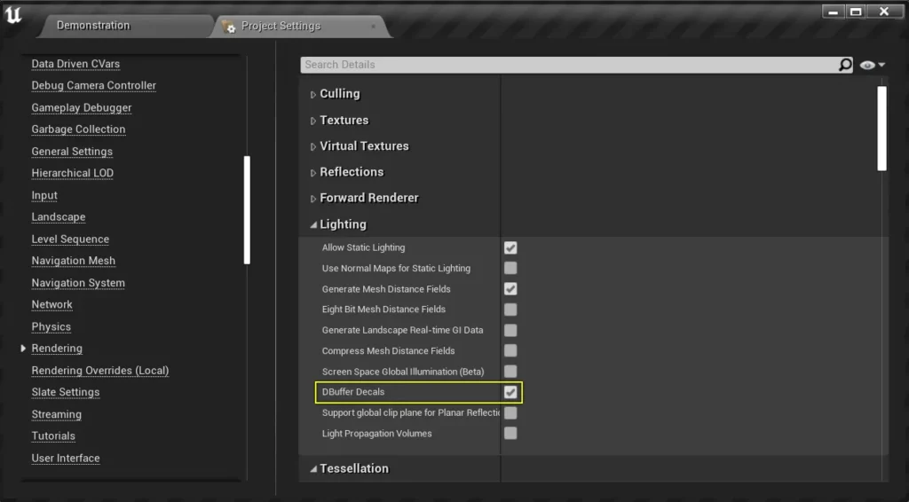

**GRASS TRAILS**  
If you would like to use our grass trails, **Virtual Texture Support** must be enabled.  
Unless you have modified your project’s settings, this should be enabled by default in Unreal 5.

Regardless, you can check that it is enabled by going to:  
**Project Settings > Engine >  Rendering > Virtual Textures > Virtual Texture Support**

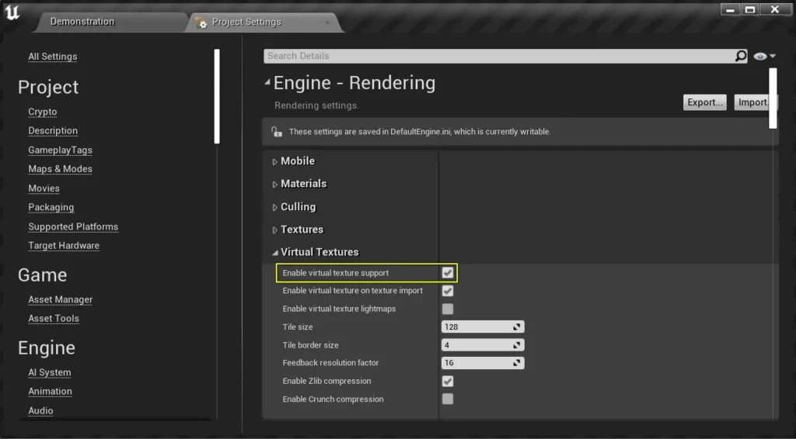

## 5.2 & Below – Control Input Mapping

**IGNORE IF USING 5.3 & ABOVE!**

By default, our Foliage System comes with the **Mannequin Pawn**, and a **Vehicle**.  
If you would like to use these in your own project, you may have to transfer input mapping or create your own custom input for these blueprints.

If using 5.0, you will need to copy over the **DefaultInput.ini** file from the Config folder, and overwrite your own input config folder.  
Otherwise, you will have to manually create the same inputs in your custom project to match the Alien Physics World project.  
  
If you are using 5.3 or above, the our Foliage Physics assets will come with **Enhanced Input** and you won’t need to make any changes.