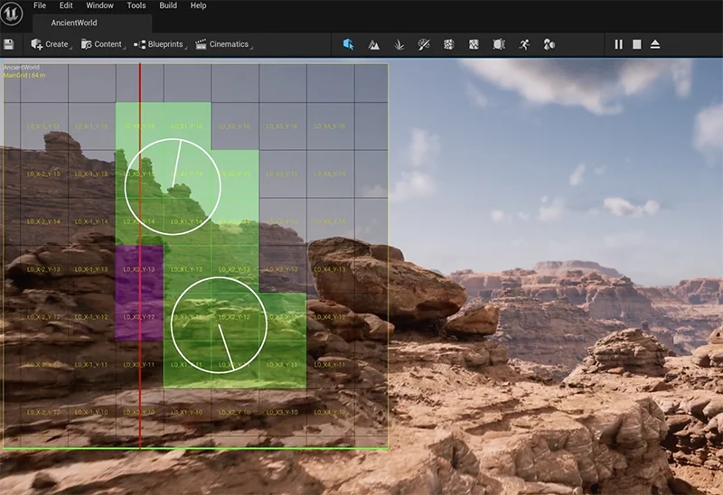
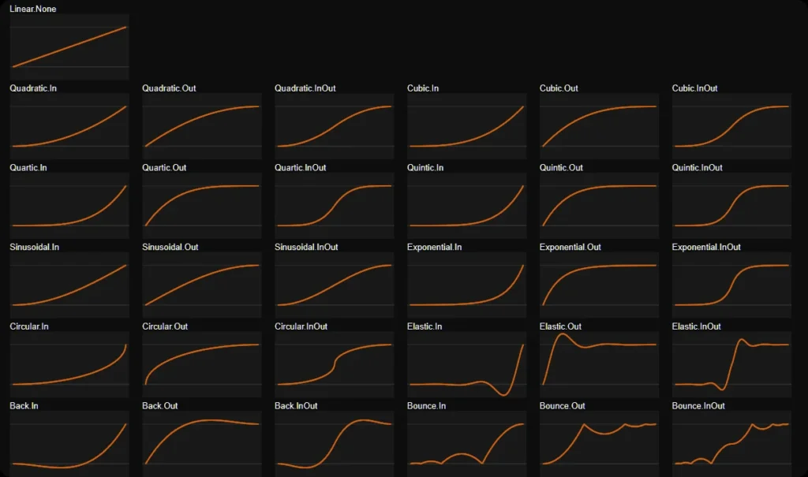
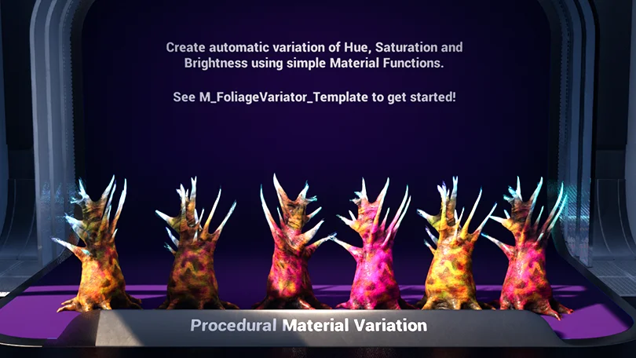

# Pro Features List {#profeatureslist}
The Pro Foliage Parent Blueprint we provide comes with a range of new features, which can be seen below. It also contains all of the Features in our Lite version!

## Weapon Support & Destructible Foliage

Our Foliage Blueprints can now receive physics impulses and damage from weapons. This includes projectiles, beam weapons, and explosions!
We have a number of nodes you can use to apply damage and physics impulses to whatever foliage the weapon hits, and you can also detect which weapon hit what foliage to produce any desired effect you can think of using blueprints! We also created custom blueprint nodes to make the process of creating destructible foliages a breeze!  [[3 Foliage Blueprint – Advanced|Click here to find out how]]

  <iframe 
    loading="lazy"
    src="https://player.vimeo.com/video/1089972357?autoplay=1&muted=1&loop=1&background=1" 
    frameborder="0" 
    allow="autoplay; fullscreen; picture-in-picture; clipboard-write; encrypted-media" 
    style="position: absolute; top: 0; left: 0; width: 100%; height: 100%; pointer-events: none;" 
    title="Feature - Destructible Foliage">
  </iframe>

## Vehicle Support

We’ve included a great example of how to set up our foliage system with Chaos Vehicles!  
[Click here to find out how][chaos-vehicle-collision-settings]

  <iframe 
    loading="lazy"
    src="https://player.vimeo.com/video/1089970679?autoplay=1&muted=1&loop=1&background=1" 
    frameborder="0" 
    allow="autoplay; fullscreen; picture-in-picture; clipboard-write; encrypted-media" 
    style="position:absolute;top:0;left:0;width:100%;height:100%;pointer-events:none;" 
    title="Feature - Vehicle Support">
  </iframe>

## Specific Interaction Detection

You can now detect exactly _which_ object interacted with the foliage—letting you trigger custom responses for each one. In this video, different weapons trigger unique material animations when they hit.  [Click here to find out how to do it!][hitter-id-damage]

  <iframe 
    loading="lazy"
    src="https://player.vimeo.com/video/1089981609?autoplay=1&muted=1&loop=1&background=1" 
    frameborder="0" 
    allow="autoplay; fullscreen; picture-in-picture; clipboard-write; encrypted-media" 
    style="position:absolute;top:0;left:0;width:100%;height:100%;pointer-events:none;" 
    title="Feature - Custom Interaction">
  </iframe>

## Ambient Foliage Effects
A foliage instance painted with the foliage tool is essentially an **Instanced Static Mesh**, which means it can’t have particles, sounds, or other features until it’s converted to a Foliage Blueprint. To solve this dilemma, we designed a system that allows additional blueprints to be placed at the same locations as foliage instances. This lets us create effects like mud particles randomly squirting out of **Gas-Pods** _(as seen in our demonstration levels)_. 
[[2 Creating Custom Foliage/6 Foliage Link System - PRO|Click here for Documentation on the topic!]]

  <iframe 
    loading="lazy"
    src="https://player.vimeo.com/video/1089979153?autoplay=1&muted=1&loop=1&background=1" 
    frameborder="0" 
    allow="autoplay; fullscreen; picture-in-picture; clipboard-write; encrypted-media" 
    style="position:absolute;top:0;left:0;width:100%;height:100%;pointer-events:none;" 
    title="Feature - Foliage Ambient FX">
  </iframe>

## Bone-Based Physics Detection

In our Lite system, foliage uses a collision box based on its scale to stay active while players or objects are nearby. This works well for simple foliage, but fails with long, complex assets like vines—since bones can move outside the original box after being hit.

To fix this, we added a smarter system that checks distance from each bone instead. It’s more accurate for things like vines, but slightly heavier on performance—so only use it when needed.  
[Click here to learn how to do it.][pro-influencer-detection-settings]

  <iframe 
    loading="lazy"
    src="https://player.vimeo.com/video/1089954454?autoplay=1&muted=1&loop=1&background=1" 
    frameborder="0" 
    allow="autoplay; fullscreen; picture-in-picture; clipboard-write; encrypted-media" 
    style="position:absolute;top:0;left:0;width:100%;height:100%;pointer-events:none;" 
    title="Feature - Bone-Based Physics">
  </iframe>

## World Partitions, Level Streaming, PCG & Nanite Support

The Pro system works perfectly fine with all the latest Unreal Engine features, including but not limited to:

- **World Partitions**
- **Level Streaming**
- **Procedural Content Generation**
- **Nanite** _(Nanite Static Meshes will only work with Wind in 5.6)_

### Tweener Component

Imagine trying to create a material animation each time a foliage is interacted with. Naturally, you’d want to use something like a timeline to ease in / ease out the new material value. We thought this would be a waste of time (and performance), so we created a Tweener Component that lets you create a huge range of animations instantly.

These tweening animations are highly performant, allowing your player to interact with hundreds of animated foliage without issues.  
  
This component can integrated into any kind of blueprint, not just foliage – opening the door to a wide range of possibilities.  
[[Advanced Features/3 Tweener Component - PRO|Click here to learn more!]]

### Static-Mesh Only Foliages

Some foliage may not require a skeletal mesh, and instead only require a static mesh. Landmines are one such example.  
You can now disable or enable the static mesh or skeletal mesh inside your Foliage Blueprint.  
[Click here to learn how!][static-or-skeletal]

  <iframe 
    loading="lazy"
    src="https://player.vimeo.com/video/1089980394?autoplay=1&muted=1&loop=1&background=1" 
    frameborder="0" 
    allow="autoplay; fullscreen; picture-in-picture; clipboard-write; encrypted-media" 
    style="position:absolute;top:0;left:0;width:100%;height:100%;pointer-events:none;" 
    title="Feature - Landmine">
  </iframe>

### Improved Object Pooling

Object Pooling is a system that reuses objects instead of constantly spawning and destroying them when the game needs those objects.  
It maintains a pool of ready-to-use assets by borrowing and returning them from a memory ‘pool’ as the game requires them.  
Our Pro version utilizes an enhanced system of object pooling to account for the inevitable performance drop that would occur when an explosion affects loads of foliage at once.  
[[3 Foliage Blueprint – Advanced#Foliage & Object Pooling|Click here to learn how to apply it to your custom foliages.]]

  <iframe 
    loading="lazy"
    src="https://player.vimeo.com/video/1089979678?autoplay=1&muted=1&loop=1&background=1" 
    frameborder="0" 
    allow="autoplay; fullscreen; picture-in-picture; clipboard-write; encrypted-media" 
    style="position:absolute;top:0;left:0;width:100%;height:100%;pointer-events:none;" 
    title="Feature - Performance">
  </iframe>

### Auto-Material Variation

Add variety to your foliage with our Automatic Material Variation function! It might seem simple, but ensuring both a foliage instance and a skeletal mesh share the same randomized material value took many days to develop due to the complexities of GPU instancing.  

# Level Design Tools

### Instant Grass Loading

Unreal’s native grass landscape system can often take minutes for the grass to appear in-game upon opening a level.  
We have no idea why they haven’t patched this, so we did! Just drag in **BP_GrassLoader** into your level, and set the designated landscape in the details panel and it will instantly load landscape grass. 

[Click here to learn more][instant-grass-loader]

  <iframe 
    loading="lazy"
    src="https://player.vimeo.com/video/1089968277?autoplay=1&muted=1&loop=1&background=1" 
    frameborder="0" 
    allow="autoplay; fullscreen; picture-in-picture; clipboard-write; encrypted-media" 
    style="position:absolute;top:0;left:0;width:100%;height:100%;pointer-events:none;" 
    title="Feature - Grass Loading">
  </iframe>

### Static Mesh to Foliage Converter
Using Unreal’s native foliage placement tool can be a nightmare when you want to carefully position and scale certain foliage.  
We developed a simple tool that allows you to instead place a static mesh, which will be converted into a foliage instance at the start of the game.  
[Click here to learn how its done][static-mesh-foliage-placement-blueprint]

  <iframe 
    loading="lazy"
    src="https://player.vimeo.com/video/1089957451?autoplay=1&muted=1&loop=1&background=1" 
    frameborder="0" 
    allow="autoplay; fullscreen; picture-in-picture; clipboard-write; encrypted-media" 
    style="position:absolute;top:0;left:0;width:100%;height:100%;pointer-events:none;" 
    title="Feature - Mesh to Foliage">
  </iframe>

### Grouped Foliage Placement

Static meshes are often grouped together in blueprints to make level design easier. We applied the same method to foliages, so you can now place them inside any blueprint as a static mesh, and have them be converted into foliage instances at the start of the game. **[Click here to learn more.][grouped-foliage-placement]**

  <iframe 
    loading="lazy"
    src="https://player.vimeo.com/video/1089955636?autoplay=1&muted=1&loop=1&background=1" 
    frameborder="0" 
    allow="autoplay; fullscreen; picture-in-picture; clipboard-write; encrypted-media" 
    style="position:absolute;top:0;left:0;width:100%;height:100%;pointer-events:none;" 
    title="Tools">
  </iframe>

# Weapons System

To speed up development, we crafted a C++ Weapons system, that allows you to quickly and efficiently create any kind of projectile or beam weapon, with single fire and rapid fire capabilities.

It handles weapon registration and controls weapon selection, enabling players to switch between different weapons. This component also manages firing actions, including aim-down-sights functionality, and integrates with the Foliage System to produce foliage impacts, damage, and destruction.  

  <iframe 
    loading="lazy"
    src="https://player.vimeo.com/video/1090304038?autoplay=1&muted=1&loop=1&background=1" 
    frameborder="0" 
    allow="autoplay; fullscreen; picture-in-picture; clipboard-write; encrypted-media" 
    style="position:absolute;top:0;left:0;width:100%;height:100%;pointer-events:none;" 
    title="Feature - Weapons">
  </iframe>

##### **WEAPON LIST**

- Single Fire Projectile
- Single Fire Projectile
- Rapid Fire Projectile
- Single Fire Beam Weapon
- Rapid Fire Beam Weapon
- Constant Beam Weapon
- Grenade Launcher

##### **WEAPON FEATURES**

- Explosion Decal
- Bullethole decal that sticks to static and movable objects
- Sparks that Ricochet according to firing angle
- Customize Impulse Force to Foliages and Non-Foliages seperately
- Customize damage to Foliages and Non-Foliages seperately
- Explosions create water ripples

# Weather System

We’ve included a custom weather system that currently supports rain, hail, and lightning – to showcase how weather can affect foliage.

  <iframe 
    loading="lazy"
    src="https://player.vimeo.com/video/1089956161?autoplay=1&muted=1&loop=1&background=1" 
    frameborder="0" 
    allow="autoplay; fullscreen; picture-in-picture; clipboard-write; encrypted-media" 
    style="position:absolute;top:0;left:0;width:100%;height:100%;pointer-events:none;" 
    title="Weather">
  </iframe>

### Core Weather Blueprint

- Provides **Saving** **and Loading** of exact weather state
- Allows for **randomized weather patterns**
- Rain and Hail **blows** with the **intensity** and **direction** provided by **BP_WindController**
- **Customize** Raining and Non-Raining **Fog Visuals** in the viewport before applying to the system
- Rain **Sounds** **adjust dynamically**, according to rain heaviness
- **Material Wetness fades out** much **slower** than it fades in, simulating the drying effect
- **Hail** Particles **bounce off objects** with collision
- Can **start** and **stop** rain based on calling **Events**.
- Fades **water murkiness** on water material **when raining**
- Automatically **increases the water level** of **BP_RisingWater** based on rain heaviness
- Provides **numerous hail controls**, including chance of hail, and rain heaviness threshold before hailing

### 2D Background Lightning

To craft immersive stormy atmospheres, our 2D Background Lightning feature simulates distant flashes across your sky.  
It’s managed through a Blueprint, giving you straightforward control over the flash color, intensity, how it illuminates the sky and clouds during a flash, its duration, and the timing between strikes. This allows you to easily set the mood, from occasional flickers to intense, frequent storms in the distance.  
**[Click here for documentation.][2d-background-lightning]**

### 3D Foreground Lightning

Spice up your level with some 3D Foreground lightning! This lightning blueprint will strike at designated targetpoints or random locations within your navmesh, causing sparks and leaving a hit decal that fades over time. This system has tones of customizable settings, including brightness, damage settings, auto-height detection, and more.  
**[Click here for documentation.][3d-foreground-lightning]**

### Parallax Occlusion Shadows

We created a material function that integrates both our 2D & 3D lightning systems to cast shadows on Parallaxed Occlusion Landscapes, to help add realism.

### Rising Water Blueprint

**Unreal Engine’s built-in water plugin struggles to simulate rising water levels.**  
While **[community solutions](https://forums.unrealengine.com/t/water-plugin-movable-water-bodies/157949/10)** exist, they often break with engine updates – and there is no current solution for the latest engine version.  To address this, we’ve developed a simpler system that reliably handles rising water, regardless of engine version. Our approach sacrifices full water simulation, including waves – but it still contains ripples that respond to players, objects and explosions, and is suitable for most scenarios involving rising water levels.

 [[4 Environment Features/6 Rising Water Blueprint - PRO|Click here to learn more!]]

# Grass & Landscape Trails

Whether your character is running through snow, mud, sand, or a grassy bioluminescent field – we’ve built a system that covers all of it. Any actor with a specific render flag will interact with the trails system, including vehicles objects or your player’s mesh. [[4 Environment Features/4 Grass & Landscape Effects - PRO|Click here to learn more.]]

  <iframe 
    loading="lazy"
    src="https://player.vimeo.com/video/1090299899?autoplay=1&muted=1&loop=1&background=1" 
    frameborder="0" 
    allow="autoplay; fullscreen; picture-in-picture; clipboard-write; encrypted-media" 
    style="position:absolute;top:0;left:0;width:100%;height:100%;pointer-events:none;" 
    title="Feature - Grass Trails">
  </iframe>

# Bonus Content

### Distance Field Fix

Unreal 5’s distance fields are great, but they aren’t smooth like Unreal 4. This makes it problematic when creating glow effects like what we see here in the water.
So we fixed it! All thats needed is to [drag a blueprint into the level][WaterPixellation] and you’re done.

  <iframe 
    loading="lazy"
    src="https://player.vimeo.com/video/1089959470?autoplay=1&muted=1&loop=1&background=1" 
    frameborder="0" 
    allow="autoplay; fullscreen; picture-in-picture; clipboard-write; encrypted-media" 
    style="position:absolute;top:0;left:0;width:100%;height:100%;pointer-events:none;" 
    title="Feature - Distance Field Fix">
  </iframe>

### Water Fluid Simulation Fix

Unreal’s built-in fluid simulation looks great—but it has strict limits. You can only have 6 fluid sims active in a level and 3 per blueprint. Go over that, and Unreal will randomly pick which ones work. Not ideal. So we built a smarter version.

  <iframe 
    loading="lazy"
    src="https://player.vimeo.com/video/1089975056?autoplay=1&muted=1&loop=1&background=1" 
    frameborder="0" 
    allow="autoplay; fullscreen; picture-in-picture; clipboard-write; encrypted-media" 
    style="position:absolute;top:0;left:0;width:100%;height:100%;pointer-events:none;" 
    title="Feature - Water Impulses">
  </iframe>

Our system automatically enables the 6 closest fluid sims during gameplay and disables the rest. It gives the illusion that more than 6 are active—without breaking the engine’s rules.  
We also improved how fluid reacts to explosions. When a blast happens, our blueprint temporarily prioritizes impulse-based fluid sims to apply force accurately.  
It works out of the box with both Epic’s default water materials and Etherion’s custom ones.  
More fluid, fewer limits. [Click here to dive in!][FluidSimFix]

### Wind that doesn’t blow Underwater

We added a useful modification to the wind system, by creating a material function that prevents wind from blowing underwater.  
