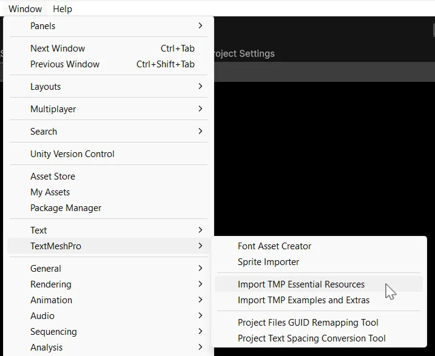

# Installation

## Requirements

| Requirement     | Details                                                                                                           |
| --------------- | ----------------------------------------------------------------------------------------------------------------- |
| Unity           | Unity 6 (6000.0 LTS or newer)                                                                                     |
| Render pipeline | URP or HDRP with Shader Graph                                                                                     |
| TextMeshPro     | Required for the Character Creator menu, Built into Unity.<br>Import **TMP Essential Resources** once (see below) |
| Input           | Works with the Input System package or the old Input Manager. Nothing extra to install                            |

Nothing else needs to be downloaded. The ragdolls use Unity's built-in physics, so no Cinemachine or other packages are needed.

### Import TMP Essential Resources

The customization menu uses TextMeshPro text. The first time you open a scene with the menu, Unity may ask you to import TMP Essential Resources. Click **Import**.

To do it yourself: **Window > TextMeshPro > Import TMP Essential Resources**.



### Using HDRP

The pack opens in URP. For HDRP, import the HDRP files over the top once:

1. Make sure your project uses HDRP and has no errors in the Console.
2. Open an empty scene, so no goblin scene is open.
3. Recommended: delete these three folders first: `Goblin/Shaders`, `Goblin/Materials` and `Goblin/Demo/Scenes`. Don't delete anything else.
4. Double-click `Goblin_HDRP.unitypackage` and click **Import**.

The HDRP files replace the URP ones under the same names, so every prefab and scene keeps its materials. Don't open or save a goblin prefab between steps 3 and 4.

> [!tip] Skin looks flat or slightly pink in HDRP
> The skin uses the `DiffusionProfile_GoblinSkin` diffusion profile. HDRP only uses profiles listed in a **Diffusion Profile List**. Select `M_Goblin_Skin` and click **Fix** if the Inspector shows a warning, or add the profile to the Diffusion Profile List in your Volume or in **Project Settings > Graphics > HDRP**.

---

## What's in the pack

Everything lives under `Assets/EtherionDesigns/Goblin/`, plus the ARKit Live Link Face Capture tool in `Assets/EtherionDesigns/FaceCapture/`.

```
EtherionDesigns/
├─ FaceCapture/          ARKit Live Link Face Capture, for driving the goblin's face from an iPhone. See its DOCUMENTATION.txt
└─ Goblin/
   ├─ Animations/        Goblin animation clips (FBX)
   ├─ Characters/        Goblin meshes, prefabs (plain and ragdoll) and the AC_Goblin controller
   ├─ Data/              Limits file and Archetype Set for the character creator
   ├─ Demo/              Optional. Delete it if you don't need the examples
   │  ├─ Animations/     AC_Goblin_ThirdPerson controller for the playable demo goblin
   │  ├─ Prefabs/        PF_Demo_GoblinPlayer (playable goblin with its camera)
   │  ├─ Scenes/         Demo, ThirdPerson and WeaponsPreview scenes
   │  ├─ Scripts/        Scripts for the demo scenes
   │  └─ Textures/       Studio cubemap for the demo reflections
   ├─ Documentation/     Tech specs and guides
   ├─ Materials/         Skin, clothes, teeth and eye materials, plus skin and eye variations
   ├─ Scripts/
   │  ├─ Runtime/        Character creator and Ragdoll
   │  └─ Editor/         Inspectors and Tools menu items
   ├─ Shaders/           Shader Graphs for the skin and eyes, warpaint function
   ├─ Textures/          All textures
   ├─ UI/                Customization menu prefabs
   └─ Weapons/           Stone age weapon meshes, materials and prefabs
```

> [!info] Already own ARKit Live Link Face Capture?
> Every Etherion Designs pack ships the same FaceCapture files, so importing it again changes nothing. If your copy is newer, untick the `FaceCapture` folder in the import window.

### The goblin prefabs

All of them are in `Goblin/Characters/`:

| Prefab | Description |
|---|---|
| `PF_Goblin` | <!-- TODO: describe outfit --> |
| `PF_Goblin_Basic` | <!-- TODO: describe outfit --> |
| `PF_Goblin_Naked` | <!-- TODO: describe outfit --> |
| `PF_Goblin_Ragdoll`, `PF_Goblin_Basic_Ragdoll`, `PF_Goblin_Naked_Ragdoll` | The same three goblins with a ragdoll ready for death. See [Ragdoll deaths](<3 Adding Goblins to Your Game.md#ragdoll-deaths>) |

The plain prefabs have no physics, movement or camera on them, so they work with any controller or AI system you already use. Use the ragdoll versions if you want the goblin to collapse when it dies.


> 📷 **Image:** All three goblins standing side by side in a neutral scene, labelled with their prefab names.

> [!tip]
> Always use the `PF_` prefabs, not the `SKM_` FBX files. The prefabs already have the Animator, avatar, controller and LODs set up.
