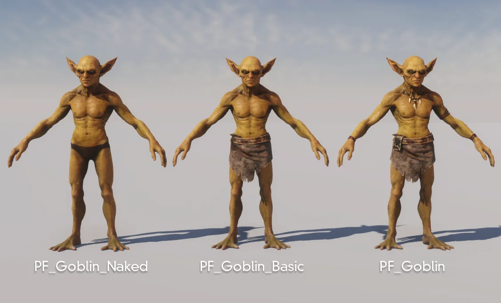

# Installation

## Requirements

| Requirement     | Details |
| --------------- | ------- |
| Unity           | Unity 6 (6000.0 LTS or newer) |
| Render pipeline | URP or HDRP with Shader Graph |
| TextMeshPro     | Only needed for the customization menu. Built into Unity. If Unity asks to import **TMP Essential Resources**, click **Import** |
| Input           | Works with the Input System package or the old Input Manager. Nothing extra to install |

Nothing else needs to be downloaded.

## Using HDRP

The pack opens in URP. For HDRP, swap in the HDRP files once:

1. Make sure your project uses HDRP and has no errors in the Console.
2. Open a new, empty scene, so no goblin scene is open.
3. In `EtherionDesigns/Goblin/`, delete these three folders: `Demo`, `Materials` and `Shaders`. Don't delete anything else.
4. Double-click `EtherionDesigns/Goblin/HDRP Patch.unitypackage` and click **Import**.

The patch puts HDRP versions of those three folders back under the same names, so every prefab keeps its materials. Don't open or save a goblin prefab between steps 3 and 4.

> [!tip] Skin looks flat or slightly pink in HDRP
> The skin uses the `DiffusionProfile_GoblinSkin` diffusion profile. HDRP only uses profiles listed in a **Diffusion Profile List**. Select `M_Goblin_Skin` and click **Fix** if the Inspector shows a warning, or add the profile to the Diffusion Profile List in your Volume or in **Project Settings > Graphics > HDRP**.

## Check that it works

Open a demo scene from `Goblin/Demo/Scenes/` and press **Play**:

| Scene | What you see |
|---|---|
| `Demo` | Goblins with random looks and the customization menu. Press **M** to open or close the menu. Left drag orbits the camera, middle drag pans, scroll zooms |
| `ThirdPerson` | A goblin you can walk around. W A S D to move, Left Shift to run, Space to jump, K to ragdoll, R to stand back up |
| `WeaponsPreview` | The included weapons |


The playable goblin in the ThirdPerson scene is a simple example, not a full player controller.

---

## What's in the pack

### The goblin prefabs

All of them are in `Goblin/Characters/`:

| Prefab                                                                    | Description                                                                                                                   |
| ------------------------------------------------------------------------- | ----------------------------------------------------------------------------------------------------------------------------- |
| `PF_Goblin`                                                               | Fully Clothed                                                                                                                 |
| `PF_Goblin_Basic`                                                         | Loincloth only                                                                                                                |
| `PF_Goblin_Naked`                                                         | Underwear                                                                                                                     |
| `PF_Goblin_Ragdoll`, `PF_Goblin_Basic_Ragdoll`, `PF_Goblin_Naked_Ragdoll` | The same three goblins with a ragdoll ready for death. See [Ragdoll deaths](<2 Using Goblins with Your AI.md#ragdoll-deaths>) |

The plain prefabs have no collider, physics, movement or camera on them, so they work with any controller or AI system you already use. Use the ragdoll versions if you want the goblin to collapse when it dies.



> [!tip]
> Always use the `PF_` prefabs, not the `SKM_` FBX files. The prefabs already have the Animator, avatar and Goblin Appearance set up.

### Folders

Everything lives under `Assets/EtherionDesigns/`:

```
EtherionDesigns/
├─ FaceCapture/          ARKit Live Link Face Capture, for driving the goblin's face from an iPhone
└─ Goblin/
   ├─ Animations/        Goblin animation clips
   ├─ Characters/        Goblin meshes, prefabs (plain and ragdoll) and the AC_Goblin controller
   ├─ Data/              Limits file and Archetype Set for the character creator
   ├─ Demo/              Demo scenes and their scripts, plus the AC_Goblin_ThirdPerson controller
   ├─ Materials/         Skin, clothes, teeth, eye and weapon materials
   ├─ Meshes/            Weapon meshes
   ├─ Prefabs/           Weapon prefabs
   ├─ Scripts/           Character creator and Ragdoll
   ├─ Shaders/           Shader Graphs for the skin, eyes and weapons
   ├─ Textures/          All textures
   └─ UI/                Customization menu prefabs
```

> [!info] Already own ARKit Live Link Face Capture?
> Every Etherion Designs pack ships the same FaceCapture files, so importing it again changes nothing. If your copy is newer, untick the `FaceCapture` folder in the import window.

### Tech specs

| Spec | Value |
|---|---|
| Rig | Unity Humanoid |
| Triangles | 89,606 (`PF_Goblin`), 77,903 (`PF_Goblin_Basic`), 73,707 (`PF_Goblin_Naked`) |
| LODs | None. One mesh per goblin |
| Blend shapes | 74: 52 ARKit face shapes for facial animation, and 22 body and face shapes used by the character creator |
| Skin and eye materials | 6 skins and 12 eyes |
| Animations | 7 Humanoid clips: idle, walk, walk in place, run, jump, fall and land |
| Ragdoll | 11 bones, 30 kg in total |
| Size | Fits a capsule 1.9 m tall with a 0.32 m radius |
| Weapons | 10 stone age weapons |
