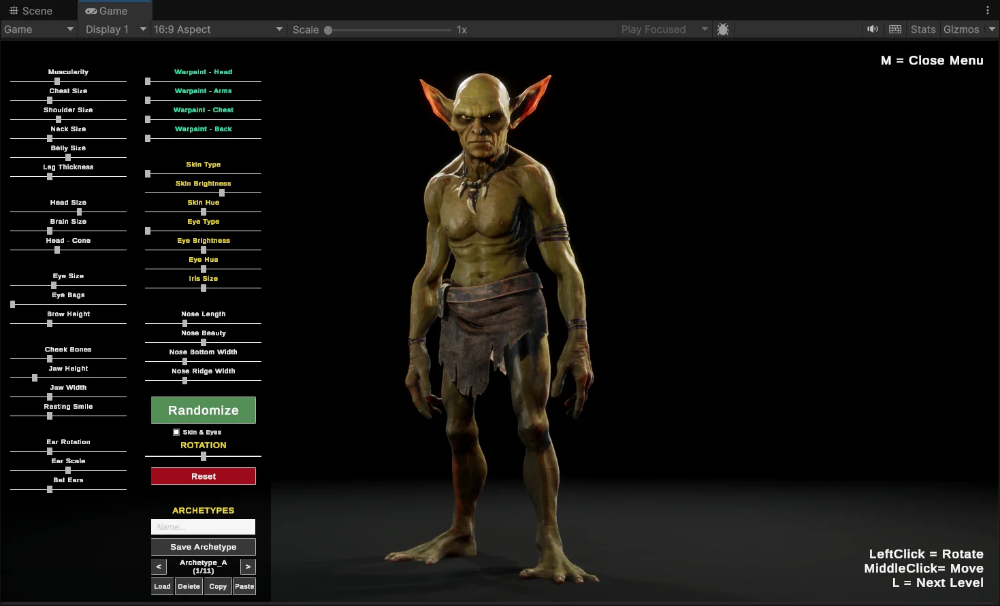
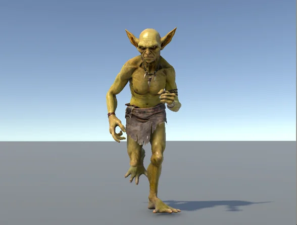

# Demo Scenes

## Demo scene (character creator)

1. Open `Goblin/Demo/Scenes/Demo.unity`.
2. Press **Play**.
3. Every goblin gets a random look. The customization menu opens on the left.
4. Drag the sliders to reshape the goblin. Drag with the **left mouse button** to orbit the camera, drag with the **middle mouse button** to move it up, down, left and right, and scroll to zoom.
5. Press **M** to close or open the menu. The camera keeps working with the menu closed.

> 📷 **Image:** The Game view in Play mode, showing the customization menu on the left and a goblin in the centre.

## ThirdPerson scene (playable goblin)

1. Open `Goblin/Demo/Scenes/ThirdPerson.unity`.
2. Press **Play**.
3. Controls:

| Action | Keyboard and mouse | Gamepad |
|---|---|---|
| Move | W A S D or arrow keys | Left stick |
| Run | Hold Left Shift | Click left stick |
| Jump | Space | South button (A / Cross) |
| Look | Mouse | Right stick |
| Zoom | Scroll wheel | |
| Ragdoll (die) | K | |
| Stand back up | R | |
| Free the cursor | Escape (click to lock it again) | |

> 📷 **Image:** The goblin mid-run in the ThirdPerson scene, camera behind and slightly above.

The playable goblin in this scene (`Demo/Prefabs/PF_Demo_GoblinPlayer`) is a simple example, not a full player controller. Use your own character controller in your game.
