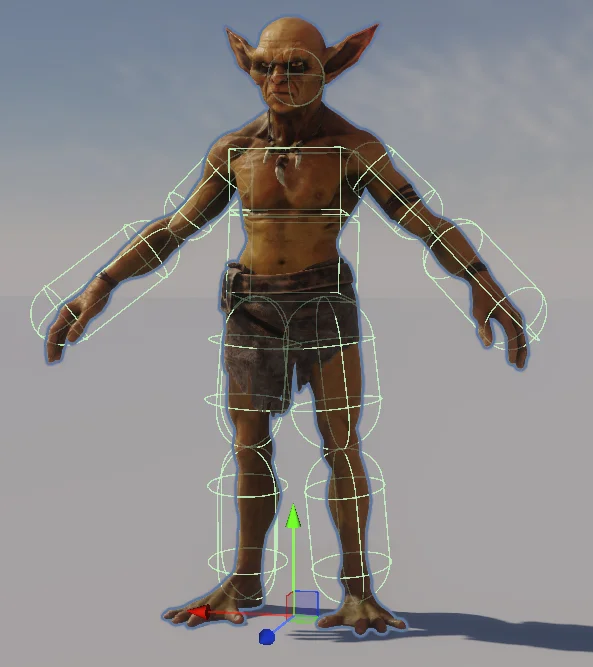
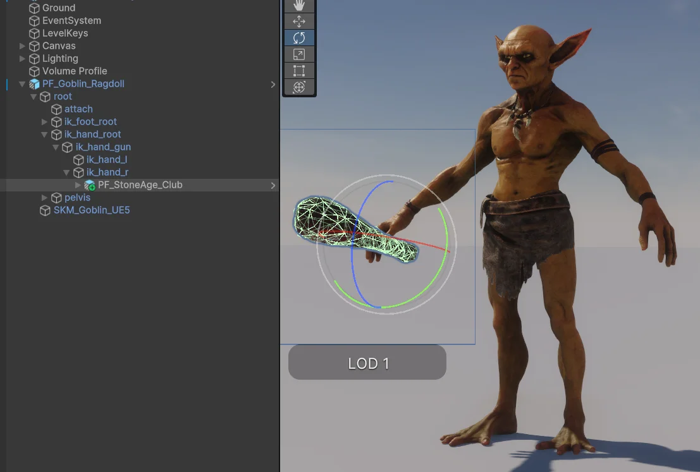

# Using Goblins with Your AI

The goblin is a standard Unity **Humanoid** character. Anything that works with a Humanoid works with the goblin: your AI, your character controller and your animations. The fastest way to get a goblin into your game is to put it into the enemy setup you already have.

## Pick your route

| You have | Do this |
|---|---|
| An enemy that already works with another Humanoid model | [Route A: swap the goblin into your enemy](#route-a-swap-the-goblin-into-your-enemy) |
| An AI or controller asset, such as Emerald AI, Invector or Opsive | [Route B: use the asset's own setup tool](#route-b-ai-and-controller-assets) |

> [!tip] Work on a Prefab Variant
> Right-click a goblin prefab in `Goblin/Characters/` and choose **Create > Prefab Variant**. Add your own components to the variant. A pack update replaces the original prefab, but your variant keeps everything you added.

## Route A: swap the goblin into your enemy

Your enemy already has AI, movement and an Animator Controller with Humanoid animations. The goblin only replaces the body.

**If your components sit on the same object as the model:**

1. Create a Prefab Variant of `PF_Goblin`, or of `PF_Goblin_Ragdoll` if you want ragdoll deaths.
2. Open the variant and add your components to its root: your AI script, NavMesh Agent or Character Controller, collider, health script and so on. To copy one from your old enemy, click the three dots on the component, choose **Copy Component**, then **Paste Component As New** on the goblin.
3. On the goblin's **Animator**, set **Controller** to your own Animator Controller. Leave **Avatar** as it is.
4. Set **Apply Root Motion** the same way as on your old enemy.
5. Press **Play**.

**If your enemy keeps the model as a child object:**

1. Open your enemy prefab and drag a goblin prefab in as a child, next to the old model.
2. Delete or disable the old model.
3. On the goblin's **Animator**, set **Controller** to your own Animator Controller.
4. If your scripts hold a reference to the old model's Animator, point them at the goblin's Animator.

Your animations play on the goblin without any extra work, because Unity retargets Humanoid animations between Humanoid characters.

> [!warning] Your animations must be Humanoid
> If the goblin stands in a T-pose, your clips are probably set to **Generic**. Select the animation file, open the **Rig** tab and set **Animation Type** to **Humanoid**.

### Sizes for your collider or agent

The plain goblin prefabs have no collider and no movement component, so nothing fights with your own. Use these sizes as a starting point:

| Setting | Value |
|---|---|
| Height | 1.9 m |
| Radius | 0.32 m |
| Centre | 0.95 m above the feet |
| Facing | +Z at rotation 0 |

## Included animations

The pack includes 7 Humanoid clips in `Goblin/Animations/`. Drag them into your own Animator Controller like any other clip.

| Clip | Length | Notes |
|---|---|---|
| Idle | 7.57 s | Loops |
| Walk_Fwd | 2.73 s | Loops. Made for 2.54 m/s |
| Walk_InPlace | 2.73 s | Loops. Stays in place |
| Run_Fwd | 1.90 s | Loops. Made for 5.62 m/s |
| Jump | 0.87 s | Take-off |
| Fall_Loop | 3.00 s | Loops while in the air |
| Land | 0.87 s | Landing |

There are **no attack, hit or death animations**. Use your own, or any Humanoid animation from the Asset Store.

`AC_Goblin`, the controller on the prefabs, only plays Idle. It is a plain list of the clips with nothing connecting them, so replace it with your own controller.

## Route B: AI and controller assets

Assets such as Emerald AI, Invector and Opsive have their own setup tool that builds an enemy from a Humanoid model. Give that tool the plain `PF_Goblin` prefab and follow the asset's instructions.

Most of these assets build their own ragdoll. Use the plain prefabs with them, not the `_Ragdoll` ones, so two ragdolls don't fight each other.

---

## Ragdoll deaths

The `_Ragdoll` prefabs have a ready-made ragdoll on 11 bones, 30 kg in total. While the goblin is alive, the ragdoll follows the animation and does nothing. When it dies, the animation stops and physics takes over.



If you would rather play a death animation, use the plain prefabs and skip this section.

### 1. Tell the ragdoll what to switch off

Select the goblin and find the **Ragdoll** component on its root. Add these to **Disable On Death**:

- Your AI script
- Your NavMesh Agent
- The collider you added to the root

The Animator and a Character Controller are switched off automatically. Anything else you leave out keeps running after death. A NavMesh Agent left on will keep walking the dead body around.

### 2. Call Die from your damage code

```csharp
using EtherionDesigns.Goblin;

var ragdoll = goblin.GetComponent<Ragdoll>();

ragdoll.Die();                                // collapse on the spot
ragdoll.Die(hitDirection * 150f, hitPoint);   // knocked back from the hit point
ragdoll.Revive();                             // stand up again where the body ended up
bool dead = ragdoll.IsDead;
```

To try it without code, enter Play mode, right-click the **Ragdoll** component header and choose **Die** or **Revive**.

### 3. Clean up the body

Use the **On Death** event on the Ragdoll component for sounds, loot or score. To remove the body after a while:

```csharp
ragdoll.Die(hitDirection * 150f, hitPoint);
Destroy(ragdoll.gameObject, 10f);   // remove the body after 10 seconds
```

If you reuse enemies from a pool, call `Revive()` before sending the goblin back out.

### Ragdoll settings

| Setting | What it does |
|---|---|
| **Disable On Death** | Components turned off by Die and back on by Revive |
| **Colliders While Alive** | On: the limb colliders stay active while alive, so raycasts and projectiles can hit the head, chest, arms and legs separately. Turn it off if your goblin has its own Rigidbody on the root and starts to jitter |
| **Inherit Velocity** | The body keeps the goblin's speed when it dies. This only works with a Character Controller. With a NavMesh Agent, pass a push to `Die(impulse, point)` instead |
| **On Death / On Revive** | Events for your own sounds, effects or game logic |

---

## Weapons

The pack includes 10 stone age weapons in `Goblin/Prefabs/`: an axe, a club, 3 hammers, 2 knives, a pickaxe, a spear and a stone. Open `Demo/Scenes/WeaponsPreview.unity` to see them all.

To put one in a goblin's hand:

1. Open your goblin Prefab Variant.
2. Type `hand_r` into the Hierarchy search box and select that bone. Use `hand_l` for the left hand.
3. Drag a weapon prefab onto the bone, so it becomes a child.
4. Set the weapon's **Position** to `0, 0, 0`, then move and rotate it until it sits in the grip.
5. Remove the **Mesh Collider** from the held weapon. It is there for weapons lying in the world. For hits, add your own trigger collider.



---

## Lots of goblins

- **Different looks:** set **On Start** to **Generate** on the Goblin Appearance component, and every goblin you spawn gets its own body, face, skin and warpaint. See [Appearance and Variation](<3 Appearance and Variation.md>).
- **Performance:** each goblin is one mesh of 73,707 to 89,606 triangles, with no LOD meshes. Plan your enemy counts around that.
