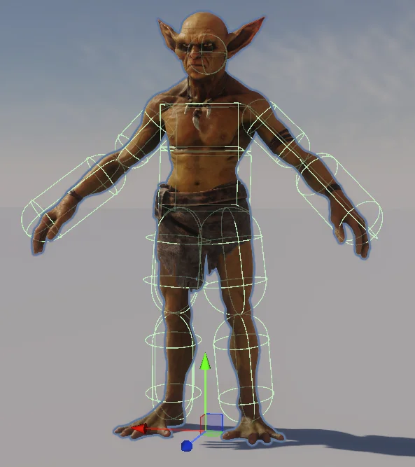

# Adding Goblins to Your Game

## Placing a goblin in your scene

1. In the Project window, open `Goblin/Characters/`.
2. Drag a `PF_Goblin` prefab into the Scene view or Hierarchy.
3. Set its **Position** and **Rotation** to `0, 0, 0` (or wherever you want it). The goblin faces **+Z** at rotation 0.
4. Press Play. The goblin plays its idle animation.


> 📷 **Image:** A goblin in the Scene view with the Inspector showing the Transform at 0,0,0 and the Animator component below it.

### What's on the prefab

| Component | Purpose |
|---|---|
| **Animator** | Plays the animations. Uses the goblin's Humanoid avatar and the shared `AC_Goblin` controller. Apply Root Motion is off. |
| **LOD Group** | Swaps to lower-detail meshes at a distance: 50 %, 25 % and 10 % screen height, culled below 2 %. |
| **Goblin Appearance** | The character creator. Set to **Keep Current**, so the goblin looks exactly as you set it up. See [Random goblins](<5 Random Goblins.md>) to make it randomize instead. |

The ragdoll prefabs have all of the above plus the ragdoll (see the next sections).

---

## Animations

### Included clips

| Clip | Length | Notes |
|---|---|---|
| Idle | 7.57 s | Loops |
| Walk_Fwd | 2.73 s | Loops. Travels forward at 2.54 m/s |
| Walk_InPlace | 2.73 s | Loops. Stays in place |
| Run_Fwd | 1.90 s | Loops. Travels forward at 5.62 m/s |
| Jump | 0.87 s | Take-off |
| Fall_Loop | 3.00 s | Loops while in the air |
| Land | 0.87 s | Landing |

All clips are **Humanoid**, so they also play on any other Humanoid character, and any Humanoid animation from the Asset Store plays on the goblin.

### The Animator Controller

`Goblin/Characters/AC_Goblin.controller` holds every clip, with Idle as the default. All three goblin prefabs share this one controller. Change it once and every goblin follows.


> 📷 **Image:** The Animator window with `AC_Goblin` open, showing all states with Idle in orange as the default.

### Playing a clip

To preview a clip in the editor:

1. Select a clip FBX in `Goblin/Animations/`.
2. In the Inspector, drag the goblin prefab onto the preview area at the bottom and press play.

To change what the goblin plays in your scene, open `AC_Goblin` in the **Animator** window, right-click a state and choose **Set as Layer Default State**.

### Root motion

Walk_Fwd and Run_Fwd move forward on their own. With **Apply Root Motion** off (the default), they play in place and your own script moves the character. Turn Apply Root Motion on in the Animator if you want the animation to move the goblin instead.

---

## Ragdoll deaths

The `_Ragdoll` prefabs have a ready-made ragdoll: a Rigidbody, collider and joint on each of 11 bones (pelvis, upper and lower legs, upper and lower arms, chest and head), 30 kg in total. While the goblin is alive, the ragdoll follows the animation and has no effect. When it dies, the animation stops and physics takes over.


> 📷 **Image:** `PF_Goblin_Ragdoll` selected in the Scene view with Gizmos on, showing the capsule, box and sphere colliders on the limbs, chest and head.

### Making a goblin die

The **Ragdoll** component is on the root of each ragdoll prefab. Call it from your own damage code:

```csharp
using EtherionDesigns.Goblin;

var ragdoll = goblin.GetComponent<Ragdoll>();
ragdoll.Die();                                  // collapse on the spot
ragdoll.Die(hitDirection * 150f, hitPoint);     // knocked back from where it was hit (impulse in N·s)
ragdoll.Revive();                               // stand up again where the body ended up
```

To try it in the editor, enter Play mode, right-click the **Ragdoll** component header and choose **Die** or **Revive**.

### Ragdoll settings

| Setting | What it does |
|---|---|
| **Bodies** | The ragdoll bones, hips first. Already filled in |
| **Disable On Death** | Components turned off on death and back on by Revive. The Animator is already listed. Add your own AI, movement or input scripts here |
| **Colliders While Alive** | On: the limb colliders stay active while alive, so raycasts and projectiles can hit individual limbs. They never collide with the goblin's own Character Controller |
| **Inherit Velocity** | The body keeps the goblin's movement speed when it dies |
| **On Death / On Revive** | Events for your own sounds, effects or game logic |

> [!tip] Using your own character framework
> Many AI and controller assets (Emerald AI, Invector, Opsive and others) build and manage their own ragdoll. With those, start from the plain `PF_Goblin` prefabs and follow the framework's ragdoll setup instead.
