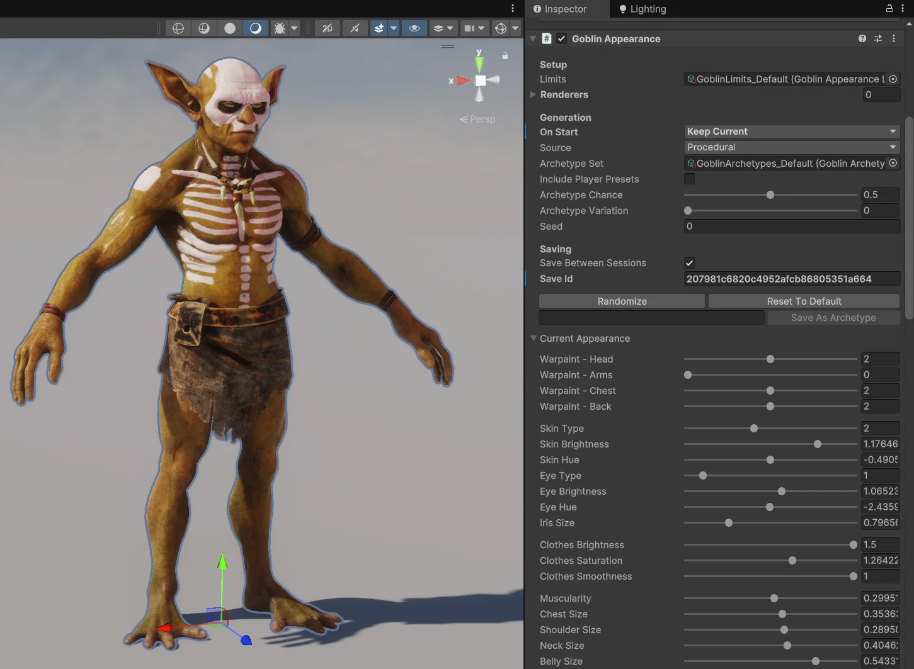
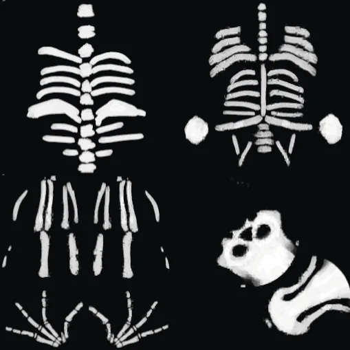
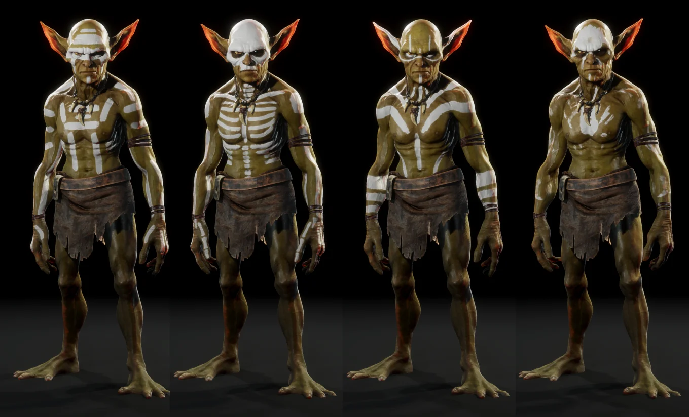
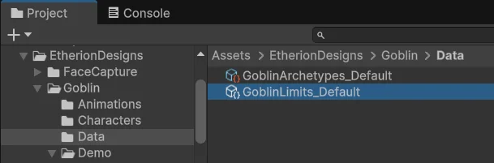
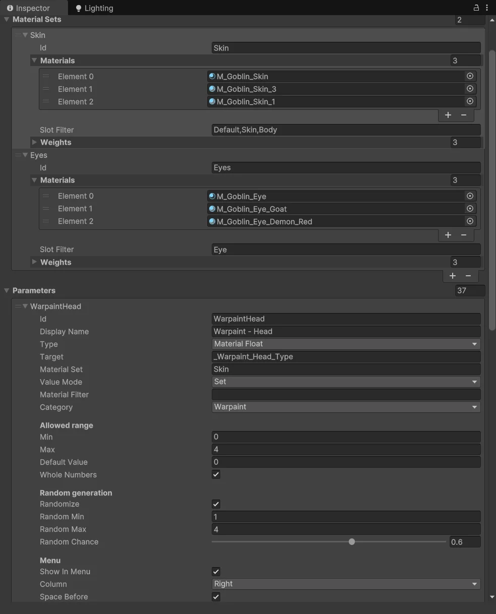
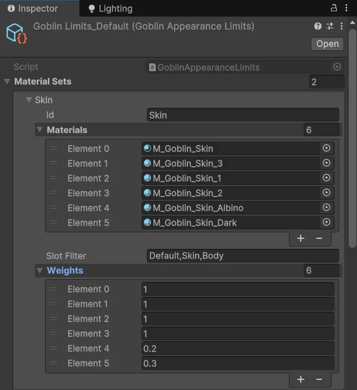
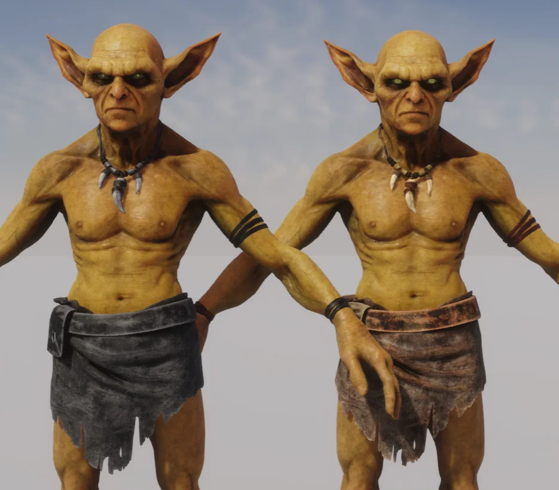

# Appearance and Variation

Every goblin prefab has a **Goblin Appearance** component. It holds that goblin's look: body and face shape, skin, eyes, warpaint and clothes tint. You can design a look by hand, let the pack generate looks at random, or mix the two.

## Design a goblin in the Inspector

You don't need to press Play. Select a goblin in your scene or prefab, and the Goblin Appearance component shows a slider for every parameter, plus **Randomize**, **Reset** and **Save As Archetype** buttons. Changes show in the Scene view right away.

The prefabs are set to **Keep Current**, so a goblin looks in the game exactly as you set it up here.

### Warpaint

The **Warpaint** sliders paint four body regions: **Head**, **Arms**, **Chest** and **Back**. Each goes from 0 (no paint) to 1–4 (four different designs). Each goblin has its own warpaint, and the material file is never changed.

### Archetypes

An archetype is a look you've designed and saved, such as "Fat Chief" or "Skinny Scout". Press **Save As Archetype** to add the current goblin to the Archetype Set in `Data/GoblinArchetypes_Default`. Random generation can then pick from your archetypes.

---

## Make every goblin different

Select a goblin, or your goblin Prefab Variant, and open the **Generation** section of its Goblin Appearance component.

| Setting | What it does |
|---|---|
| **On Start** | **Keep Current** (the default) keeps the look you set in the editor. **Generate** makes a new look every time the goblin appears |
| **Source** | **Procedural** rolls every value at random. **Archetype Pool** picks one of your saved archetypes. **Mixed** does both |
| **Archetype Chance** | With Mixed, how often an archetype is picked (0 to 1) |
| **Archetype Variation** | 0 = an exact copy of the archetype. Around 0.2 = each copy comes out a little different |
| **Seed** | 0 = different every run. Any other number always gives the same goblin |

For a camp of enemies, set **On Start** to **Generate** on your enemy prefab. Every goblin you place or spawn then gets its own look.

> [!warning] A saved look wins over a new one
> **Save Between Sessions** is ticked on the prefabs, so a goblin placed in a scene remembers its look the next time you press Play. If your goblins stop changing between runs, use **Tools > Etherion Designs > Goblin > Delete Saved Appearances**, or untick Save Between Sessions. See [Saving and Scripting](<5 Saving and Scripting.md>).

---

## The Limits file

The Limits file is the rulebook for random goblins: everything that can change, how far, and which skin and eye materials to use. Select `Data/GoblinLimits_Default`.

### Example: random goblins are too fat

Find **Belly Size** and lower its **Random Max** from 1 to 0.5. You can still drag the slider all the way up by hand, but random goblins stay slimmer.

### Different goblin types

Duplicate the Limits file, change the ranges, and assign the copy to the goblins that should use it. A "Brute" file could push Muscularity and Shoulder Size toward the top of their ranges.

### Parameters

**Parameters** are everything that can change. The fields you'll use most:

| Field | Meaning |
|---|---|
| **Id** | The name used from code, for example `Belly` |
| **Min / Max** | How far the slider goes |
| **Random Min / Random Max** | How far random generation goes. This is the one you'll change most |
| **Random Chance** | The odds the parameter gets a random value at all. Warpaint uses 0.6 |

**Center Bias**, at the bottom, controls how extreme random goblins are. At 0, every value in the range is equally likely. Raise it and most goblins land near the middle.

### Skins and eyes

**Material Sets** are the skin and eye materials goblins can pick from. The pack includes 6 skins and 12 eyes, in `Goblin/Materials/`. Drag your own materials into a list to add more.

> [!warning]
> Always add new materials to the **end** of a list. Goblins remember their skin by its position in the list.

Each material set has a **Weights** list, one number per material in the same order as **Materials**. It sets how often random generation picks each material.

| Weight | Meaning |
|---|---|
| 1 | Normal |
| 0.5 | Half as likely |
| 3 | Three times as likely |
| 0 | Never picked at random, but you can still choose it by hand |

For example, skin weights of `1, 1, 1, 0.2` make the last skin turn up on about 1 goblin in 16. New materials start at 1. If you reorder **Materials**, reorder **Weights** to match. Weights only affect new random goblins, never saved ones.

### Colour ranges

Your material files are never changed. Each goblin picks a material, then applies its own changes on top. Hue is added to the material's hue. Brightness, saturation and smoothness multiply the material's own values, so each skin keeps its own character.

| Parameter | What it changes | Default random range |
|---|---|---|
| Skin Hue | Skin hue | ±10° |
| Skin Brightness | Skin brightness | 0.2 to 1.8 × the material |
| Eye Hue | Eye hue | ±40° |
| Eye Brightness | Eye brightness | 0.9 to 1.1 × the material |
| Iris Size | Iris and pupil size. 1 = original | 0.3 to 1.5 |
| Clothes Brightness | Clothes brightness | 0.3 to 2 × the material |
| Clothes Saturation | Clothes colour strength | 0.5 to 1.4 × the material |
| Clothes Smoothness | Clothes shine | 0 to 1.5 × the material |

### Adding your own parameters

- **New morph targets:** select the Limits file, drag your mesh into the **Mesh** field at the bottom, and press **Add Missing Morph Targets**. Every blend shape starting with `Character_` that isn't listed yet is added.
- **New material properties:** add a parameter, set **Type** to **Material Float**, put the shader property's **Reference** name in **Target** (for example `_Roughness_Min`), and set **Material Set** to Skin. To target materials by name instead, leave Material Set empty and type part of the name in **Material Filter**, as the clothes parameters do with `Clothes`. **Value Mode** decides whether the value replaces, adds to or multiplies the material's own value.

> [!note] Facial animation
> The character creator never touches the ARKit face blend shapes, so face capture and facial animation work on any goblin look.
