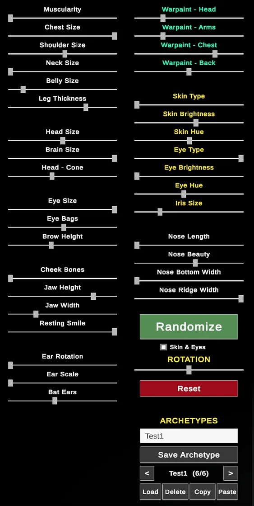

# Customization Menu

The customization menu is an in-game panel of sliders for changing a goblin while the game runs. It is optional. Use it if you want to:

- Give your players a goblin creator.
- Design goblins in Play mode, with your game's lighting, instead of in the Inspector.

If your goblins are enemies with designed or random looks, you don't need the menu. See [Appearance and Variation](<3 Appearance and Variation.md>).

## Adding the menu to a scene

**One click:** open your scene and choose **Tools > Etherion Designs > Goblin > Set Up Customization In Open Scene**. This places the menu prefab and makes sure every goblin in the scene has a Goblin Appearance component with the Limits file and Archetype Set assigned.

**By hand:**

1. Drag `Goblin/UI/PF_GoblinCustomizationMenu` into the scene.
2. Select the menu object and drag your goblin into its **Target** field. If Target is empty, the menu takes the first goblin it finds.
3. Press **Play**, then **M** to open or close the menu.

The menu uses TextMeshPro. If the text is missing or pink, choose **Window > TextMeshPro > Import TMP Essential Resources**.

## Using the menu

| Control | What it does |
|---|---|
| **White sliders** | Body and face shape |
| **Yellow sliders** | Skin and eyes (type, hue, brightness, iris size) |
| **Green sliders** | Warpaint per region (0 = none) |
| **Randomize** | Rolls a new goblin. Untick **Skin & Eyes** first to keep the current skin and eyes |
| **Rotation** | Turns the goblin to see it from all sides |
| **Reset** | Puts every value back to default |
| **Name + Save Archetype** | Saves the current goblin as a preset |
| **< Archetype >** | Flips through saved presets |
| **Load / Delete** | Applies or removes the selected preset |
| **Copy / Paste** | Copies the look to the clipboard as text, or pastes one in |

> [!warning] Save Archetype in the editor vs. in a build
> In the Unity editor, Save Archetype adds the goblin to your Archetype Set, so it becomes part of your game. In a finished build, it saves a personal preset on the player's computer instead, and players can't delete the archetypes you shipped.

## Changing the menu

The menu is a normal Unity UI prefab. Double-click `Goblin/UI/PF_GoblinCustomizationMenu` to open it, and edit it like any other UI.

| To change | Do this |
|---|---|
| Layout, colours, fonts | Edit anything under **Panel** |
| What a button does | Edit its **On Click** list. Each button calls a function on the root object, such as `Randomize` |
| How the sliders look | Edit `UI/PF_GoblinMenuSliderRow`. Every slider is a copy of it |
| Which sliders appear, and where | In the Limits file, each parameter has **Show In Menu**, **Display Name**, **Column** and **Space Before**. The clothes sliders are hidden by default |
| The key that opens the menu | **Toggle Key** on the root object (default M) |
| The camera | **Orbit Speed**, **Pan Speed** and **Zoom Speed** on the root object, under **Camera**. Untick **Enable Camera Orbit** if your own script moves the camera. Tick **Orbit When Closed** to keep the camera working after the menu closes |
| Which goblin it edits, from code | `menu.SetTarget(goblin);`, for example when the player clicks a goblin |

Buttons can call these functions: `Randomize`, `ResetLook`, `SetRotation`, `PreviousGoblin`, `NextGoblin`, `SaveArchetype`, `LoadArchetype`, `DeleteArchetype`, `PreviousArchetype`, `NextArchetype`, `CopyLook`, `PasteLook`, `Open`, `Close`.

While a player types in the menu's name box, the menu's own key is ignored, so a name with an M in it doesn't close the menu. To make your own shortcut keys do the same, check `GoblinCustomizationMenu.IsTyping()` first.
