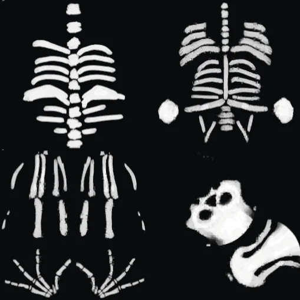
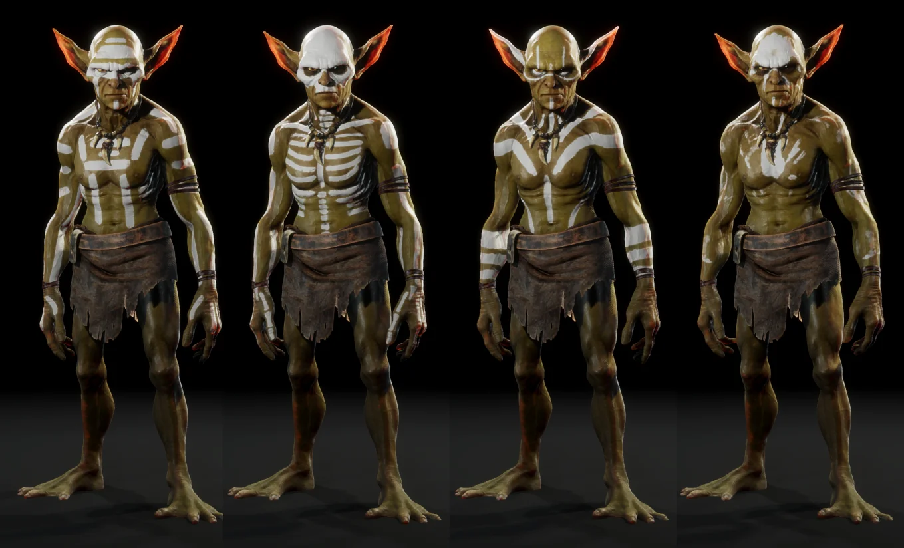
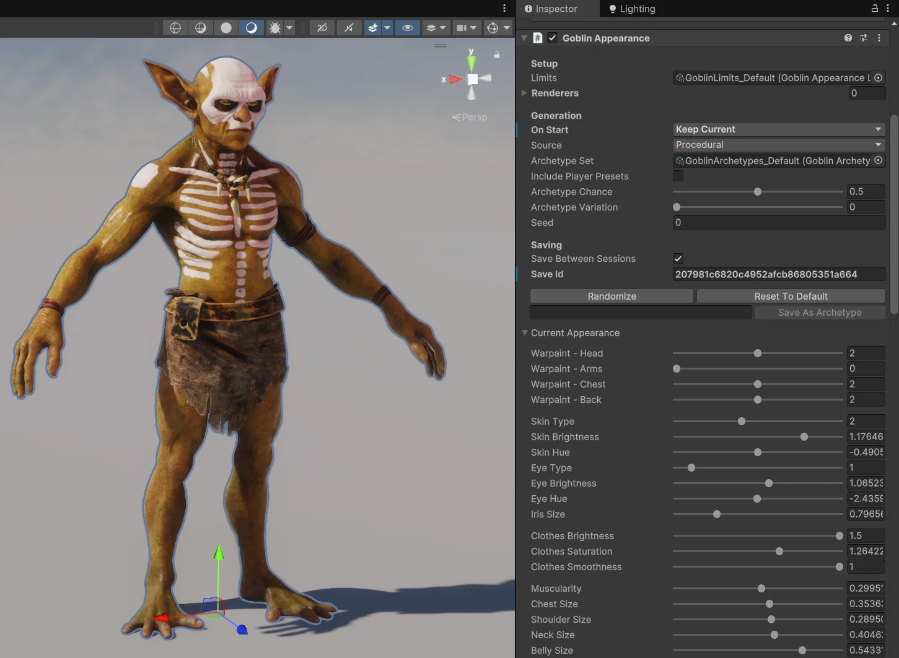
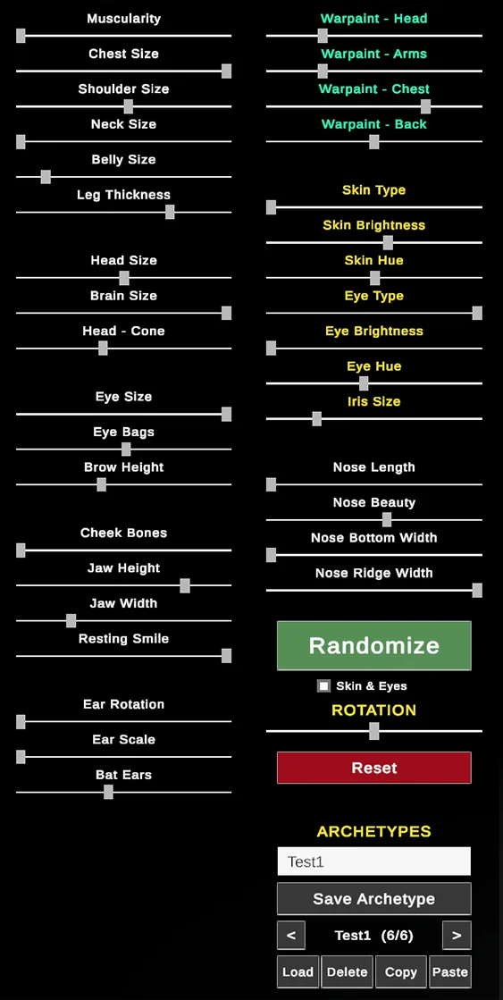

# Customizing Appearance

## Materials and warpaint

| Material | Shader | Used for |
|---|---|---|
| `M_Goblin_Skin` | `Shader_Goblin_Skin` | Skin and body |
| `M_Goblin_Clothes` | `Shader_Goblin_Skin` | Clothing |
| `M_Goblin_Teeth` | `Shader_Goblin_Skin` | Teeth |
| `M_Goblin_Eye` | `Shader_Goblin_Eye` | Eyes |

All materials are in `Goblin/Materials/`, with extra skins in `Skin Variations/` and extra eyes in `Eye Variations/`. The shaders are Shader Graphs in `Goblin/Shaders/` and can be opened and edited.

### Warpaint

The body shader can paint warpaint on four body regions: **Head**, **Arms**, **Chest** and **Back**. Each region has 5 options, from 0 (no paint) to 1–4 (four different designs).

To set it on the material, select `M_Goblin_Skin` and change:

| Property | Region |
|---|---|
| `_Warpaint_Head_Type` | Head |
| `_Warpaint_Arms_Type` | Arms |
| `_Warpaint_Chest_Type` | Chest |
| `_Warpaint_Back_Type` | Back |

> [!tip]
> You usually don't need to touch these on the material. The character creator sets warpaint per goblin without changing the material file, so each goblin can have different paint.


> 📷 **Image:** A 2×2 grid of the goblin with warpaint on one region each (head, arms, chest, back), labelled.


> 📷 **Image:** The same goblin four times in a row, showing warpaint designs 1 to 4 on all regions.

---

## The character creator

The character creator gives every goblin its own look. It can generate goblins at random, pick from looks you've designed, and remember each goblin between play sessions.

### The three pieces

| Piece | Where | What it does |
|---|---|---|
| **Goblin Appearance** component | On each goblin | Holds that goblin's look and decides how a new look is made |
| **Limits file** | `Data/GoblinLimits_Default` | The rulebook: everything that can change, how far, and which skin and eye materials to use |
| **Archetype Set** | `Data/GoblinArchetypes_Default` | Goblins you've designed and saved, such as "Fat Chief" or "Skinny Scout" |

### Setting it up: one click

1. Open your scene with goblins in it.
2. Choose **Tools > Etherion Designs > Goblin > Set Up Customization In Open Scene**.
3. Press **Play**.

This places the customization menu prefab and makes sure every goblin in the scene has a Goblin Appearance component with the Limits file and Archetype Set assigned. The `PF_Goblin` prefabs already have the component.


> 📷 **Image:** The Tools menu open at Etherion Designs > Goblin > Set Up Customization In Open Scene.

### Setting it up: by hand, or for one specific goblin

1. Select the goblin in the **Hierarchy**.
2. If it's not one of the `PF_Goblin` prefabs, **Add Component > Etherion Designs > Goblin Appearance.**
3. Set **Limits** to `Data/GoblinLimits_Default`.
4. Set **Archetype Set** to `Data/GoblinArchetypes_Default`.
5. Drag `UI/PF_GoblinCustomizationMenu` into the scene.
6. Select the menu object and drag your goblin into its **Target** field.
7. Press **Play**.


> 📷 **Image:** The Goblin Appearance component in the Inspector with Limits and Archetype Set assigned, and the slider section visible.

### Editing a goblin in the editor

You don't need to press Play to design a goblin. Select it, and the Goblin Appearance component shows a slider for every parameter, plus **Randomize**, **Reset** and **Save As Archetype** buttons. Changes show in the Scene view right away.

---

## The customization menu

### Using the menu


> 📷 **Image:** The menu in Play mode with numbered callouts on each area: 1 body sliders, 2 skin and eye sliders, 3 warpaint and clothes sliders, 4 Randomize and Skin & Eyes toggle, 5 Rotation, 6 Reset, 7 archetype controls.

| Control | What it does |
|---|---|
| **White sliders** | Body and face shape |
| **Yellow sliders** | Skin and eyes (type, hue, brightness, iris size) |
| **Green sliders** | Warpaint per region (0 = none) and clothes brightness, saturation and smoothness |
| **Randomize** | Rolls a new goblin. Untick **Skin & Eyes** first to keep the current skin and eyes |
| **Rotation** | Turns the goblin to see it from all sides |
| **Reset** | Puts every value back to default |
| **Name + Save Archetype** | Saves the current goblin as a preset |
| **< Archetype >** | Flips through saved presets |
| **Load / Delete** | Applies or removes the selected preset |
| **Copy / Paste** | Copies the look to the clipboard as text, or pastes one in |

> [!warning] Save Archetype in the editor vs. in a build
> In the Unity editor, Save Archetype adds the goblin to your Archetype Set, so it becomes part of your game. In a finished build, it saves a personal preset on the player's computer instead, and players can't delete the archetypes you shipped.

### Which goblin the menu edits

- **Target field:** select the menu object and drag a goblin into **Target**. The menu edits that goblin.
- **Target left empty:** the menu takes the first goblin it finds. Set Target if it matters which one.
- **From code:** `menu.SetTarget(goblin);`, for example when the player clicks a goblin.


> 📷 **Image:** The menu object selected in the Hierarchy, with the Inspector showing the Target field filled with a goblin.

### Changing how the menu looks

The menu is a normal Unity UI prefab. Double-click `Goblin/UI/PF_GoblinCustomizationMenu` to open it in Prefab Mode.

```
PF_GoblinCustomizationMenu      Goblin Customization Menu component
└─ Canvas
   ├─ Hint / Camera Hint        "M = Close Menu" and "Left Drag = Orbit   Middle Drag = Pan"
   └─ Panel                     Background panel
      ├─ Left Column
      │  └─ Sliders             Filled with parameter sliders at Play
      └─ Right Column
         ├─ Sliders             Filled with parameter sliders at Play
         └─ Footer              Randomize, Skin & Eyes, Rotation, Reset
                                and archetype controls
```


> 📷 **Image:** The menu prefab open in Prefab Mode, with the Hierarchy expanded to show Canvas, Panel, both columns and the Footer.

| To change | Do this |
|---|---|
| Layout, colours, fonts | Edit anything under **Panel** like normal UI |
| What a button does | Edit its **On Click** list. Each button calls a function on the root object, such as `GoblinCustomizationMenu.Randomize` |
| Add a button | Add a Button, press **+** on On Click, drag the root object in, and pick a function |
| Remove a button | Delete it |
| How parameter sliders look | Edit `UI/PF_GoblinMenuSliderRow`. Every parameter slider is a copy of it |
| Slider label colours | On the root object, under **Parameter Sliders** |
| Which sliders appear, and where | In the Limits file (see [Random Goblins](<5 Random Goblins.md#the-limits-file>)) |
| Toggle key | **Toggle Key** on the root object (default M) |
| Camera speed | **Orbit Speed**, **Pan Speed** and **Zoom Speed** on the root object, under **Camera**. Untick **Enable Camera Orbit** to control the camera yourself |
| Camera with the menu closed | Tick **Orbit When Closed** (under **Camera**) to keep orbit, pan and zoom working after the menu closes. It's on in the Demo scene. Leave it off in scenes where another script moves the camera, such as your own player camera |

Functions you can call from On Click: `Randomize`, `ResetLook`, `SetRotation`, `PreviousGoblin`, `NextGoblin`, `SaveArchetype`, `LoadArchetype`, `DeleteArchetype`, `PreviousArchetype`, `NextArchetype`, `CopyLook`, `PasteLook`, `Open`, `Close`.


> 📷 **Image:** The Randomize button selected, with its On Click list showing the menu object and `GoblinCustomizationMenu.Randomize`.

> [!tip]
> You don't have to ship the menu. It's one prefab in the scene, so delete it if you only want it as a design tool.
