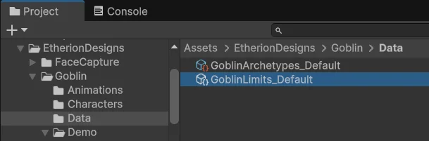
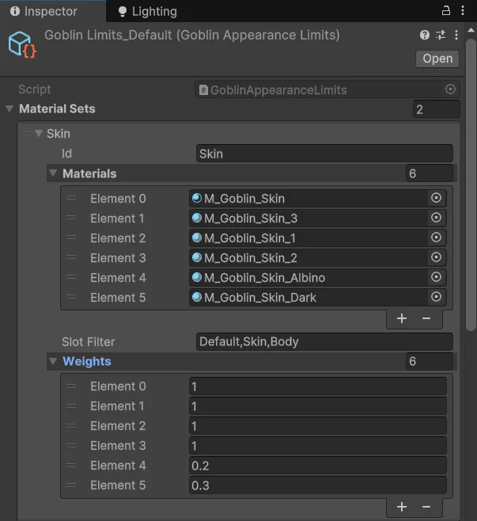
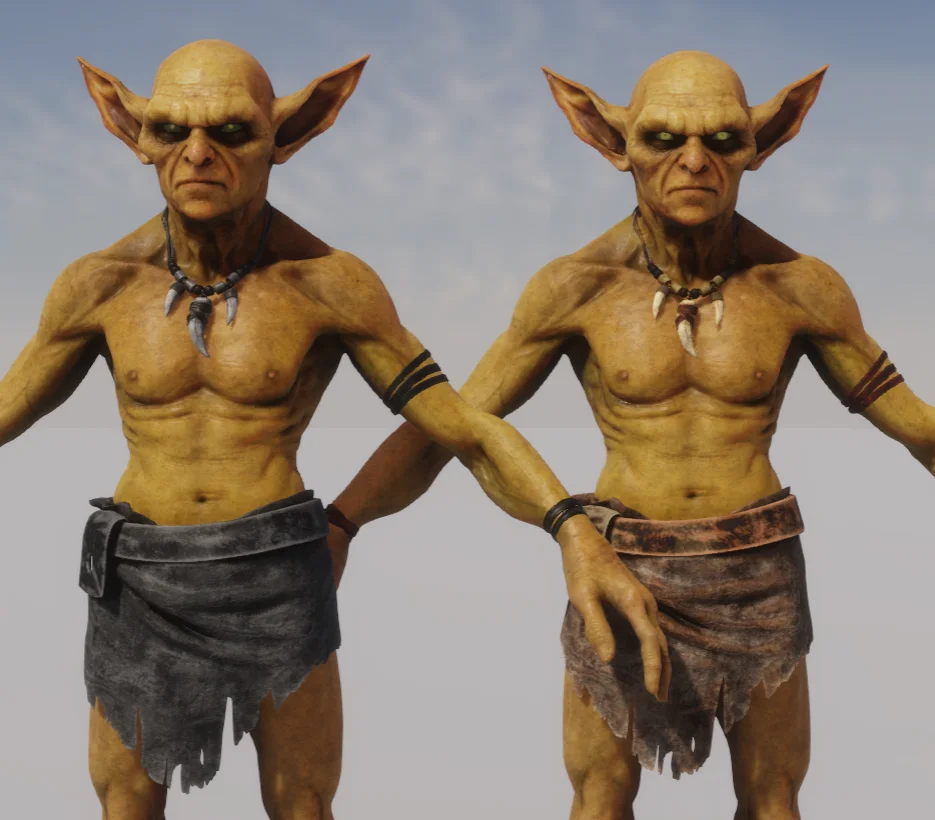

# Random Goblins

## Generation settings

Select a goblin and open the **Generation** section of its Goblin Appearance component.

| Setting | What it does |
|---|---|
| **On Start** | **Keep Current** (the default on the prefabs) keeps the look you set in the editor. **Generate** makes a new look every time the game starts |
| **Source** | **Procedural** rolls every value at random. **Archetype Pool** picks one of your saved archetypes. **Mixed** does both |
| **Archetype Chance** | With Mixed, how often an archetype is picked (0 to 1) |
| **Archetype Variation** | 0 = an exact copy of the archetype. Around 0.2 = each copy comes out a little different |
| **Seed** | 0 = different every run. Any other number always gives the same goblin |

## The Limits file

Select `Data/GoblinLimits_Default`.

> 📷 **Image:** The Limits file in the Inspector, with the Material Sets list and one parameter (such as Belly Size) expanded to show its fields.

**Material Sets** are the skin and eye materials goblins can pick from. Drag your own materials into a list. Once a list has two or more materials, a **Skin Type** or **Eye Type** slider appears in the menu.

> [!warning]
> Always add new materials to the **end** of a list. Goblins remember their skin by its position in the list.

### Rare materials: Weights

Each material set has a **Weights** list, one number per material in the same order as **Materials**. It sets how often random generation picks each material.

| Weight | Meaning |
|---|---|
| 1 | Normal |
| 0.5 | Half as likely |
| 3 | Three times as likely |
| 0 | Never picked at random, but still selectable in the menu |

For example, skin weights of `1, 1, 1, 0.2` make the last skin turn up on about 1 goblin in 16. New materials start at 1. If you reorder **Materials**, reorder **Weights** to match. Weights only affect new random goblins, never saved ones.

> 📷 **Image:** The Skin material set in the Limits file, with Materials and Weights lists expanded side by side.

**Parameters** are everything that can change. Each one has:

| Field | Meaning |
|---|---|
| **Id** | The name used from code, for example `Belly` |
| **Display Name** | The label in the menu |
| **Target** | The blend shape, bone, or shader property **Reference** name, for example `_Hue` |
| **Material Set / Material Filter** | Material Float only. Which materials get the value: a material set such as `Eyes`, or part of a material name such as `Clothes` |
| **Value Mode** | Material Float only. **Set** replaces the material's value, **Add** adds to it, **Multiply** multiplies it |
| **Min / Max** | How far the menu slider goes |
| **Random Min / Random Max** | How far random generation goes. This is the one you'll change most |
| **Random Chance** | The odds the parameter gets a random value at all. Warpaint uses 0.6 |
| **Show In Menu** | Whether it appears in the customization menu |
| **Column** | Left or right column in the menu |
| **Space Before** | Adds a gap above it in the menu |

**Center Bias**, at the bottom, controls how extreme random goblins are. At 0, every value in the range is equally likely. Raise it and most goblins land near the middle.

### Example: random goblins are too fat

Find **Belly Size** and lower its **Random Max** from 1 to 0.5. Players can still drag the slider all the way up, but random goblins stay slimmer.

### Different goblin types

Duplicate the Limits file, change the ranges, and assign the copy to the goblins that should use it. A "Brute" file could push Muscularity and Shoulder Size toward the top of their ranges.

## Skin, eyes and clothes

Your material files are never changed. Each goblin picks a material, then applies its own changes on top. Hue is added to the material's hue. Brightness, saturation and smoothness multiply the material's own values, so each skin keeps its own character.

| Parameter | What it changes | Default random range |
|---|---|---|
| Skin Hue | Skin hue | ±10° |
| Skin Brightness | Skin brightness | 0.2 to 1.8 × the material |
| Eye Hue | Eye hue | ±40° |
| Eye Brightness | Eye brightness | 0.9 to 1.1 × the material |
| Iris Size | Iris and pupil size, the rest of the eye stays put. 1 = original | 0.3 to 1.5 |
| Clothes Brightness | Clothes brightness | 0.3 to 2 × the material |
| Clothes Saturation | Clothes colour strength | 0.5 to 1.4 × the material |
| Clothes Smoothness | Clothes shine | 0 to 1.5 × the material |

The clothes parameters only affect `M_Goblin_Clothes`, because their **Material Filter** is `Clothes`.

> 📷 **Image:** Three goblins side by side with different clothes brightness, saturation and iris size.

## Adding your own

- **New morph targets:** select the Limits file, drag your mesh into the **Mesh** field at the bottom, and press **Add Missing Morph Targets**. Every blend shape starting with `Character_` that isn't listed yet is added.
- **New material properties:** add a parameter, set **Type** to **Material Float**, put the shader property's **Reference** name in **Target** (for example `_Roughness_Min`), and set **Material Set** to Skin. To target materials by name instead, leave Material Set empty and type part of the name in **Material Filter**, as the clothes parameters do with `Clothes`.

> [!note] Facial animation
> The ARKit facial blend shapes are never touched by the character creator, so face capture and customization work together.
